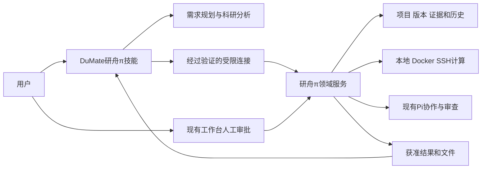

# 研舟π迁移到 DuMate 的实施计划

日期：2026年10月14日。代码基线：`15d0a6465527d53083a5d4a69edbe7b666d2c490`。

迁移采用增量接入：DuMate负责用户需求理解、科研步骤规划、技能调用、分析与成果说明；研舟π继续保存研究项目、固定来源、实验、证据、审批和计算任务。现有Pi执行内核保留，承担已实现的内部协作与审查。用户可以逐步从DuMate发起科研工作，但第一阶段需要在现有研舟工作台完成必要审批。

实施顺序是公开材料演示、受限后端读取、文献研究、分析绘图、论文交付、正式实验、内部协作、发布分享。每批只完成一条用户能走通的流程，达到验收条件后才进入下一批。制定本计划不等于已经实施，也不自动授权数据外发、安装软件、启停服务、运行实验或公开分享。

## 目标和迁移完成标准

迁移的用户目标是：在DuMate中提出研究问题，获得有实际来源的分析、图表、报告或论文，并能回查任务、文件和研究依据。实验运行和审查继续通过研舟π的真实服务执行，DuMate不能用生成文字代替实际运行结果。

迁移按三个交付级别验收：

| 级别 | 用户可以完成的流程 | 完成标准 |
|---|---|---|
| 参赛演示版 | 上传公开论文与示例数据，得到证据整理、科研图表和研究报告 | DuMate实际完成流程，结果文件可打开，执行记录和分享页可访问；材料清楚说明实际能力范围 |
| 科研接入版 | 从DuMate读取获准的研舟项目资料，完成文献、分析和论文交付 | 使用受限身份与具体来源授权，保留审批和历史，断线后能找回原任务；所选真实用户流程全部通过 |
| 实验协作版 | 从DuMate准备正式实验，衔接内部Pi协作、审查、运行和成果交付 | 对源码、授权、重复提交、失败和恢复逐项验收，后端账本保持一致；明确DuMate与Pi的各自职责 |

“完整能力接入”以本计划中各条科研流程的验收结果为准，不以导入全部技能、生成分享链接或接通一个API为准。停止使用Pi、以DuMate替换其执行内核是单独的架构项目，不纳入本计划的默认实施范围。

## 已有基础和平台限制

研舟π已有受管科研技能、版本化资产、统一操作契约以及本地、Docker和SSH计算服务。现有科研方法与模板可以复用，但技能中的工具名称、角色身份和批准步骤需要适配。[当前能力与技能说明](openresearch/CURRENT-SKILLS.zh-CN.md)

DuMate官方支持Skill中的执行指令、脚本、参考资料和资产，也支持用入口智能体、技能和连接应用组成专家套件。套件文档目前明确限制子智能体及随套件提供的本地连接服务。先以当前账号可以实际安装和执行的Skill交付；专家套件和连接应用上架在账号及平台条件具备后再安排。[技能开发指南](https://cloud.baidu.com/doc/Dumate/s/Umrn6n4qe)、[套件开发指南](https://cloud.baidu.com/doc/Dumate/s/Mmszjeygh)

现有CLI与HTTP操作入口使用`USER`身份；真实Agent身份另由宿主校验会话、项目、角色、任务尝试和generation。DuMate不能通过提供sessionId获得Pi身份，也不能将本机owner接口当作自己的工具权限。[CLI入口](../apps/cli/index.ts#L88)、[HTTP入口](../apps/server/operation-routes.ts#L16)、[Agent身份校验](../packages/contracts/operations/registry.ts#L414)

### 进入实施前要确认的条件

| 条件 | 核验方法 | 不满足时的处理 |
|---|---|---|
| 自定义Skill可安装、可触发 | 在实际参赛账号安装一个最小Skill并真实调用 | 记录客户端版本和平台提示，先解决账号或版本问题 |
| 脚本运行位置和可用环境明确 | 用无敏感内容的回显探针确认系统、运行位置、Node或Python、工作区写入 | 使用已验证的运行方式；不假设Windows宿主、沙箱和云端是同一环境 |
| 后端可达方式明确 | 只在隔离演示环境测试回环或平台认可的连接方式 | 不把研舟服务改成公网监听，不以关闭原有访问保护解决连通问题 |
| 原始owner接口和私有文件不能被绕过访问 | 在隔离副本中尝试绕过接入层访问owner路由和未授权目录 | 无法证明隔离时只接公开或合成材料，或使用用户手工导出的固定材料 |
| 来源的接收平台和处理边界可以批准 | 核验实际账号、处理平台、模型标识或可明确批准的处理边界 | 不继承原Pi授权；不把未知目的模型伪写成原Pi模型，私有资料暂缓 |
| 分享形态适合评审 | 用另一个账号或无痕浏览器打开实际分享链接，检查过程与附件 | 修复访问问题；分享页只证明它实际展示的内容，不声称可以重新运行 |
| 比赛接受作品的组成方式 | 阅读报名系统最新要求，核实自定义Skill、外部科研后端与作品链接规则 | 对无法确认的参赛资格保留条件，不通过改写作品说明掩盖实现方式 |

现有研舟服务以本机所有者为信任边界，Host和Origin检查不能阻止所有本机脚本直接调用。给桥接接口增加令牌，只能识别接入实例，不能自动解决绕过桥接的问题。实际工具、网络和文件隔离必须先验证。[本机访问边界](../apps/server/http.ts#L36)

## 系统职责和接口边界

图中的受限连接是待实现并验收的组件，不代表目前已经具备权限隔离。公开材料演示版只交换经过选择的材料和结果文件，可以先不接真实研究数据库。

### 三种身份各自负责什么

| 身份 | 允许的职责 | 授权依据 |
|---|---|---|
| 人类用户 | 选择资料、批准外发和任务、决定正式运行与整合、选择分享内容 | 当前用户操作及对应准确批准 |
| DuMate外部接入实例 | 读取获准材料、提交分析草稿、准备指定请求、回查任务 | 新增外部委托记录，不能等同`USER`或借用Pi会话 |
| 现有Pi Agent | 执行既有内部科研、协作和审查任务 | 原宿主身份、角色、租约与固定来源授权 |

接入采用独立外部主体的领域授权路径，默认不创建伪Pi会话。配对凭证和外部委托分别管理：配对证明接入实例，委托规定该实例能对哪些对象做什么。后端生成主体与授权，不接受请求体自报用户身份、角色、generation或他人的会话身份。具体存储结构在D2设计门禁中固定，不预先增加通用第三方Agent框架。

每份外部委托至少绑定：接入实例、项目、外部任务、允许操作、固定来源及摘要、允许返回的字段或页段、目的接收方及处理边界、用途、期限和撤回版本。实际运行的控制实例另有租约或等价机制，重开时旧实例不能继续写入。

只读也可能向外部平台发送科研资料。输出原文、源码、日志、页图或派生摘要前必须检查来源与接收授权；读操作不因为“不修改数据库”就免于出站检查。原有Pi模型绑定的授权不自动覆盖DuMate。[会话来源与模型授权](../packages/policy/session-permissions.ts)

### 接口允许范围

| 接入操作类别 | 开放条件 | 必须保留的检查 |
|---|---|---|
| 查询状态和固定资料 | D2通过后逐项开放 | 项目归属、对象版本、来源效力、出站许可、分页与大小限制 |
| 提交外部分析草稿和成果文件 | 对应批次通过后开放 | 文件摘要、实际输入、内容类型、授权路径、外部任务身份与来源声明 |
| 准备解析、构建、实验或协作请求 | 精确请求可由用户回查并决定 | 固定参数与来源，批准版本，资源范围，幂等键 |
| 消费已经批准的请求 | 对应执行主体及任务链已适配 | 批准与当前请求一致，不扩权，真实执行回执 |
| 决定审批、开启完全访问、扩大Grant、修改全局设置、删除历史或任意owner调用 | 不交给DuMate | 人类用户仍使用现有明确入口 |

复用领域服务必须进入正确的授权路径；不能在接入层检查一个token或操作名后统一以`USER`执行。若某服务目前只有user或Pi授权路径，需要补充外部主体的明确约束并通过独立复核，或暂不开放该操作。

## 各项能力如何迁移

| 当前技能或能力 | DuMate端的工作 | 保留或复用的研舟能力 | 首次交付批次 |
|---|---|---|---|
| overview科研入口 | 确认目标和资料，选择最少必要步骤，统一说明结果 | 实体发现、固定来源规则、真实状态查询 | D1，D2补后端读取 |
| create研究启动 | 整理研究问题、对照、指标和停止条件，准备研究方案 | 项目、源码导入、基线和不可变方案 | D6先接已有项目；新建及导入按实际任务另批 |
| lit-review文献研究 | 制订检索策略，筛选资料，整理有来源的证据 | 已启用连接器、固定文档、PDF解析和页段定位 | D3 |
| evidence证据回查 | 区分原文、摘要、视觉观察和分析，引用准确来源 | Artifact、Evidence、固定版本、撤回与失效规则 | D2，D3 |
| figures科研绘图 | 选择方法，执行已验证脚本，核对数据和图形 | 现有样式、方法资源、代码及数据来源归档 | D1演示，D4正式归档 |
| reports报告 | 综合真实输入，生成完整分析正文和局限说明 | 固定报告、引用回查和本地成果包 | D1草稿，D5正式成果 |
| paper论文 | 使用指定模板起草、修订并核对引用 | 模板库、TeX资产、隔离编译、诊断、固定稿件和审查 | D5 |
| compute计算 | 准备具体运行要求，解释状态、日志与结果 | 本地、Docker、SSH运行合同、队列、取消和恢复 | D6；其他目标按需独立验收 |
| experiment-tree实验 | 基于准确父修订准备一个候选，比较实测结果 | 不可变实验树、冻结运行、Campaign与历史 | D6；后续循环按需另批 |
| git代码与版本 | 说明准确来源、差异和所需变更 | 私有工作区、开发测试、正式整合、Git同步回执 | D6先接固定来源；源码修改闭环另批 |
| agent-delegation协作 | 提交有界目标，综合已经验收的助手成果 | 现有Pi Team、Task、Attempt、Reviewer与独立工作区 | D7 |
| customize技能与模板 | 安装经过适配的技能，选择真实模板 | 原Pi技能发行、固定版本、模板库与回滚 | D1基础包，D5模板，D8发布包 |
| feedback反馈 | 保存实际问题、复现步骤和脱敏反馈草稿 | 既有本地反馈流程 | D8；不自动发送维护者 |

技能方法、示例、资产和模板按原来源保留版权与许可。DuMate版本另建适配目录，不修改Pi当前发行和旧会话绑定。整个包不能一键照搬：每个工具示例都要改成该批实际可用的调用方式，未接入的能力保留明确限制，不伪装成执行成功。

能力表覆盖长期接入方向，不把“完整新建项目”“任意代码改进”“自动多轮Campaign”塞入某一批。只有用户任务需要时，按同样的单流程、3至5条验收条件拆成后续批次。

## 分批实施和验收

所有批次先固定验收条件，再安排实施。出现平台、账号、授权或隔离阻断时保留已有成果，补齐前置条件后续接，不重复启动模型、服务或同一计算任务。

### D0 验证实际账号的最小科研任务

**用户流程：** 安装最小技能，处理一份公开或合成资料，生成可打开文件和实际分享页。

工作包括记录客户端与账号功能、真实执行位置、必要运行环境、工作区访问、分享页面展示范围，以及D2连接需要的网络和隔离能力。测试使用独立空目录和无科研秘密的服务副本，不针对生产库进行绕过探测。

验收条件：

1. Skill可真实安装、触发，并交付一个可打开文件；记录实际平台版本和执行位置。
2. 文件写入和运行环境在指定演示范围内可用，缺依赖时给出准确阻断，不临时扩大权限或自动安装。
3. 在隔离环境核实回环可达性、未授权文件访问以及绕过owner入口的结果；不能证明隔离时，真实项目接入标为阻断。
4. 完成分享后另用无痕窗口或其他账号检查对话及文件，记录是否需要登录、附件是否可读、是否只有查看功能。
5. 技能禁用或卸载后原研舟项目、服务和历史仍可使用；正式科研数据未参与探针。

交付：探针Skill、公开或合成输入、客户端能力记录、实际运行与分享证据。预计0.5至1个工作日，不含账号和平台支持等待。

### D1 完成公开材料的科研报告

**用户流程：** 用户上传少量公开论文和一份示例CSV，DuMate完成证据整理、数据分析、绘图和研究报告。

先交付一个组合Skill，按需复用文献阅读规范、绘图样式及报告结构。脚本只承担确定性计算与文件生成；DuMate负责计划、阅读、判断与综合。输入和输出均在演示工作区，不访问真实研舟数据库。PDF如果没有可靠文字层，应说明实际视觉阅读范围，不制造字符定位；解析环境不足时保留原件和缺口。

验收条件：

1. 从明确输入生成证据表、图形、完整报告和来源清单；文件名称、内容及实际打开效果可核对。
2. 引用对应真实材料、页或可核对段落；缺失全文、无文字层、坏CSV或缺列均明确处理，不编造引用和数值。
3. 确定性计算以小型已知数据独立核验，图形与实际输出一致；示例数据明确标注，不冒充正式Run。
4. 重开任务后能回查原输入、输出和清单摘要，既有结果保持；未经用户要求不覆盖原件或重复开展研究。
5. 演示只使用已允许外发和分享的材料，现有Pi技能、工作台与科研数据不受影响。

交付：可安装Skill、最小脚本和资源、触发与边界用例、真实成果、完整执行录屏或关键截图。预计1至2个工作日。

此批可以形成参赛演示版，但作品说明必须限定为已走通的公开材料流程。后端接入、正式实验和多智能体协作不能提前写成已完成。

### D2 在DuMate回查一个获准项目的固定证据

**用户流程：** 用户选择项目和固定资料，授予外部委托，DuMate取得最小资料并解释已有结果。

先完成外部主体、委托、出站授权和隔离方式的设计门禁，再实施受限读取。固定一类资料作为本批主流程，例如一个成功Run的获准指标与产物说明。不能第一次就开放项目总览、所有日志和所有文件。最初使用隔离数据副本；私有资料必须在隔离和目的接收方条件通过后进入。

验收条件：

1. 配对与具体委托分别生效，DuMate获得获准项目、对象版本和最小字段；无凭证、到期或撤回凭证均拒绝。
2. 跨项目、猜测ID、换版本、扩大页段、任意文件路径及自报user或Pi身份均被拒绝；存在绕过owner或私有目录通道时不接真实项目。
3. 原Pi授权不能作为DuMate外发授权；来源、目的接收方或处理边界变化时停止新的内容交付。
4. 读取失败或超时保留准确状态；重开重新检查委托，撤回后的缓存和历史回执不能继续输出受限内容。
5. 原记录、CAS产物、Pi会话与工作台审批保持，读取不隐含提交实验、改设置或开启完全访问。

交付：一个受限资料读取入口、委托和回执记录、最小DTO、权限与重开测试、隔离环境及实际DuMate证据。预计3至5个工作日；权限与隔离设计未通过时不计为已交付。

### D3 完成有来源的文献研究

**用户流程：** DuMate依据明确研究问题检索已启用来源，取得获准原件或文本，生成带准确引用的证据综述。

复用现有文献服务，按实际来源分别区分元数据、摘要、全文和PDF。解析继续用研舟已有固定解析环境和批准流程；原文页图或全文送到DuMate需要单独符合接收授权。现有未证明的来源、扫描OCR、表格结构恢复不通过迁移措辞变成已实现。

验收条件：

1. 查询、来源和取得版本都有真实记录，证据综述能回查到固定原件或文本；摘要不会标成已读全文。
2. 未启用来源、超出委托的检索、原文或页面请求被拒绝，不通过换URL绕过来源开关。
3. 检索失败、限流、解析失败和原件不可取得时保留已有资料与准确缺口，不虚报完成。
4. 断线或重开继续读取原文献任务，未知状态不自动重复取得或解析；原件和失败历史保留。
5. 资料或委托撤回后停止新的出站与派生使用，已存在的科研历史不删除。

交付：文献Skill适配、受限检索和读取路径、固定证据综述、边界及失败证据。预计2至3个工作日。

### D4 分析固定数据并归档科研图形

**用户流程：** DuMate分析一个获准的数据版本，生成图形和分析草稿，再将用户确认的成果归档到研舟。

复用绘图代码与方法资源，固定输入摘要、参数和脚本。分析结果作为外部分析产物保存，不直接升级为科学Claim或正式Run证据。入库使用本批明确允许的产物动作，内容和来源经用户核对；不开放任意workspace写入。

验收条件：

1. 产物绑定固定输入、实际脚本、参数、外部任务和内容摘要，能由研舟回查并打开。
2. 一组已知数据能独立核验计算结果，缺列、坏数据或脚本失败不产生伪成功产物。
3. 获准范围外的路径、文件覆盖或数据修改被拒绝；杜撰的Run、来源或“已验证”声明不能成为正式证据。
4. 相同请求和内容重复提交只对应一份成果；同一请求键换内容产生冲突，不覆盖旧图与历史。
5. 用户拒绝入库或来源撤回时停止相应新交付，已保存草稿、失败记录和旧产物按原保留规则处理。

交付：绘图及分析Skill、受限产物提交、可复核计算样例、真实归档与重复提交证据。预计2至3个工作日。

### D5 交付可编辑论文和正式成果包

**用户流程：** DuMate用指定模板和已有证据起草论文，用户批准固定稿件的编译及审查，再取得PDF、可编辑源和成果包。

复用当前模板库、文稿修订、编译器、诊断和报告导出。执行编译与审查的主体沿用可验证的后端任务；内部独立审查可以继续由Pi Reviewer执行，并明确在交付记录中标示。若尚未接上对应批准消费路径，则DuMate只准备资料，用户在现有工作台继续执行，不能声称全流程均由DuMate提交。

验收条件：

1. 固定稿件绑定准确模板、TeX或其他已有受支持源、引用、图形及输入，成功构建的PDF与可编辑文件都可回查。
2. 缺图、编译器未配置、引用或编译失败给出真实诊断，不显示不存在的可用PDF。
3. 编译、审查和导出沿准确批准及原来源规则，参数或内容改变必须重新准备；DuMate不能自批。
4. 修订产生新版本，重复提交不重复编译或导出；断线重开能找回原作业和产物，旧稿与失败记录保留。
5. 报告与包内文件、审查意见、来源和清单一致；技术审查、排版检查及科学结论支持分别说明。

交付：论文Skill适配、真实模板到PDF闭环、审查与成果包实物及边界证据。预计2至4个工作日。

### D6 从DuMate衔接一次正式实验

**用户流程：** 在已有项目中，以一个准确父修订准备一个候选，用户批准后运行，DuMate读取真实结果并比较。

本批只接已有项目和固定源码，不包含任意代码修改。复用实验、RunIntent、批准、现有计算队列和日志。先选择已有验证基础且实际可用的一个执行目标，不同时验证本地、Docker、SSH和GPU所有组合。杜绝DuMate直接执行宿主科研命令绕过正式Run。

验收条件：

1. 候选来自准确父修订，运行绑定固定源码、命令、环境、数据、指标与资源；成功后读取真实Run和产物。
2. 未批准、来源或参数变化、超出资源与目标范围时拒绝提交；换模型或委托不能隐式继承旧授权。
3. 重复提交仅对应原Run，超时先查询回执；状态为unknown时等待核对，不生成新键重跑。
4. 失败和取消保留原Run；取消请求与实际终态分别记录，关闭DuMate不隐含取消后端任务。
5. 重开后继续回查原Run，冻结节点和历史保持，比较依据准确可比来源；没有结果时不作实测结论。

交付：实验与计算Skill适配、一个真实批准运行闭环、失败或越界检查及原任务重开证据。预计3至5个工作日。

源码改进后再运行、开发测试及审查后整合、研究项目创建或导入、多轮Campaign分别作为后续需求批次。每批重用已通过的身份、回执及批准协议，不为能力目录完整而同时新增所有入口。

### D7 衔接现有Pi协作和独立审查

**用户流程：** DuMate准备一个有界协作目标，用户批准研舟内部Team，DuMate综合已验收成果。

内部Task继续使用现有Pi身份、独立工作区和角色权限。DuMate是外部发起与综合入口，不把它的技能组合称为平台原生子智能体。先选一个不与正式运行抢占相同资源的协作流程；与D6不能共享活跃数据库副本、端口和服务状态做并行实施。

验收条件：

1. Team及Task绑定准确目标、输入和验收条件，真实助手成果经现有验收后才进入DuMate综合。
2. DuMate不能伪造角色、任务尝试、generation或扩大Team授权，独立审查者保持只读。
3. 助手失败、结果拒收或审查分歧按真实状态报告，助手结束不等于成果已验收。
4. 断线重开找回原Team和Task，不创建重复团队；旧控制实例不能继续新写入。
5. 取消或撤回按原任务规则执行，已有结论、意见和产物保留，综合过程仍检查对DuMate的出站授权。

交付：协作Skill适配、一个真实内部协作流程、结果验收及恢复证据。预计2至4个工作日。

### D8 发布可安装技能并验证分享交付

**用户流程：** 在干净的受支持账号环境安装固定版本，用公开演示输入完成工作并分享给评审者查看。

先发布Skill包。实际账号支持专家套件且有组合需要时，再制作套件清单和入口智能体，验证平台挂载结果；连接应用的声明不代表完成接入。包中只包含代码、资源、模板、说明及最小用例，不包含运行库、密钥、原生对话或私有材料。

验收条件：

1. 固定版本可安装、触发并执行一条已验流程，缺依赖或缺连接时有准确说明，未接入能力不出现为成功功能。
2. 换账号或无痕窗口能查看实际分享的需求、过程、结果和获准附件，链接在评审环境可用；不能查看或重新运行的部分明确说明。
3. 安装新版本、禁用和回退保持旧任务、旧产物及原研舟工作台可用；新任务使用明确新版本。
4. 安装包、分享对话、截图、文件与版权来源经过实际清单检查，不携带凭证、私有研究数据或不可分享原文。
5. 演示录屏、工作流截图、使用说明和作品方案与实际功能一致，区分DuMate分析、研舟服务执行和Pi内部协作。

交付：固定版本安装包与摘要、使用和恢复说明、公开演示输入、真实分享链接、录屏或截图、比赛所需作品材料。预计1至2个工作日，不含平台上架或支持等待。

## 长任务和数据保留规则

以下规则从D2第一次后端接入就写入契约，并在后续每批按受影响路径复验，不拖到发布前补做。

| 情况 | 处理规则 |
|---|---|
| 客户端请求超时 | 先按持久请求ID回查；无回执不代表没有执行，unknown不自动重跑 |
| 同一请求重复到达 | 同一主体、外部任务、操作及稳定键绑定固定请求摘要；同键同参数回原任务，同键异参数报冲突 |
| 新聊天或DuMate重开 | 通过原任务回执恢复，后端重新检查委托、来源、接收方和控制实例；不能以新幂等键冒充恢复 |
| 丢失客户端任务ID | 提供已有回执的人工恢复入口；不能按相似提示词猜测任务或新建替代任务 |
| 脚本或会话停止 | 不自动取消后端计算；取消是另一个明确、可回查的授权动作 |
| 旧客户端仍在发送 | 以租约或等价控制版本拒绝旧实例的新写入，不影响已完成历史 |
| 授权到期或来源撤回 | 拒绝新的读取、出站、派生和提交；已经运行的作业按原任务类型规则处置，不能统一承诺立即停或一定继续 |
| 历史回执和缓存 | 保留历史字节，但返回其中受限内容前重新做来源与出站检查 |
| 已发送到DuMate的内容 | 后端撤回不能追回平台已有内容、历史或分享副本；不能声称本地撤权会删除外部数据 |
| DuMate历史自动重发无法控制 | 不接入要求可撤销重发的敏感材料；先限制为允许长期外发的公开或演示资料 |

研舟数据库、CAS、Git对象和Pi原生会话继续留在原数据位置，不改schema去导入DuMate聊天。验收使用独立副本；需要备份或恢复时沿用现有流程和单活动副本约束。代码Git备份不等于科研数据备份。[备份与迁移入口](BACKEND-READINESS.zh-CN.md)

DuMate成果入库保留实际来源：来自公开演示、用户文件、固定文献、既有Run或外部分析。外部模型的自述不能成为真实计算、源码审查或机器解析的证明；实际缺失的科学核验仍标为缺口。

## 文件范围与实施分工

以下为拟定文件范围，名称在对应批次固定后再创建，不表示已有实现。优先复用现有服务，不引入通用Agent框架或额外依赖。

| 范围 | 拟定位置或已有模块 | 变更原则 |
|---|---|---|
| DuMate初始Skill与资源 | 新增`skills/dumate/`下单一入口及按需资源 | 原`skills/piresearch/`发行不直接改成DuMate版本；保留许可和来源 |
| 最小运行及文件探针 | 新增受限的`skills/dumate/`技能脚本 | 不提供任意owner request、任意Shell或全盘读取包装 |
| 外部委托与来源出口 | 对应批次新增小型策略模块，复用`packages/policy/`规则 | 先固定主体与授权设计，再改领域检查；不冒充Pi actor |
| 外部接入路由与契约 | 对应批次新增专用路由及精确schema，复用现有契约验证 | 不直接暴露全部`/api/operations`；每批只接需要的操作 |
| 回执与恢复绑定 | 复用既有幂等、任务及存储结构，必要时增加外部映射 | 只有确需持久化的新实体才做迁移，旧历史字节保留 |
| 验证 | 复用相应unit及integration检查，新增能暴露接入错误的小测试 | 不削弱断言；真实平台验证只覆盖当批关键流程 |
| 交付记录 | `docs/acceptance/flow-dumate-*/` | 每批一份结果和必要机器证据，引用原日志，不重复复制大份资料 |

项目中其他在途改动和前端布局继续保持。本计划不修改全局模型配置，不重启现有服务，也不自动为连接恢复创建新作业。

主代理负责范围、设计决定、集成、验收和提交。设计明确、文件和接口范围固定的Skill局部实现优先使用Luna/max；涉及调用链、接线与集成判断使用Sol/high，复杂分支可用xhigh；外部身份、权限、数据保留及恢复设计使用Astra/high，相关关键独立复核使用Astra/xhigh。默认最多一个实施代理；独立复核另建会话，实施者不能复核自己的工作。请求配置与工具可核实的实际配置分别记录。

## 验证和交付方式

### 每批验证顺序

1. 固定3至5条验收条件与代码快照，实施时只跑相关检查。
2. 主代理核对实际差异、真实输入输出和失败路径；成功退出码不单独代表通过。
3. 代码集成后集中运行全量回归、干净构建及类型检查；按改动执行现有`npm test`、`npm run verify:build`和`npm run typecheck`。仅文档计划批次不运行无关产品回归。
4. 独立复核锚定同一提交或包含未提交改动的文件及摘要；常规改动用Sol，权限、事务、恢复与数据保留用Astra。
5. 有必要修复时重验受影响路径，独立复查相应部分；公共接口、依赖、迁移或运行环境改变使原证据失效时重跑相关验证集。

D2优先复用`operations-http-cli`、`session-permissions`及相关Grant测试；文献与页图复用文档、来源和图片权限测试；D5复用文稿、报告与来源失效测试；D6和D7复用运行合同、任务身份、worker生命周期及恢复检查。这些是测试选择依据，实际运行文件和通过、失败、跳过、未运行状态仍逐批记录。

第一次平台运行要保留客户端版本、安装包摘要、输入摘要、实际执行位置、任务和后端回执、输出摘要、用量或耗时观察及失败证据。观察到的用量不等于真实账单，跳过或平台不支持的路径不记为通过。

### Git和研究数据交付

本批及后续批次沿用当前工作分支，明确暂存该批完成文件，提交后推送到已核验的私密仓库`hailuohl/pi-research`，再确认远程分支包含该提交。不得把其他在途改动全量暂存，也不得强推、改写历史或自动合并默认分支。

只提交必要代码、文档及精简证据；密钥、认证文件、运行数据库、原生会话、无关研究数据和大份原始日志保留原位置。科研数据按既有备份恢复流程处理。

## 排期和参赛安排

预计工作量以一名实施者、复用现有后端、平台条件具备为假设，包括相关实现、验证和独立复核；各批数字是初始规划范围，D0和D2通过后按实际缺口修订。账号申请、官方答复、依赖下载及外部主机环境等待不计入工程工作日。

| 交付段 | 包含批次 | 初步工程工作量 | 决策节点 |
|---|---|---|---|
| 公开材料演示 | D0至D1 | 1.5至3个工作日 | 确认真实Skill执行及分享链路，再决定是否用于本届提交 |
| 科研后端接入 | D2至D5 | 9至15个工作日 | 身份、隔离和接收授权通过后才能使用真实获准项目 |
| 实验与内部协作 | D6至D7 | 5至9个工作日 | 先完成一次正式实验，再接一条内部协作流程 |
| 固定发布与分享 | D8 | 1至2个工作日 | 只发布实际通过的能力和依赖说明 |

按以上顺序约为16.5至29个工程工作日，不包含后续按需的新建导入、代码改进或多轮Campaign批次。不能在平台能力尚未实测时承诺完整迁移日期。

此前查到的比赛转载通知写报名及作品提交截止为2026年10月15日；当前日期为10月14日，应首先在报名系统核验本队最新期限。若期限未延期，本届提交最多争取实际完成的公开材料演示，不以赶截止为由跳过授权、隔离、运行证据或分享验证。即使不能赶上本届，后续迁移仍按同一计划继续。[赛事通知转载](https://www.saihuan.net/article/keji/299.html)

参赛材料按通知准备作品名称、200字以内简介、平台生成链接、应用方案PDF及完整执行录屏或工作流截图。转载通知的PDF上限为20页和50MB，最终以报名系统要求为准。工作流截图展示实际输入、计划、关键工具或Skill调用、结果文件与必要审批；示意流程图可以辅助说明，不能替代真实执行证据。[赛事通知转载](https://www.saihuan.net/article/keji/299.html)

DuMate官方任务分享说明允许选择消息和确认文件读取权限。参赛分享必须逐项检查所选消息和文件，明确页面展示能力；实际客户端是否生成`https://www.dumate.cn/s/...`形式，以及评审者是否可直接查看或复用，均以真实复制链接和另账号访问结果为准。[官方分享说明](https://cloud.baidu.com/doc/Dumate/s/5mqtdo3nt)

## 暂缓事项和下一步

本计划暂缓研舟前端布局、原生DuMate审批UI、替换Pi执行内核、科研历史搬迁、公网部署、新增云算力后端、自动投稿或成果外发、无需求的依赖与通用平台抽象。后续确需恢复这些范围时，由用户明确恢复并单独固定验收条件。

第一项实施工作是D0，在隔离演示环境验证真实账号的最小Skill、执行位置和分享链路。D0通过后实施D1，先交付一条有真实文件和证据的科研流程。D2开始前固定外部主体、委托、隔离及来源接收规则，并由独立Astra复核；未通过的前置条件不以“已接通API”代替。

本轮交付只包含迁移计划和计划复核记录。计划阶段没有运行DuMate、模型科研任务或新的实验，后续实施与外发仍沿既定授权和对应批次执行。
