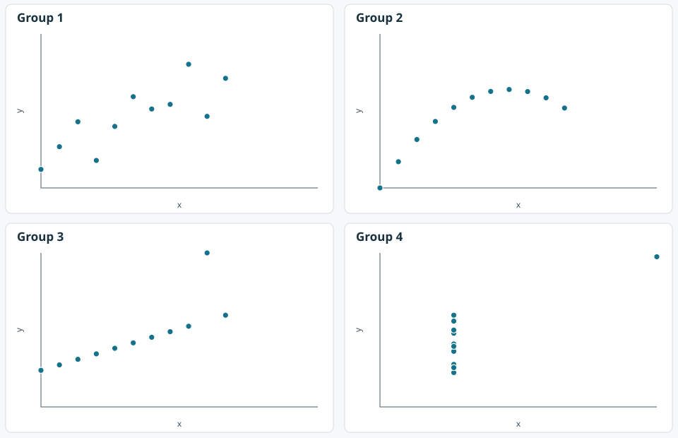

# 固定公开数据的四组回归基线

新增可用能力：把 [R 官方 `datasets::anscombe` 数据源](https://svn.r-project.org/R/trunk/src/library/datasets/data/anscombe.R)和标准库 Python 程序固定在实验源码快照中，经单独批准后完成一次正式 Docker Run。四组各 11 点的均值、OLS 斜率/截距与相关系数可从历史 Run 的原始指标回查；[四格散点图](quartet.svg)和[完整指标](metrics.json)由该 Run 归档，文件摘要见 [机器证据](evidence.json)。[R 数据集说明](https://search.r-project.org/R/refmans/datasets/html/anscombe.html)把这四组数据关联至 [Anscombe 1973 原论文](https://doi.org/10.1080/00031305.1973.10478966)。这里复现的是 R 固定数据的数值和图形，未声称通读受限的论文全文或验证其全部结论。

边界与保留：未批准提交被拒绝；准备后改动源码会使旧批准失效。实际只启动一个正式 Docker Run，退出 0 且归档完整。关闭并重开控制对象、刷新工作台后，Run、指标、官方原始数据及程序仍能回查；隔离恢复副本中旧 PMC 报告保持 current，54 条原有非设置记录摘要未变。

剩余工作：工作台目前将 SVG 显示为原始文本，浏览器下载事件未返回落盘路径，因此图形的浏览器下载落盘没有验证；归档字节和 SVG 结构已核对。这两个展示/下载问题列入后续，不扩大本批。正式 Run 的指标方向字段要求 min/max，描述性计数在速览中被显示为“越高越好”，后续应提供中性方向。真实 Pi 代码生成不在本批范围；SSH 主机暂无，依用户指示暂缓。原 PR01–14 仍保留，前端布局继续暂缓。

验证：夹具本地数值与 SVG 结构检查通过；真实 Docker Run、审批失败路径、重开历史及浏览器中的 Run/源码回查通过。独立复核未发现阻断。产品源码无变更，本批未重复上一批的全量回归和干净构建。复现源码为 [官方数据副本](anscombe.R)与 [Python 程序](fixture/main.py)；运行数据库和完整日志留在本地 `.validation/anscombe-baseline/`。

