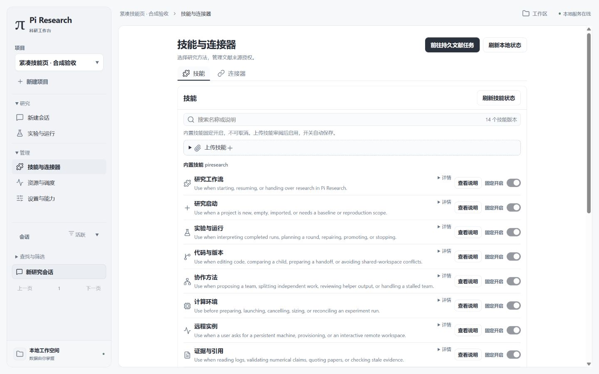
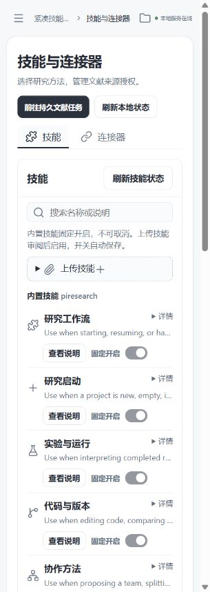

# 内置技能固定开启与紧凑页面

2026-10-06；基线 567091f0a350c507328c3e8f6bf848cbeb87cc79，工作分支 implementation/pr01-reproducible-baseline。

用户明确要求默认内置不可取消。14 个内置技能开关保持开启并锁定；新的禁用请求和旧禁用包精确回滚均拒绝 BUILTIN_SKILL_REQUIRED/400。保留历史 Bundle 原文、启动边界与固定会话；旧项目若有禁用记录可点击“恢复内置默认”，保留上传选择并更新后续绑定。删除上传版本产生的新配置也恢复内置默认。旧成功幂等回执只读重放，不回写旧配置或新增事件。

页面缩短标题、页签、上传折叠入口与行间距，默认说明单行显示；完整说明、技能 ID、资源、发行版本保存仍可折叠查看。上传的审阅、开关和删除保留。没有新增依赖、操作接口或发行版本，默认目录仍是 skills/piresearch。

## 四项验收

1. 内置固定开启，UI 无关闭/删除动作，服务拒绝新的禁用写入：通过。
2. 紧凑列表可查看完整原文、ID 和资源，高级配置仍可保存：通过。
3. 上传审阅、开关、删除及撤销/拒审的严格减项规则保持：通过。
4. 历史固定会话和字节保留，旧项目可显式恢复默认，连接器不回归：通过。

## 实际验证

新 UI 两项和后端两项回归在旧 dist 上实测失败；构建后相关 55/55 通过，无跳过。全量 1107 项：1084 通过、0 失败、23 跳过，退出码 0；跳过不记为通过。干净 npm ci、构建、类型检查通过，524 个产物与交付 dist 完全一致。

独立 Astra/xhigh 复核未发现代码阻断，11 个受审文件哈希前后相同。5 项隔离 DB 检查覆盖拒绝写入无变化、剩余撤销仍阻止启动、旧回执只读重放、删除事务末尾失败回滚、同键重试与历史字节。

浏览器用独立合成数据检查 14 个开关均开启且禁用，默认行高在桌面为 58–59px、320px 为 94–95px。1440/1024/768/320px 均无页面、技能行或内部滚动容器横向溢出；完整 SSH 资源可读，上传开关与删除可用；错误/警告记录为空。既有服务未重启，需重启后加载新后端。科研模型调用及外部文献查询未作为此页验收操作执行。

实施请求 Sol/high，关键复核请求 Astra/xhigh；接口接受参数，运行时未回显，不宣称实际模型/档位已核验。主会话设置保持。原日志与机器证据保存在 .validation/builtin-required-20261006 和 .validation/clean-build-EzkPsm；用户五个在途文件不提交。

移动端截图复核发现原外壳的 320px 最小宽度导致 15px 横向溢出；此前将 scrollWidth 与 innerWidth 对比漏掉了竖向滚动条。已仅在本页的小屏 CSS 解除 html/body 最小宽度，按 documentElement.clientWidth 重测：320px 视口下 clientWidth/scrollWidth 均为 305px，横向滚动条消失。必要 CSS 修复后重新构建、同步干净副本重建，524 个产物一致；原全量行为检查适用，原截图已更新。

