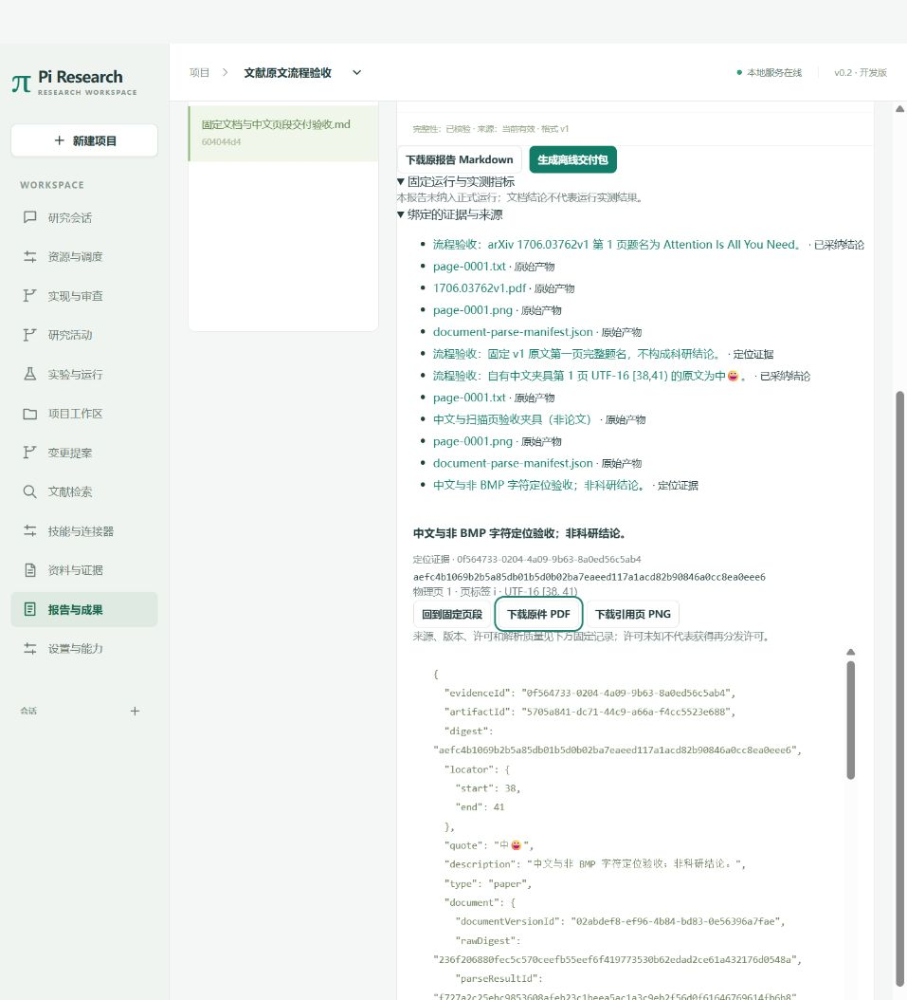

# PDF 页段证据进入报告与离线成果包

2026-09-28。本批补齐上一批明确保留的文档证据到报告/本地交付链路，固定验收见[交付记录](../../DELIVERY-FLOWS.zh-CN.md)。完整 PR01–14 及 PR10/12 尚未验收范围继续保留。

## 新增可用能力

报告现在可以纳入已采纳的 PDF 页段结论，冻结原件、DocumentVersion、来源/获取时间/许可出处、请求与观察版本、解析镜像及脚本/依赖摘要、物理页/页标签、UTF-16 区间和提取质量。来源仍为 unknown 或 unverified 时原样保存。重复引用同页复用产物，后续取得同论文新版本不会替换旧报告。

从报告引用可返回准确文档、解析结果、物理页和字符区间，也可显式下载该原件 PDF 与引用页 PNG。入口只使用经过服务端返回核验的固定记录 ID，正文和 JSON 为纯文本；迟到或错配响应不能启用其他引用的操作。

导出包含原 PDF、引用页文本/图像、解析输出清单及离线来源记录。未引用页的派生文件不自动加入包，清单和 README 说明这种范围；每个已包含文件有大小与摘要。保留既有 30 MiB 总量上限，超限明确拒绝。许可声明按来源保留，本地包不表示拥有再分发许可；没有远程发布。

原件、页文本/页图、清单、文档/解析元数据和证据变化会使当前报告失效；解析批准或结论失效时阻止新报告和新导出。历史 Markdown 与冻结引用不改写。可选文档绑定不改变旧报告格式或旧摘要，旧运行报告仍可核验。

## 实际交付与浏览器证据

在上一批真实文献项目中，通过浏览器提出并采纳两条明确标为流程验收的观察：arXiv `1706.03762v1` 第 1 页题名，以及自有夹具第 1 页 `[38,41)` 的“中😀”。这不是模型生成的科学结论。

浏览器报告 `604044d4-6611-433d-8796-4419cf33eb0c` 实际生成并显示当前有效；论文引用回到 v1 的 `[0,25)`，没有改成已保存的 v2。390px 下从中文引用返回页标签 i、物理页 1、区间 `[38,41)`，刷新后仍保持原文和位置；页面内容宽度 375px。PDF/PNG 下载按钮已触发，浏览器落盘位置没有确认；服务端交付包另经真实解包校验。

本地成果包 **1,303,750 字节**，SHA-256：

`bfef1b803f48ab21110033fd47799d16df66b71bd5d95a8a63a2edf181a5b88a`

实际解包 **11 个条目**，包括 9 个固定文件以及 manifest/README。9 个文件的原字节、大小和摘要全部匹配；两份原 PDF、两张引用页图、两份页文本与两份解析清单完整包含，未引页派生文件未混入。当前配置凭据和宿主路径未出现在包中；HTTP/CLI 回查一致，同键导出重放返回同一产物。

本机可直接读取[成果包](../../../.validation/document-report-flow/research-document-result.tar.gz)。它包含第三方原 PDF，仅留在本机忽略目录，没有随项目源码提交。可移交的固定元数据/摘要见[真实执行证据](live-evidence.json)，浏览器过程见[浏览器记录](browser-evidence.json)。

原有 57 条文档/解析/证据/产物记录全部字节不变。对上一条真实科研闭环数据库先做在线备份，再用当前代码回查：历史报告 `28b4360a…` 仍 current/verified，原正文和绑定摘要不变；原数据库未改动，见[旧报告兼容记录](legacy-evidence.json)。

## 验证与局限

本批修复实物阻断：PDF 压缩字节中偶然出现 `A:/`，旧导出器将整个二进制当作 UTF-8 文本而误判为宿主路径。有效 UTF-8 文本保留原规则；二进制仍全局检查已知宿主根路径及凭据，一般路径启发式限定为至少 8 字节的可读 ASCII 片段。可读 Windows/UNC/宿主标记和凭据仍拒绝。该规则是有限检测，不保证发现任意编码或混淆内容。

相关验证覆盖文档/报告来源、同标题新版本、审批与结论失效、12 类篡改/失效、离线解包、体积边界、契约及真实 React16 行为。最终统一回归 **501 通过、0 失败、3 跳过（504 项）**；干净安装、构建、类型检查成功，**339 个 dist 文件完全一致**。独立只读审查无本批阻断；没有新增模型调用或重做 PDF 解析。详见[验证摘要](verification.json)。

下一批推进 PR11 的技能导入审阅、固定版本授权、任务预检与回滚。PR10 的其余原文来源实网、结构抽取、跨源分页/覆盖和文档语料授权，以及 PR12 的真实论文/隔离 LaTeX 构建、PR13 远端、PR14 分发等仍待完成。

