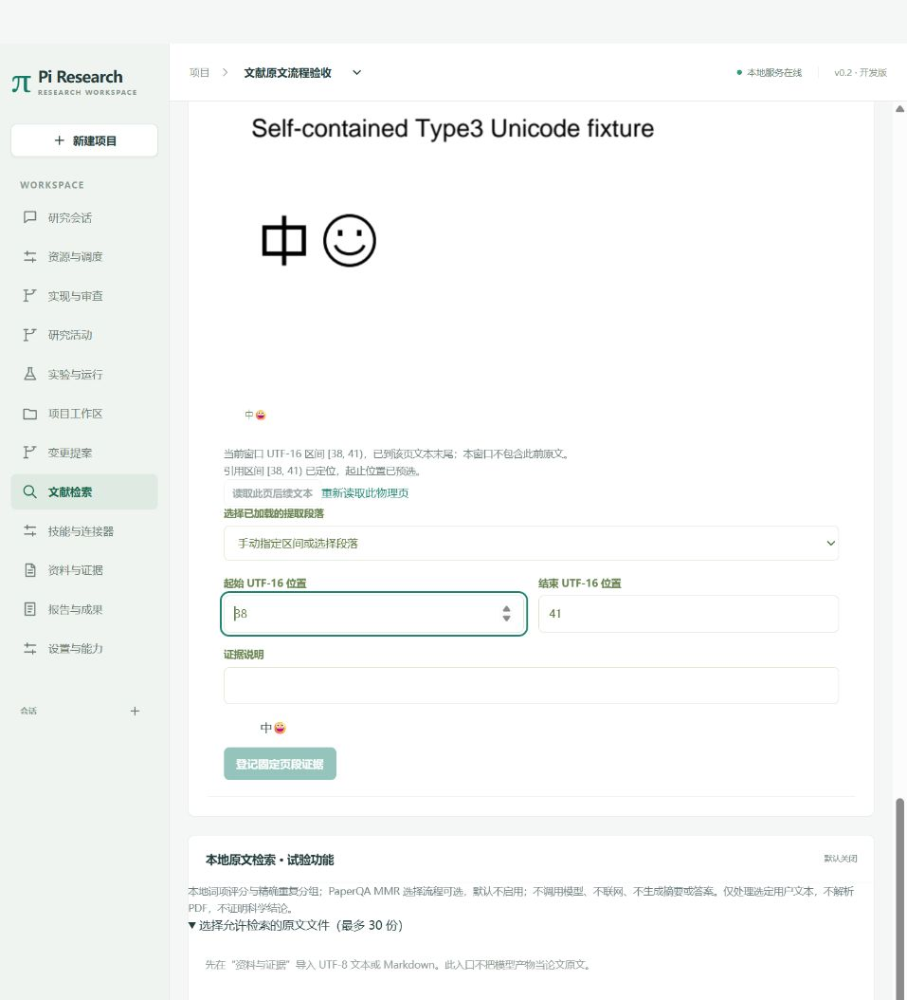

# 文献任务、固定原文版本与页定位

2026-09-28。本批交付 PR10 的核心用户流程：显式文献任务→取得固定原件→批准隔离解析→原页/文本回查→登记精确页段证据。固定条件见[交付记录](../../DELIVERY-FLOWS.zh-CN.md)；完整 PR01–14 仍保留，PR10 未全量完成。

## 新增可用能力

文献检索与原文获取立即返回持久任务 ID，由独立 Node worker 执行，关闭页面或控制服务不会直接丢弃请求。最多同时执行两项后台文献任务，每个 HTTP 尝试仍先记入项目预算。取消、来源设置变化和项目状态会在等待、下载及发布前复核；未知请求不自动重发。结果已经提交但任务终态尚未写入时，控制器从精确服务回执恢复原任务，不重新下载或多建文档。

`DocumentVersion` 保存原始字节摘要、来源、获取时间、请求/报告版本、保证等级与许可证出处，不覆盖旧版本。原始响应和重构摘要/格式化文本分开，保留 UTF-8 BOM 等原始字节。获取 PDF 只表示取得文件；摘要、供应商提取文本、原 PDF 和解析结果分别展示。原始文件最大 32 MiB，CLI 可使用 `operation ... --input-file <JSON文件>`，避免大文件内容塞入命令行。

PDF 解析另有固定清单、批准和持久 `DocumentParseJob`。固定 Python 3.12 基础镜像、pypdfium2 5.13.0、Pillow 11.3.0 及脚本/依赖摘要进入配置。镜像不启用 V8/XFA，解析程序不初始化 forms 或提取附件；输入只读、无网络、无宿主凭据，使用现有隔离和目标身份检查。文档解析并发固定为 1，并计入共享 CPU/RAM/作业总预算，未知作业继续占位。

当前限制为 100 页、页图最大边 1600、提取文本总量 8 MiB、输出总量 128 MiB、1 CPU、512 MiB、180 秒。宿主再次核对文件名、普通文件属性、尺寸、摘要和闭合 JSON 结构，再发布解析结果；这不是通用宿主磁盘配额实现。失败或恢复后证据不完整时不发布可用页结果。

工作台显示物理页号与印刷页标签、固定 PNG 页图、文本/段落和质量说明。PNG 通过认证下载并在浏览器核对签名和摘要。证据绑定原 PDF、解析清单、页文本及页图；从证据回跳时携带确切 UTF-16 区间，非零区间使用有界窗口，刷新后仍保持位置。来源启用、最近实际请求状态和是否取得全文是不同信息；文档和派生文件不自动加入本地检索语料。

## 实网、真实容器与浏览器证据

五源基线通过产品 `ConnectorService`，在独立验收项目显式启用，共 9/25 次请求，无重试、无模型调用：

| 来源 | 实际结果 | 内容边界 |
|---|---|---|
| alphaXiv | 检索及 Markdown 读取 HTTP 200 | 供应商文本，地址版本未作内容核验 |
| OpenAlex | 未配置 key，检索及摘要 HTTP 200 | 元数据/摘要，不代表匿名 PDF 下载可用 |
| bioRxiv | 检索及摘要 HTTP 200 | 返回版本 1/2，选取版本 2；保留供应商版本信息 |
| Crossref | 检索及读取 HTTP 200 | 元数据，不是原始 PDF |
| PubMed | 请求阶段失败，无 HTTP 响应 | `CONNECTOR_UNAVAILABLE`；不能说认证错误、429 或零结果 |

详见[五源记录](provider-evidence.json)及[provider 契约](../../provider-contracts/literature.md)。原 PDF 实网验收另使用明确版本的 arXiv 官方地址：

| 对象 | 实测记录 |
|---|---|
| v1 文档 | `5465c5ac-75bf-43d5-baae-72009dc32ca9`，2,128,686 字节 |
| v1 SHA-256 | `0a9bff1be3575cf9fe26a4a3d3a9175bc791ecec90de8b9deba4cff75d2b9476` |
| v2 文档 | `2efa5419-59c0-496a-8504-5aeb5452e6d9`，2,233,055 字节 |
| v2 SHA-256 | `803b95695f178d1804b8cf66ab7ae3d7c8b94e044a045cbff8d9b37435ca4dd4` |
| v1 解析作业 | `3b54eb94-293b-461a-8ca4-33ae29ca73d1`，成功且完整 |
| v1 解析结果 | `27f472b6…`，15 页，`marker-match`，请求/观察版本均为 1 |

v1 获取过程中关闭控制存储后，独立 worker 仍完成任务。随后由 Codex 在真实浏览器配置固定镜像、准备并审阅批准清单、提交解析，刷新后回查真实终态、页图和页文本。浏览器检索选中同一论文，再指定 v2 获取；v1 记录保持逐字节不变。v2 仅取得原件，仍明确为地址版本保证，没有伪称已经解析或核对内容版本。

自有夹具进一步验证了中文与 emoji、页标签 i/ii/iii、嵌入 OpenAction、图像页及边界：101 页明确失败；共享 1 CPU 时文档占用阻止 Run，取消后 Run 推进；监管进程丢失后仍是同一容器，没有重复启动，但无法证明日志完整，所以终态保留 failed/incomplete，不发布解析结果。[容器记录](parser-runtime-evidence.json)保留这些实际状态。

图文检查区分了测试输入本身的局限：初版 CID 夹具只证明 Unicode 映射提取，实际字形不对应；已改为自包含 Type3 “中”和笑脸，并真实解析、查看 PNG。初版白色图像页只证明无文字层；另用可见位图 **SCAN** 的图像页单独实测，提取文本为空、`no-text-layer`、`ocr=false`，没有伪造 OCR。见[中文页图](unicode-page.png)、[扫描页图](scan-page.png)及[扫描检查](scan-visual-evidence.json)。

浏览器在 390px 下完成页面选择与刷新恢复。中文证据的 `[38,41)` 指向“中😀”，回跳及再次刷新后仍显示该区间和原文；第 25 页的分页定位与迟到响应另有行为检查。页面内容宽度为 375px，console errors=0，临时视口已复原。固定原件、两份解析的全部 36 个页产物及三条证据已核对字节/摘要，见[浏览器与原件核验](browser-evidence.json)。本次本地文件通过 CLI 导入，未把它说成已经完成原生浏览器文件选择器自动化。

## 验证与收口

新增 16 项统一操作，Registry 共 79 项。原始字节暂存、解码和大上传体摘要在写事务之外处理；发布事务只做权限/版本复核与持久记录。独立审查发现的“已发布结果丢失任务终态”和“大上传体在 Registry 写锁内重哈希”已修复并复核关闭。

首次全量为 489 通过、1 失败、3 跳过，暴露新归档限制误伤既有开发测试取消路径。限制已仅保留给新文档/文献任务，相关 25 项通过后重新统一回归：**490 通过、0 失败、3 跳过**。之后浏览器发现精确回跳未携带字符范围，已修复并完成 UI/工作流 13 项、文献任务/UI 15 项相关检查及真实浏览器复核，没有再次重复无关全量。

首次真实解析失败是 Python 对象释放方式不匹配：Page/TextPage/Bitmap 不支持文档对象的上下文写法。改为 `contextlib.closing` 并重建固定镜像后真实验收通过；失败目录保留，不计作成功。最终镜像为 `sha256:2ed5e93a14d15b3928da39d7cb60dc0cadefd51accc2ead500e894bb3fea850e`，依赖与脚本摘要见[解析配置](parser-profile.json)，安装指引见[固定解析器说明](../../../scripts/pdf-parser/README.md)。

最终干净安装、构建与类型检查成功，**339 个 dist 文件完全一致**；清单摘要 `2644f0353f16eeaa7ac6acf2aba66eeb0603690a1f2627c2180bdeee3ff4b80b`，见[验证摘要](verification.json)。累计旧验收库从 schema 1/2/3 升到 1/2/3/4/5，173 条原记录全部字节不变；见[迁移证据](migration-evidence.json)。本批没有调用模型、远程发布或重写旧报告。

## 仍需完成

PubMed 本机实网读取仍为环境待验。原 PDF 实网仅证明此次 arXiv 指定版本路径；OpenAlex 内容下载缺少对应 key，bioRxiv PDF 尚未独立实网验收；PubMed/PMC 与任意出版商原文未接入，Crossref 元数据不替代它们。

段落与阅读顺序没有语义核验，表/图结构仍为 unknown；OCR 没有启用。完整跨源分页、覆盖/相关性对照、历史任务完整列表、文档语料显式接入及 Agent 的细粒度文档授权仍待后续验收。

报告/离线包尚未收集完整 PDF 版本与页图来源。因此包含新 document-linked evidence 的报告创建目前明确返回 `REPORT_DOCUMENT_BINDING_PENDING`，防止悄悄丢弃来源后称为完整成果；旧运行报告保持可用。下一批补齐这条文档证据到报告/成果包的链路，再继续原计划技能、论文与分发范围。

