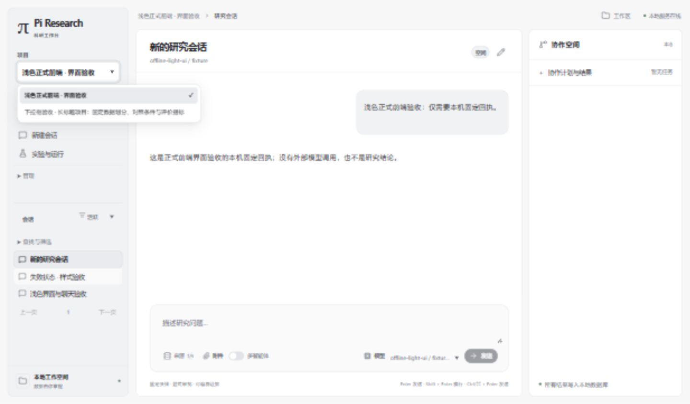
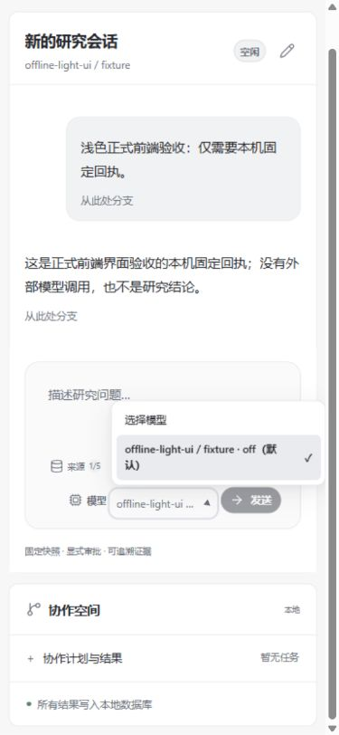

# UI-DROPDOWN-06 · 浅色下拉框

基线：`a69ff330c889c79ba46a5dbf411a90169de5600a`。本批仅调整正式 React 前端的下拉控件；已确认的面板布局、聊天输入区及工具位置继续保留。

## 固定验收条件

1. 项目、会话分类、角色、模型及表单单选使用一致的浅色浮层，选中状态清晰；收起时省略长名称，展开时可完整阅读。
2. 原选项、值、业务回调、FormData、授权锁定及 disabled 规则保持。
3. 原生方向键、Enter、Escape、Tab 与原 label/aria 名称保持可用。
4. 在 1440×844、1280×720、1024×844、390×844 下保留主布局、输入框及发送按钮几何；不支持增强的浏览器保留原生选择器。

## 实际改动

最后加载的 `light-workbench.css` 统一控件圆角、细边框、焦点与禁用状态，并在双重 `@supports` 内使用 `appearance: base-select` 和 `::picker(select)`。展开列表使用白底、轻阴影、选中勾号与背景、长文本换行、受视口约束的滚动区域。

60 个现有单选保留原 `<select>`，首子复用 `button type="button"` 与原生 `selectedcontent`，使关闭按钮里的文字能够省略。仅在支持增强的控件内同步动态选项内容，卸载时断开观察；不写入选择值或选项。对话框中的 Escape 先关闭已展开的菜单，再关闭对话框。没有新增依赖、自建键盘或弹层逻辑，业务选项与回调没有替换。

参考：[shadcn Native Select](https://ui.shadcn.com/docs/components/base/native-select)、[Chrome 可定制 select](https://developer.chrome.com/blog/a-customizable-select)、[MDN 结构与渐进增强](https://developer.mozilla.org/en-US/docs/Learn_web_development/Extensions/Forms/Customizable_select)。

## 验证记录

最终结果与快照哈希见 [evidence.json](evidence.json)。浏览器使用实际 `dist/web` 和仅含合成数据的本机验收实例；没有外部模型请求。

集成回归：1036 项，1013 通过、0 失败、23 跳过。最后两处 DOM 内容同步与 Escape 修复后，184 项相关界面检查全部通过；无关后端结果复用，未将跳过项计为通过。最终干净构建、类型检查成功，507 个产物与分发目录一致。四个视口各 44 项几何比较均无偏移，手机浮层右边界 369px 小于可用页面宽度 375px，关闭文字与发送按钮之间留有间距。

已复验项目切换、角色筛选、模型选择及刷新保留、归档历史和禁用、动态标签更新、对话框两次 Escape，以及关闭增强规则后的原生回退。曾尝试已有会话重命名按钮并遇到内置浏览器不支持 `prompt()` 的既有限制；本批未改变该入口，不记作下拉回归失败或全局零控制台错误。

五个此前在途文件继续保留并排除本批暂存：基础 `styles.css` 的 source/dist、两个 reference-baseline 文件与 `project-design.txt`。

未验证实体输入法、屏幕阅读器、外部模型、Docker及其他浏览器引擎。原生回退另用关闭增强规则的同版本正式应用检查，不冒充跨浏览器实测。
