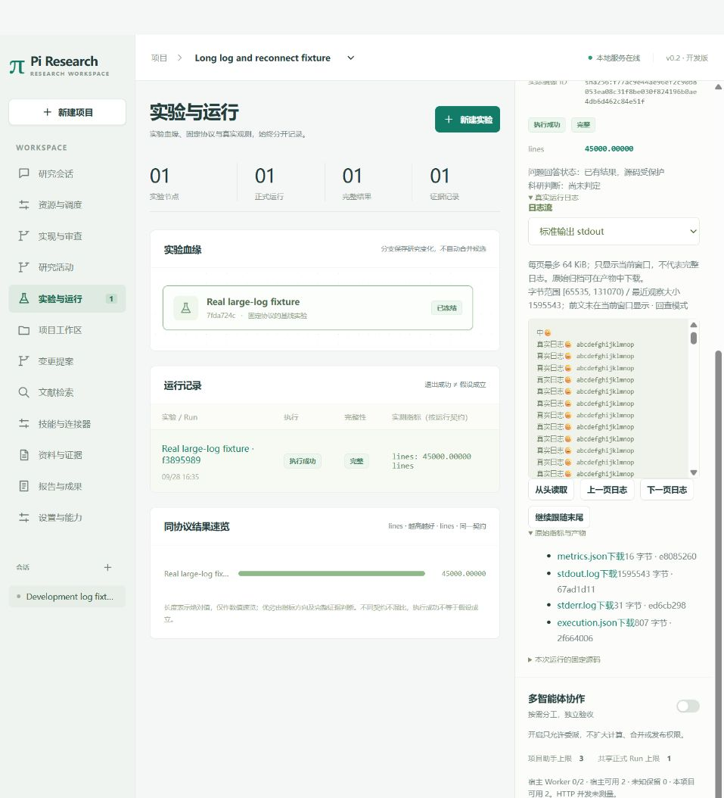

# 长任务日志与断线恢复验收

2026-09-28。本批按预先固定的[用户流程验收](../../DELIVERY-FLOWS.zh-CN.md)推进 PR07。完整 PR01–14 不变；模型 HTTP 并发、其余历史实体分页和原计划后续关卡继续保留。

## 新增可用能力

正式 Run 和开发测试现在共用字节日志分页。单次实际读取最多 64 KiB，中文和 emoji 跨页或被分次写入时保留完整字符，超过 1 MiB 的游标可继续读取。日志文件缺失、缩短、替换或旧身份不匹配时返回 `LOG_RESET`，由用户显式从头读取；非法或终态残缺的 UTF-8 返回明确错误，原始文件保持不变。

页面只显示一页日志，提供从头、前页、后页、暂停和继续跟随。回查用已经观察过的 UTF-8 字节边界，不从任意偏移猜字符。最多保留 128 个页起点；更早内容可重新从头读取。开发测试日志按需展开，终态且 EOF 后停止日志读取；日志 EOF 与作业/归档完整性仍分别展示，原始产物可继续下载。

事件由按项目及序号索引的持久页提供，游标支持安全整数，有积压和超前重置语义。新增 SSE 只发小型唤醒提示：沿用 owner、回环 Host/Origin 和 Authorization header 校验，令牌不进入 URL；最多 32 个连接，每连接最多每 500 ms 合并一次提示，15 秒空闲心跳，写入背压时停止继续写。连接断开或服务关闭会清理计时器和流。

页面每轮最多补拉 3 页，成功应用权威快照后才保存项目游标。推送断开会自动重连，20 秒状态读取作为兜底；读取失败不会重发写操作、模型请求或 Run。当前会话的执行代、已保存消息及有限输出尾部来自同一个 SQLite 读快照，不通过重放历史 delta 拼接回答。旧响应和旧错误受选择代保护，切项目/会话会取消旧读取。新发生的展示截断有明确提示。

## 真实 Docker 与浏览器

真实固定 Python 容器分别完成正式 Run `f3895989…` 和开发测试 `e835d0b2…`。两者 stdout 均为 **1,595,543 字节**，每项分 **25 页**读完，与生成字节和归档摘要一致：`67ad1d1104de837185a1a28f44a8a1f6395d2de6f3183e1177f34107b65bd0d7`。程序把“中”的首字节和后续字节分次写入，同时覆盖 64 KiB 页边界。

正式 Run 运行且 SSE 打开时关闭 HTTP 控制器，再用原数据目录启动控制器：仍是原容器，`StartedAt` 相同、`RestartCount=0`，每项只有一个容器；两项最终均成功且完整。事件补拉包含真实终态。这些程序只验证日志与恢复，不构成科研结论，也没有调用模型。

浏览器实际验证：

- 正式 stdout 从头→下一页→上一页；第二页范围为 `[65535,131070)`，显示字节 65,535，开头为“中🙂”，没有替换字符。之后成功切换至真实 stderr。
- 开发日志按需展开；390px 下使用键盘切流和从头回查，`document.scrollWidth=375`，没有横向溢出；临时视口已复原。
- 停止经过进程身份核对的验收服务后，页面显示重连并保留原成功终态。离线期间修改隔离验收项目名称，重启服务后页面自动显示“已恢复”，无需手动刷新；日志范围保留。之后完整刷新也恢复了所选 Run。
- 另用两个真实子进程 IPC 夹具，页面明确标注“非模型输出”。A/B 会话切换不串流，刷新 A 后恢复当前输出；夹具结束后仅有一条最终消息，临时流面板消失。该项不冒充新的 Pi/供应商验收。
- 浏览器 console errors=0。既有坐标点击偏移通过原生键盘操作绕过。

见[真实容器记录](runtime-evidence.json)、[浏览器及归档字节记录](browser-evidence.json)。上一批累计验收数据库经在线备份后独立迁移，schema 1/2/3→1/2/3/4，**173 条既有记录全部逐字节一致**；见[迁移证据](migration-evidence.json)。没有重跑或改写旧成果。

## 有界读取与性能

相关检查实测底层 `readSync` 的请求与读取字节；日志读取最多 65,536 字节，不能先读完整文件再截取。事件页最多 500 条，单 payload 最多 64 KiB、整页保留 payload 最多 256 KiB；超限 payload 显式标记 `omitted`，事件序号仍可补拉，业务事实从权威状态读取。页的元信息另计，不把 256 KiB 说成整个 JSON 的大小。

固定规模为 20,000 条其他项目历史事件、1,200 条当前执行代 delta、6,900,000 字节日志。20 次预热、100 次测量：

| 操作 | p50 | p95 |
|---|---:|---:|
| 事件页 | 10.37 ms | 10.87 ms |
| 当前会话读快照 | 5.13 ms | 5.57 ms |
| 单页日志 | 0.76 ms | 1.13 ms |

事件页实测 JSON 368,949 字节、500 条事件，其中 424 条仅保留省略标记；会话尾部 32,000 个 UTF-16 单元，日志页 65,536 字节。测量进程 RSS 约 128.4 MB、heapUsed 约 25.6 MB，包含种子数据和日志缓冲，不是每次请求增量。保存查询计划与可重跑脚本 `scripts/benchmark-events.mjs`，见[性能证据](performance-evidence.json)。这是指定读取路径的本机测量，不是全站性能或相对旧版加速倍数。读快照与另一 SQLite 连接同时写入的检查通过，没有预占写锁。

## 验证与保留项

相关检查包括日志/契约 25 项、事件 HTTP/背压 4 项、会话快照与真实 IPC 4 项、前端 12 项；集成后统一回归 **466 项：463 通过、0 失败、3 明确跳过**。真实 Docker 日志与控制器恢复另 **1/1** 通过。独立交叉复核没有发现本批阻断；集成时修复了事件补拉部分失败后的连续自触发重试，以及恢复后的过期提示。

干净 npm ci、构建、类型检查通过，**311 个 dist 文件完全一致**，清单摘要 `64d5488426f5777aad5343c37e1c29bc9eda8faf1c39edf2065fb947cc4eeb64`，见[验证摘要](verification.json)。Registry 仍为 63 个动作，本批扩充已有日志契约与只读 HTTP 流，没有新增模型权限。

仍保留的边界：项目 state 与完整历史消息尚未全面分页/虚拟化；原生 Pi JSONL 恢复预检仍非本批优化范围；Host 字符串上限可能切到 UTF-16 代理对，现已有截断提示，按代码点截断作为非阻断后续项。旧事件没有 generation 时不猜测其当前输出；历史最终消息仍可读。Docker 监管恢复可能重附着已有日志，保留原有 incomplete 标志，不宣称精确续传。trusted-example 的旧 stderr 合流行为保持，真正双流验证以 Docker 为准。

模型 HTTP 请求级限流、硬磁盘配额、其他远程/GPU 目标、完整 UI 迁移及 PR08–14 未完成部分继续推进。本批没有重新执行供应商 live 测试，没有修改密钥或远程发布。下一批按用户流程推进文献任务与可定位的原文版本。

