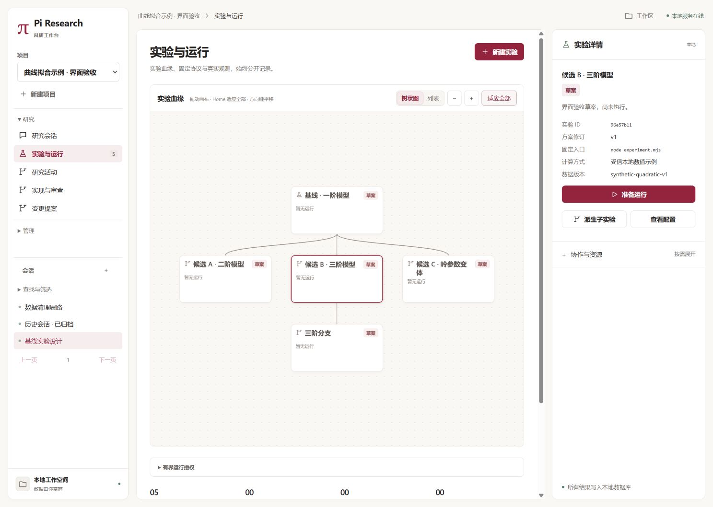
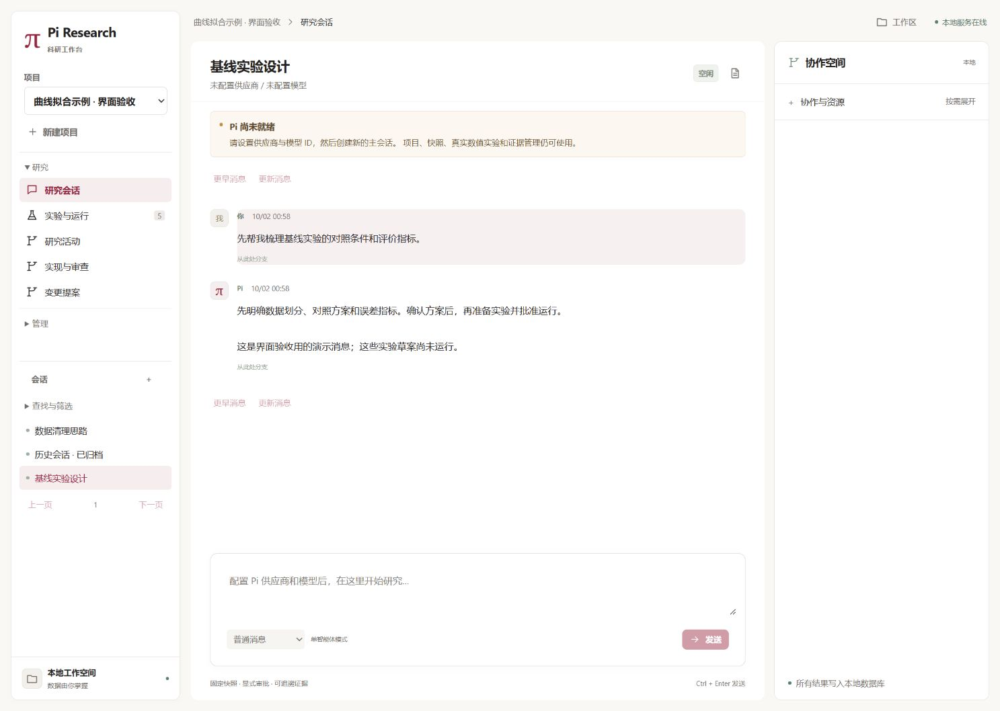
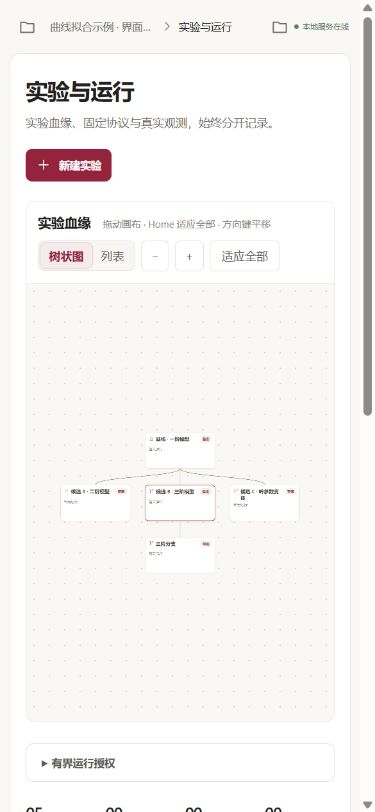

# Pi Research 前端页面重设计

用户于 2026-10-02 选定方案 2，并要求采用 OpenResearch 的布局、融合 Pi Research 的实际功能、降低页面密度。本批在现有 React 工作台上改造全部 12 个页面，以项目和会话目录、当前任务区域、实验上下文面板组成工作台。相关验证已完成，详见下方记录。

## 页面布局与功能

| 页面 | 布局 | 保留的实际功能 |
| --- | --- | --- |
| 研究会话 | 左侧项目和会话目录，中间对话与输入，右侧团队上下文 | 会话搜索与分页、角色筛选、历史原文、流式状态、普通消息、引导、后续消息、停止 Agent |
| 实验与运行 | 节点连线树图为主体，右侧显示所选实验与 Run | 基线与候选血缘、图与列表切换、拖动、缩放、适应全部、固定协议、运行批准、日志、指标、原始产物、固定源码 |
| 研究活动 | 方案与活动选择器、分轮记录、决定与比较 | 有界研究方案、轮次、候选、失败记录、批准决定、回查原 Run 与会话 |
| 实现与审查 | 固定来源选择、文件与编辑区、开发测试和审查 | 私有工作区、源码编辑与差异、有限测试授权、测试日志、独立审查、批准整合为子实验 |
| 变更提案 | 提案准备区与提案记录，差异按需查看 | 固定父来源、候选产物、前后差异、批准与整合、失效与历史记录 |
| 文献检索 | 查询与任务区、结果和固定文档阅读区 | 显式来源、检索任务与分页、取消和重试、文档导入、固定版本、PDF 解析与原页定位 |
| 项目工作区 | 左侧文件目录，右侧编辑器 | 文件读取、新建和保存、未保存提醒、摘要冲突、准备区与实验快照的边界 |
| 资料与证据 | 左侧资料列表，右侧原文与引用位置 | 原始资料、原文区间、固定文档回查、授权语料检索、带来源和限制的结论候选 |
| 报告与成果 | 报告目录与正文预览，文稿和编译按需展开 | 固定文稿、编译诊断、PDF、论文审查、报告引用、历史分页、Markdown 与本地成果包 |
| 技能与连接器 | 来源开关与技能版本区，明细按需阅读 | 显式启用来源、请求观测、技能导入、审阅、启用、撤销和回滚、会话绑定版本 |
| 资源与调度 | 容量与队列总览、资源配置区 | Worker、模型 HTTP 与计算分别计量、共享容量、排队原因、未知占用、配置冲突、Docker 目标核对 |
| 设置与能力 | 模型配置与能力清单 | Pi 供应商与模型、运行时状态、已验证与受限能力、配置错误 |

登录、首次项目、加载、离线、操作错误和已有模态表单采用同一字体与配色。正文与表单提高可读性，状态仍以文字标注，颜色仅作辅助。

## 布局与页面密度

采用暖白背景、白色内容区、深色正文与酒红强调色，沿用项目的 π 标识和现有图标。桌面左栏约 252 像素，常驻研究与管理入口；文件、文献、资料与证据、报告放在顶部工作区工具菜单，作为对话生成内容后的查看与确认入口。当前分组可直接访问，其余分组可展开。会话查找与角色筛选收纳在同一入口，搜索、分页和旧会话定位继续可用。

实验树优先占据首屏，有界运行授权放在树图之后。实现页的有限授权、文献页的检索授权和成果页的文稿编译按需展开。折叠保留子组件、草稿及原有状态；报告中的固定文稿或审查引用会展开文稿区后定位原构建。关键运行状态、错误和禁止操作的条件仍由原业务组件显示。

窄屏使用可关闭的导航抽屉，主区域与上下文纵向排列。打开导航时背景区域不可交互，关闭后回到导航按钮；改回桌面宽度会关闭抽屉，避免遮挡工作台。

对话可以请求 Pi 编写文字、LaTeX 和普通产物。当前冻结文稿修订、编译准备与批准、最终可追溯报告构建仍是用户入口；本批仅重排这些入口，尚未将它们接成对话中的待确认操作卡片。

## 实验树与历史

节点与连线直接来自现有实验父子关系。图与列表显示全部节点；缺失父节点单独标注，循环关系标注并断开一条用于展示的异常连线，科研记录本身不修改。深链布局使用迭代遍历。

选择节点只更新当前实验，原 Inspector 继续读取相应源码、协议和 Run。实验生命周期、Run 执行状态、完整性分别显示；指标只有在完整且为有限数值时显示，空结果明确标注。准备运行、用户批准与提交运行仍是原来的操作。

同一会话查看辅助页面后返回保留聊天草稿；换项目或会话重新建立输入实例。图与列表偏好按项目保存；所选实验按项目恢复并由当前项目返回的清单验证。会话、Run、报告、文档与历史锚点继续沿用现有持久化逻辑和服务端归属校验。

## 验收范围

1. 全部 12 个真实页面入口及关键操作可达。
2. 原 API、审批、错误与冻结边界保持，折叠不卸载业务组件。
3. 实验树可拖动、缩放、适应全部、选择节点、切换列表，并回查原详情。
4. 切换项目与刷新恢复有效选择及图偏好，历史与固定引用可继续定位。
5. 桌面、窄屏及键盘主要路径可用，不遮挡持久控件。

浏览器预览使用独立的合成曲线拟合验收项目；没有提交模型任务或正式 Run。已有真实后端验收沿用原记录。本次重点验证页面呈现与读取选择路径。

## 验证与交付

桌面 1487×1058 与窄屏 390×844 各检查 12 页，未见外层横向溢出或可见操作错误。节点选择、列表切换、缩放、鼠标拖动、键盘平移、项目返回、刷新恢复、归档禁发和聊天草稿保留通过。浏览器控制台无错误。

集中回归 889 项：865 通过、23 跳过、1 项旧实验视图夹具缺少项目 ID。补齐夹具后保留原 accuracy、max、单位及数值断言，34 项受影响检查全部通过。按既定规则只重验必要修复的相关范围；原始回归日志留在本机。最终干净安装、构建与类型检查通过，474 个输出文件一致。独立 Sol 复核未发现阻断。摘要见 [机器证据](evidence.json)，视觉复核见项目根目录 [design-qa.md](../../../design-qa.md)。

原有基线 CSS 及三份文档在途改动继续保留并不纳入本批提交。实验列表的窄屏缩进与防溢出修复保留在新图组件内。科研数据库、原始会话、认证文件和大份日志未纳入代码交付。
