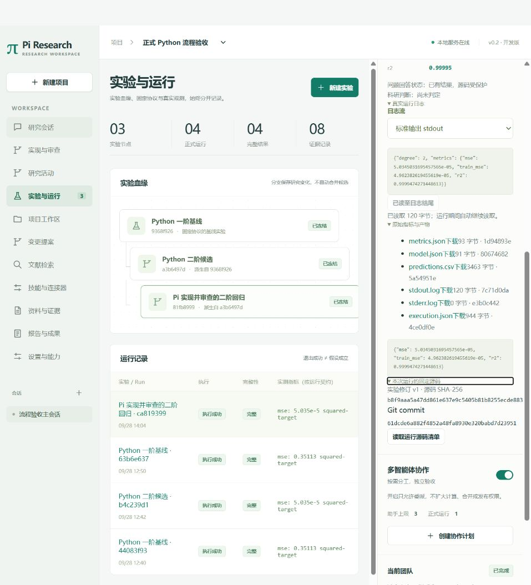

# 首条真实科研闭环验收

2026-09-28。本批已完成既定的“指定版本 → Pi 实现 → 开发测试 → 独立审查 → 批准整合 → 正式运行 → 结果回查”。完整 PR01–14 计划继续保留；本记录只证明本机智谱 Coding Plan、Linux CPU Docker 与这条固定任务的实际行为。

浏览器操作由 Codex 执行，批准均经过工作台的用户入口。Pi 模型没有审批权限。没有用假 Worker、手工填写的成功状态或预填指标替代真实执行。

## 新增可用能力

工作台新增“实现与审查”页：选择已有实验与修订，准备私有 Git 工作区，查看和保存源码/版本，批准固定开发测试，读取真实日志，批准另一 Pi 会话的独立审查，查看完整变更并批准创建子实验。随后接入既有正式 Run 页面。

独立审查固定到成功测试的 CAS、命令、镜像、报告和日志；审查角色只读，必须提交明确 verdict 并引用全部必要证据。新 `reviewed_change_prepare` 从受审快照计算完整差异，包括删除及文件模式，不接受模型另行拼装候选。应用提案和后续使用来源时再次核对审查与测试有效性。传统手动提案保持兼容，并在页面区分。

## 实际过程与结果

| 步骤 | 实际结果 |
|---|---|
| 选择来源 | `a3b6497d…` 的 revision 1，二阶配置；项目原有一阶配置及其他文件不变 |
| 模型实现 | `zai-coding-cn / glm-5.3` 读取固定源码，在私有工作区实际改写 `main.py` 并新增 `test_main.py` |
| 首次测试 | 真实容器退出 1；测试把 CSV 文本字符串误当行迭代器，得到 3340 行而非 60 行；失败结果不能进入审查 |
| 依据日志修复 | 同一原生 Pi 会话读取失败 stderr，修复 CSV 读取及文件句柄关闭，保留原断言并重新请求批准 |
| 新测试 | 新源码、新批准，真实 Docker 的 5 项 unittest 全部通过；日志和结果完整 |
| 独立审查 | 另一原生 Pi reviewer 会话读取已测试的固定源码和证据，提交 `accept`，引用全部 4 项必要证据 |
| 整合 | 页面展示 `main.py` 修改和新增 `test_main.py` 的完整差异；批准后创建 `81fb8999…` 子实验 |
| 正式运行 | 单独批准 `python main.py`；Run `ca819399…` 成功且完整，实际产生指标、模型及 60 行预测文件 |
| 回查 | 浏览器预览原始 metrics，读取本次 Run 的二阶配置、CAS 和 Git commit；刷新后恢复所选 Run 与指标 |

正式测量来自 [metrics.json](run-metrics.json)：MSE **0.000050345031695457565**，训练 MSE **0.00004962382619455619**，R² **0.9999474271448613**。它们与重构前二阶实验一致，说明这次重构保持了本例行为。数据为固定合成数据，本次验收不构成外部科学发现，也不证明多 Agent 比单 Agent 更有效。

## 来源对应

- 成功测试：`074803b8-5d7c-4892-b78d-725db988e7d7`。
- 审查任务：`853c095c-f714-4702-a20b-08db475b6f58`；reviewer 会话与实现会话不同。
- 受审提案：`c33ac936-68d7-4cd1-b02d-d28da7aa862f`。
- 正式 Run：`ca819399-1714-4aaa-b50e-ef1700b3991f`。
- 测试、审查、提案和正式 Run 使用同一候选 SHA-256：`b8f9aaa5a47dd861e637e9c5405b81b8255ecde883057f49bf6db0de98da1b80`。
- 私有实现 commit：`89c4826158287f1447b40e757d6e87a63a8a0145`；正式实验 commit：`61dcde6a882f4852a48fa8930e320babd7d23951`。逐文件读取两个 commit 后与同一 CAS 摘要核对一致。

[完整执行证据](live-evidence.json)包含模型/原生会话 ID、原生文件位置及哈希、22 次工具调用、1281 条流事件的统计、14 条模型用量记录、批准、测试、审查、提案与 Run 的关系。SDK 报告的累计 totalTokens 为 254763（包含缓存读取）；其中 cost 字段是 SDK 目录估算，不是 Coding Plan 实际扣费。

固定的[实际候选程序](fixture/main.py)、[实际测试](fixture/test_main.py)、[失败日志](development-failed-8483fa25.txt)、[通过日志](development-succeeded-074803b8.txt)、[模型参数](run-model.json)、[预测文件](run-predictions.csv)和[容器执行记录](run-execution.json)随本记录保存。原始数据库、原生 Pi 会话和控制日志保留在本地 `.validation/flow-run-ui/data`，没有导出认证配置。

## 集成验证

- `npm run build` 成功；`npm run test:core`：398 项，395 通过、0 失败、3 明确跳过。跳过项为两个显式启用的 Docker 扩展测试和 Windows 不适用的 POSIX 权限测试；本批上面的开发测试和正式运行另经真实 Docker 执行。
- `npm run verify:build`：干净安装、构建、类型检查成功，280 个 dist 文件完全一致。摘要 `6e72d83b653d541ae915a4e0459c109302559f265a577aff8298ea146f49bc77`。
- 新操作及任务审查字段通过 Registry 正例输出契约；回归覆盖错误 digest、审查拒绝、撤销、旧尝试、固定快照、删除与执行模式。
- 一次独立只读集成审查未发现阻断本批的 P1/P2 问题。
- 真实浏览器发现旧 React 16.0 不支持的 Fragment，已用原生容器修复相关页面；[浏览器记录](browser-evidence.json)中修复后的控制台错误为 0。

## 保留限制

独立 reviewer 的文字摘要把空 stdout 误写成 stderr；原始 stderr 实际保存了 `5 tests / OK`。原始证据、来源绑定和测试状态均正确，本记录按原始日志更正该表述，保留模型原文，不把审查意见当成科学证明。

浏览器本次坐标点击有偏移，使用原生键盘和表单操作完成验收。上一批下载事件捕获超时，下载实际落盘仍未确认。实现页的审查失败重试暂沿用现有 Team 面板。上述非阻断项保留后续，不据此扩大本批范围。

资源硬配额、更多并发/恢复场景、完整前端迁移、文献原文、技能生命周期、论文构建、远程/GPU、成果分发等仍按[完整实施计划](../../IMPLEMENTATION-PLAN.zh-CN.md)推进。

