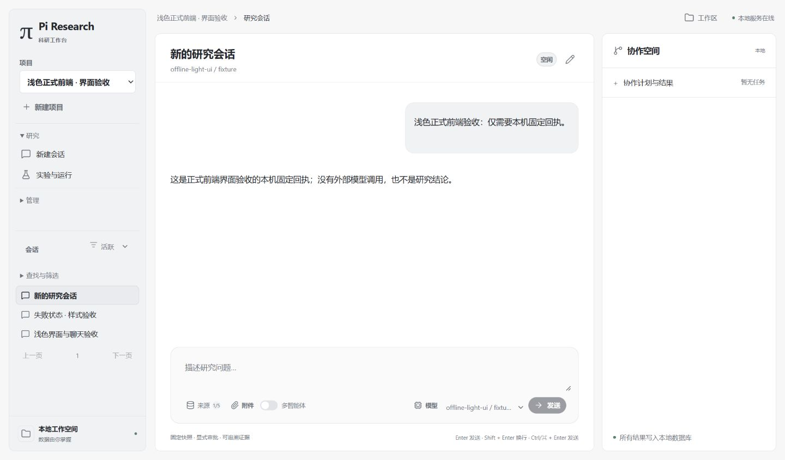
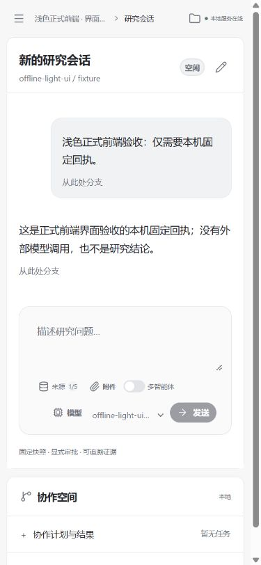

# 浅色方案正式接入

2026-10-04，用户指出此前浅色只停留在预览。本批将已确认的浅色、Codex 风格聊天、列表与 Lucide 图标接入真实 React 前端及发布目录。

## 实际变化

- 正式 `index.html` 在原四份样式后加载 `light-workbench.css`，使用中性灰白画布、白色阅读区和墨色主操作。
- 保留原布局样式、栏宽、断点、导航分组、工作区入口及输入工具栏顺序。用户气泡、助手正文、输入框和列表采用已定样式。
- 真实消息的失败、移出队列、截断、附件、原文、分支、重试和通知类别保留；只弱化指定作者/时间，未隐藏整行状态。
- 图标以固定 Lucide 版本的 inline SVG 接入，保持 `name`、`size`、未知图标回退及 `currentColor`；没有新增运行时依赖。

## 验收

1. 编译后的真实前端加载最后的浅色样式，实际 CSS 变量为 `--canvas:#f7f7f8`、`--green:#292d35`。
2. 1280×720、1440×844、1024×844 的侧栏、顶栏、主区域、协作面板与原基线矩形一致；输入框和左右工具栏尺寸、位置保持。390px 的原导航与来源浮层可用。
3. 使用同一份正式 `dist/web`、独立合成项目和本机固定 SSE 供应商，通过真实 Pi 内核验证发送与回执；失败标记/分支/重试可访问，归档保留历史并禁发，同会话查看工作区后草稿保留。
4. API、后端、数据结构、授权、默认模型及历史控制未改。既有两份基础 CSS 和三份在途文档的批前后 SHA256 一致，未纳入提交。

## 验证状态

首次全量回归共 1036 项：1006 通过、7 失败、23 跳过。7 项失败来自新图标使用 React Fragment，而既有严格节点渲染器只支持原生/函数类型。将图标分组改为 SVG `g` 后，实体构建与全部 174 项受影响 UI 检查通过；测试和断言未修改。未重复不受影响的完整检查。

干净安装、构建和类型检查通过；507 个发布文件与隔离干净构建逐字节一致。独立 Sol 只读复核无阻断。实体 IME、读屏器/axe、外部供应商和 Docker 路径未在本批重新实测，不能记为通过。

原日志与隔离数据留在 `.validation/ui-light-2026-10-04/`，精简记录见 [evidence.json](evidence.json)。科研数据、认证文件、原生对话及完整日志未提交。

## 运行入口

当前工作区的 `http://127.0.0.1:4794/` 已实际返回新浅色 CSS，浏览器计算样式已核对。`4795` 是旧的设计预览入口。独立 `4796` 用于读取同一正式发布目录的合成验收；本批没有重启或停止原有服务/模型任务。

另一个现有 `4317` 实例仍返回访问令牌页，未提供新浅色 CSS（404）；它不作为当前工作区接入验证的依据，也未被本批重启或修改认证策略。

