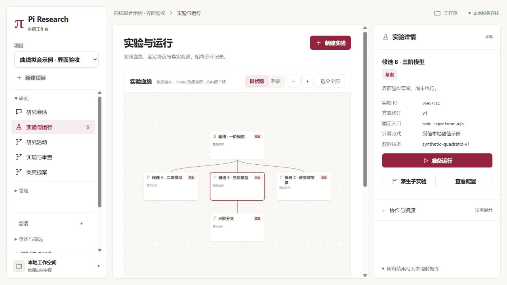

# 本机工作台免访问令牌

2026-10-02按用户请求去掉本机访问令牌。普通本机地址直接打开工作台，API、事件流、产物读取和下载、CLI request均不需要Bearer头；启动地址不再包含令牌片段。

服务继续只监听127.0.0.1，并保留Host白名单、Origin同源、JSON写入、幂等及原有业务权限与审批。新增Fetch Metadata跨站拒绝覆盖静态页、健康接口、API、SSE和下载；无此浏览器头的本机CLI可以使用。供应商API密钥、Worker身份与租约不变。

旧access.token文件不读取、不删除或覆盖；新服务不再生成。历史备份仍排除遗留凭据，恢复目录无需新发令牌。浏览器分别清理自身旧storage键及启动URL的token参数，保留其它片段和history.state。

相关检查44项通过；独立复核发现CLI旧读取路径后补齐修复，实际CLI请求和相关34项通过。集中894项中870通过、23跳过、1项历史catalog仍期望401；按本批目标更新该机制断言，保持其来源、历史和路径隔离断言，受影响15项通过。最终干净构建输出一致，数量见机器证据。Astra限定复核无新增阻断；原日志留本机。

当前4794预览在确认无活动任务后使用原数据目录更新；新标签直开、原2项目及旧令牌链接首次清理已验证，页面无可见错误。其它控制器或模型未重启；旧服务需在任务空闲时自行重启以载入服务端改动。

[机器证据](evidence.json)
