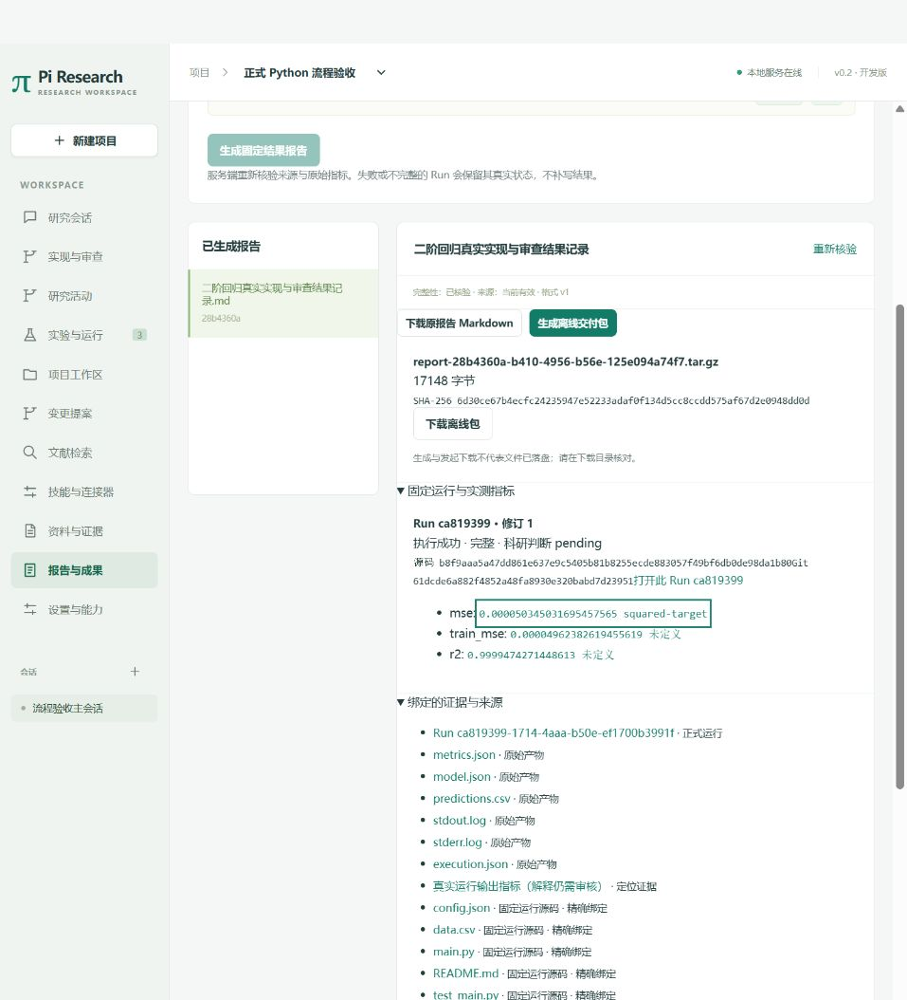

# 固定结果报告与离线交付验收

2026-09-28。本批完成 PR09 的报告证据联动和 PR12 的本地成果包部分；PDF/LaTeX、完整文献版本、远程发布及其余 PR01–14 范围没有缩减。

## 新增可用能力

“报告与成果”页面从选定的真实终态 Run、当前有效的已采纳 Claim 生成不可变 Markdown 和固定引用清单。点击具体指标可查看原始指标证据及定位；同页可读取固定 CAS 源码、测试作业和日志、独立审查，并跳到准确的历史 Run。正文与引用内容按纯文本展示，不把任意 URL 或 HTML 当作导航权限。

报告区分生成时记录与当前适用性。输入或审查撤销、文件篡改后，历史正文不改写，页面重新核验并阻止新导出。祖先测试/审查只标为历史血缘，实际源码摘要完全相同才标为精确绑定。旧版报告仍能阅读，但不会补造过去不存在的固定绑定。

用户可显式生成本地 tar.gz 包。包包含原报告、可读清单、固定源码及归档证据；不扫描可变工作区、数据库或会话目录。原生 tar 在 SQLite 写锁之外运行，压缩前后复核字节和来源，发布前再做版本检查；同一请求只发布一份产物。输入含清单限 30 MiB，最终包限 32 MiB，超限明确拒绝。

## 真实浏览器与文件证据

使用上一批真实 Pi 与 Docker 结果，未新造实验数字，也未启动模型代写报告。操作由 Codex 通过本地工作台完成。

| 对象 | 本次绑定 |
|---|---|
| 报告 | `28b4360a-b410-4956-b56e-125e094a74f7` |
| 正式 Run | `ca819399-1714-4aaa-b50e-ef1700b3991f` |
| 源码 SHA-256 | `b8f9aaa5a47dd861e637e9c5405b81b8255ecde883057f49bf6db0de98da1b80` |
| 正式源码 Git commit | `61dcde6a882f4852a48fa8930e320babd7d23951` |
| 实测 MSE | `0.000050345031695457565` |
| 成果包 | 17148 字节，20 个普通文件 |
| 成果包 SHA-256 | `6d30ce67b4ecfc24235947e52233adaf0f134d5cc8ccdd575af67d2e0948dd0d` |

浏览器已验证报告生成、MSE→原始指标及 UTF-16 定位、固定 `main.py`、成功开发测试和 stderr、独立审查、精确 Run 跳转，以及刷新后恢复报告。390px 窄屏通过原生键盘完成跳转与回查，内容宽度没有超过可用宽度；临时视口已复原。控制台错误为 0。

[成果包](research-result.tar.gz)已实际解包，全部 20 个文件与清单及当前固定引用逐字节核对一致，逻辑文件模式保留在清单中。[原始报告](report.md)、[完整绑定与解包验证](live-evidence.json)、[浏览器记录](browser-evidence.json)随本记录保存。报告原文保留工作台的类型化引用 ID；离线可通过清单定位包内对应文件。

## 检查与审查

- 统一回归：416 项，413 通过、0 失败、3 明确跳过；这是收口路径检查修复前的全量结果。
- 独立审查发现 1 项 P2：失败 Run 的 `execution.json.error` 可能夹带宿主路径。已增加导出拒绝检查，原始归档不改写或静默遗漏；独立复核确认该项关闭。
- 收口修复后，报告/真实 tar 导出相关 **14/14**，HTTP/CLI/输出契约相关 **9/9** 通过；没有重复运行无关全量。相关负例覆盖转义宿主路径、当前凭据、私钥格式、跨项目、篡改、撤销、祖先审查、重复请求、归档历史和包大小。
- 最终干净安装、构建、类型检查成功，**290 个 dist 文件完全一致**，清单摘要 `76cd4f5f95d6e85af38e2012d5f3d8360ce2d10ac22a1f81b4c6e81c53de53e3`。见[验证摘要](verification.json)。

## 环境与保留边界

浏览器已发起下载，但 5 秒有界下载事件检查仍超时，未确认浏览器的实际保存路径。服务端真实包已独立解包验证并保存为上方可直接领取的成果包；不把这一证据冒充浏览器落盘成功。

敏感内容检查覆盖当前配置凭据、常见凭据格式、已知宿主路径和常见 JSON/Unicode 转义；这是有限规则检测，不能保证识别任意混淆编码或所有无标记的 POSIX 路径。Windows tar 不可靠地保存执行权限位，包内模式清单是恢复依据。本批不自动上传、发布、执行包内代码或恢复文件。

本任务仍使用固定合成数据。测试通过、审查意见及退出码都不构成科学结论；上一批 reviewer 对日志流的文字误述保留为历史原文，原始 stdout/stderr 可分别回查。

