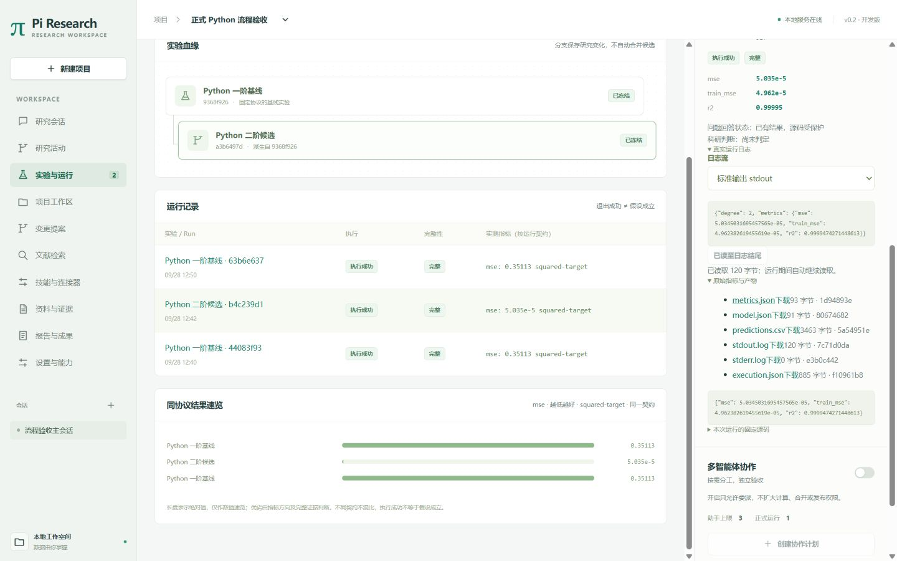

# 流程批次：批准正式运行与结果回查

2026-09-28，开发基线 `7367bf3`。范围按 [DELIVERY-FLOWS](../../DELIVERY-FLOWS.zh-CN.md) 固定。本批打通后半段用户流程，不代表实现、开发测试及独立科研审查已全部在同一浏览器旅程中完成。

## 可用能力

用户可在工作台使用字段表单创建 Docker 实验，填写固定镜像、argv、数据/评估协议、指标、必需产物和资源。子实验继承父协议。准备 Run 后显示固定快照、镜像、命令与资源，再由用户批准并提交；开发测试批准不会代替正式批准。

正式 Docker Run 已通过独立 supervisor 执行，使用稳定容器名、ID、所属标签和持久 startRequested。预检、创建、查询及停止在 SQLite 写事务外执行；真正启动前重新核对批准及 generation。重启先查询同一容器，不能确认的状态保留占位，不重复 start。旧的 trusted-example 也通过真实适配器运行，宿主白名单边界保持。

Docker 源码只读、工作副本与输出分开、默认禁网、非 root、有限资源，复用开发沙箱的基础实现。stdout/stderr 存在容器不可写的 control 目录，按流和字节游标读取。RunService 从实际普通文件归档后决定完整性；缺必需产物、日志中断和不确定恢复不能形成完整成功。退出码、metrics 和科研判断仍是不同字段。

工作台可选择历史 Run，查看双流日志、原始 metrics/模型/预测产物，并从该 Run 的 CAS 快照读取源码。后续实验目录修改不会改变这些内容。Git 映射若在 Run 准备后完成，只在 sourceDigest 精确相符时补充回查链接，不重写已批准 Manifest。

## 真实执行与浏览器证据

固定本机镜像：`python@sha256:f77ac9e44ae96ef2c90b8053ea08c31f8be030f824196b0ae4db6d462c84e51f`，Docker context `desktop-linux`，Linux CPU 路径。

[正式服务端到端记录](formal-live-evidence.json)实际经过 ResearchApp、实验契约、批准、submit、独立后台 supervisor 和归档。新增 Python OLS 程序不在宿主示例白名单中。实际覆盖：未批准不启动、真实指标/预测文件、控制对象关闭再打开、缺产物、真实 stderr、取消、超时、杀掉所属 supervisor 后恢复同容器且计数为一次、来源篡改阻断。恢复日志不确定时明确 incomplete。

[浏览器操作与归档记录](browser-evidence.json)使用另一份固定合成二次数据及 Python 标准库拟合程序。源码与数据由验收夹具提供，未冒称为模型本轮生成的科研成果。浏览器实际创建协议、批准、运行和回查：

| 实验 | Run | 实测测试集 MSE | 完整性 |
|---|---|---:|---|
| 一阶基线 | `44083f93` | 0.3511265525724083 | complete |
| 二阶候选 | `b4c239d1` | 0.000050345031695457565 | complete |
| 一阶复跑（检验历史选择） | `63b6e637` | 0.3511265525724083 | complete |

两种阶数使用相同契约与固定 180/60 划分。这里只证明流程真实执行与证据可回查，不推论外部科学问题。源码预览确认基线仍为 degree=1、候选为 degree=2；Git/CAS 均可定位。第二次基线运行完成后，选择第一次 Run 并刷新，仍保留原选择。控制服务重启后，结果继续可读。

可复验输入已从实际 Run 快照保存至 [fixture/base](fixture/base/main.py)（程序、原始 CSV、基线配置）；[候选配置](fixture/candidate/config.json)只改变阶数。它们的文件摘要可与 `browser-evidence.json` 中的固定清单逐项核对。导入 base 目录后使用上面的固定镜像、`python main.py` 和 `metrics.json / predictions.csv / model.json` 必需产物即可复跑，再以候选配置派生子实验。

[390px 窄屏截图](narrow.jpg)显示历史 Run、实际指标和日志控件；Tab 可进入日志折叠控件。另检查 320/768/1024/1440 尺寸，768 以上未发现页面水平溢出；320 下存在 15px 的旧最小宽度边界，记录后续。

浏览器首次切换 Docker 表单暴露了真实 vendor React 16.0.0 不支持 Fragment 的白屏，已用普通容器修复，未展开框架升级。修复后本次页面检查没有 console error。下载事件监听等待超时，实际保存文件未验证；原始产物的页面预览和受认证 API 内容读取已验证。该自动化限制单列，不用 DOM 按钮存在代替下载落盘证据。

## 统一收口验证

- 开发阶段只运行相关契约、适配器、监管和 UI 检查。
- [统一单元/集成回归](integration-tests.txt)：381 pass、0 fail、3 skip。跳过为 POSIX 原生权限位、默认关闭的两项 Docker live 检查；真实 Docker 服务链另行启用执行。
- 正式 Run live：8/8，通过证据见上述 JSON；可信宿主程序、开发沙箱相关回归保持。
- [固定基线及无依赖启动](parity.txt)：4/4。
- [干净构建](clean-build-summary.json)与 [dist 文件摘要](dist-manifest.json)验证同一源码和锁文件可重建。
- 收口审查未发现阻断本批主流程的权限或恢复问题。真实源码查询、精确目标、独立监督、日志归档与旧接口兼容均已核查。

## 后续项与环境边界

1. 主路径剩余：工作台选择私有实现来源、真实 Pi 实现/开发测试、独立科研审查与批准整合，随后接回本批正式 Run 页面。
2. 非阻断日志边界：取消/超时且日志恰好满额时，末尾诊断 marker 可能在完整性计算后触发截断，形成 failed/cancelled + logTruncated + complete。不会成为 succeeded 比较结果；PR07 收尾应统一这处完整性计算。
3. 浏览器下载落盘自动化、320px 最小宽度及遗留 `v0.2` 角标另列 PR09；角标不是当前源码基线，源码基于用户提供的 v0.3.1。
4. 宿主磁盘硬配额、跨目标并发、GPU 与远程后端未在本批验收；不把本机 CPU 成功外推为这些能力可用。

完整 PR01–14 未删除，整体目标仍未完成。
