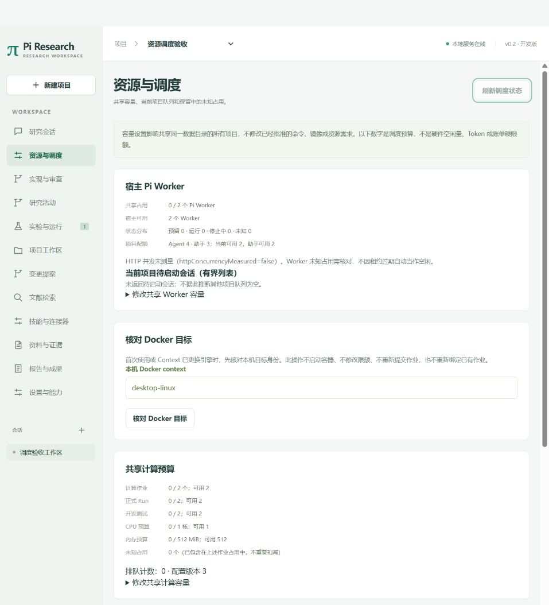

# 资源调度：明确排队、容量与恢复

2026-09-28。本批完成 PR07 的共享资源队列、Pi Worker 槽位及相应工作台流程。固定验收条件见[交付顺序](../../DELIVERY-FLOWS.zh-CN.md)；PR01–14 完整范围保留。

## 新增可用能力

正式 Run 和开发测试共用持久计算队列，按作业数、CPU、内存及目标预算原子领取。两个控制服务共享同一 SQLite 时使用同一份预留；租约过期、失联或未知结果不被当成空闲。终态观察才释放计算资源。当前默认保持正式 Run 1 槽、开发测试 1 槽、总计 2 槽；CPU、内存、排队数量默认未设置额外预算。

Docker context 别名按真实 engine 身份共享目标额度。启动与恢复时复核绑定；context 改指新引擎不能据此认定旧容器已消失。旧活动作业只有核对实际容器身份后才绑定目标。用户可显式核对新 context，避免目标零排队额度阻断身份解析；这一操作不启动任务、不修改旧预留。

Pi Worker 槽位独立持久化，服从全局、项目和团队额度。任务结果提交后等待进程实际退出才释放；已请求启动但结果不明时保留占位。未请求 fork 且无 PID 的过期槽位可释放，旧 owner 无权随后启动。尝试预算与 Worker 槽位分开，不自动重试可能付费的模型请求。

“资源与调度”页面由服务端返回占用、剩余额度、未知占用、队列原因和版本。用户显式保存配置，旧版本冲突保留编辑草稿；配置不修改已批准的执行契约。Run 与开发测试页也显示等待状态。CPU/RAM 是调度预算，Worker 数不是模型 HTTP 并发或费用上限。

## 真实流程与证据

所有本批计算均为固定验收程序，不构成科研结论，没有新增模型调用。Worker 故障与槽位检查使用明确标记的真实子进程 IPC fixture，不冒充真实模型响应。

| 验收路径 | 观察结果 |
|---|---|
| 两控制进程竞争共享 1 核 | 正式 Run 占用时开发测试保持 queued；采样最大 1 个作业、1 核；同一数据目录关闭并重开控制服务后仍只运行原容器，之后开发测试成功 |
| 正式 Docker 回归 | 8/8 通过，覆盖关闭控制服务、取消、超时、监管恢复及不重复启动 |
| 开发 Docker 回归 | 12/12 通过，覆盖隔离、语法/断言失败、取消/超时、失联恢复、日志及产物限制 |
| 工作台批准两类任务 | 显式把总作业额度设为 0 后，两项已批准任务留在队列；恢复为 2 槽、保持 1 核后顺序完成 |
| 完成结果回查 | Run `69046c81…` 成功且完整，实际 sum=5050；开发测试 `295bed01…` 成功且完整，stderr 为 Ran 1 test / OK；两者均释放预留 |
| 刷新和窄屏 | 配置版本 3 刷新后保留；Worker 2→1→刷新→2 由键盘完成；390px 无横向溢出，临时视口复原，console errors=0 |

工作台 Run 与开发测试共用源码 `aeb3a7585ffd34d902f92a867d9a3ffa440d00c9c1789fa10b47ab06f92af3da`。Run 在 08:08:36.655 UTC 完成，开发测试在 08:08:42.178 UTC 启动。已直接核对归档 metrics 和 stderr 的原始字节及摘要。浏览器保存了等待和完成后的截图；短暂的“运行中＋等待中”转换未截图，不用截图冒充这项证据，跨控制器采样单独记录。

详见[真实运行证据](runtime-evidence.json)、[浏览器与字节核验](browser-evidence.json)及[迁移检查](migration-evidence.json)。迁移前已保存数据库备份；145 条旧记录中 144 条逐字节一致，另 1 条原 Git 工作区租约正常续期，仅期限、版本和更新时间变化，owner、generation 与分支不变。既有源码、审批、Run 摘要和报告没有改写。

首次开发 live 执行 `.validation/development-live-9sxbLt` 有失败：测试在关闭 AgentHost 后只驱动一次队列，未持续执行异步目标探测后的调度。已修测试等待循环，使裸 ResearchApp 持续驱动调度；没有放宽超时或伪造状态。修复后单独重跑 12/12 通过，失败目录保留，不计为成功证据。

## 查询规模与性能

固定合成数据：20,000 条终态、64 条排队、2 条占用。计算队列使用投影和定向索引，候选和活动记录有界读取；旧终态 JSON 不被轮询反序列化。100 次查询的本机结果：

| 操作 | p50 | p95 |
|---|---:|---:|
| inspect | 8.72 ms | 16.87 ms |
| Run 候选 | 0.91 ms | 1.36 ms |
| 开发测试候选 | 1.16 ms | 1.60 ms |

进程 RSS 约 91.8 MB、heapUsed 约 11.6 MB；另一个连接持有 200 ms 写锁时，测得等待约 250.9 ms。保留 EXPLAIN、规模和摘要，见[性能证据](performance-evidence.json)及可重跑脚本 `scripts/benchmark-scheduler.mjs`。此数据仅覆盖计算队列，不是全站性能或相对旧版的加速倍数；真实 Docker 身份检查会增加外部 CLI 开销。

## 验证与独立审查

- Registry 63 个精确输入/输出动作，新增容量与目标探测仅向 owner 开放；版本、幂等、分页及权限边界已验。
- 最终统一回归：444 项，441 通过、0 失败、3 明确跳过（两个 opt-in Docker 单测及 Windows 上的 POSIX 权限检查）。实际 Docker 另由上述 live 套件验证。
- 独立审查发现 2 项 P2：未 fork 的过期槽位无法释放、零排队额度下未知 context 解析自锁。均修复，相关检查进入全量，两项都经独立只读复核关闭。
- 干净 npm ci、构建及类型检查成功，303 个 dist 文件完全一致；清单摘要 `c4995101af806b716f43ebc495e93635469ff73ac590a20b851ab50ddd1877e5`。见[验证摘要](verification.json)。

## 保留范围

本批只保证共享同一数据目录/SQLite 的控制器，不宣称跨机器分布式容量一致性。无法证明是否仍活跃的旧 Worker 或未知作业继续保守占位；无 PID 且已请求启动的历史状态需要核对。没有新增强制释放未知任务的按钮。

PR07 的模型 HTTP 请求级限流、全站事件/SSE 背压与 cursor 恢复、其余历史列表分页/虚拟化、有界日志全面迁移，以及硬磁盘配额、自动清理、其他远程/GPU 目标仍待验收。PR08 收益对照、PR09 完整迁移、PR10 文献、PR11 技能、PR12 论文、PR13 远端、PR14 分发均保留。本批不因非阻断问题扩大范围。

