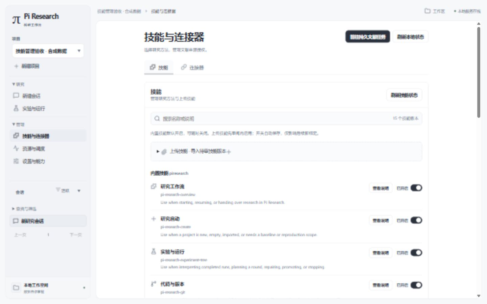

# 技能管理与默认目录迁移

2026-10-06；基线 `d0d7b871bbd4d10459bbca43eef2959293cbc6eb`，工作分支 `implementation/pr01-reproducible-baseline`。

技能页统一展示内置与上传版本，支持搜索、上传、原文与资源查看、审阅、开关和上传版本删除。内置默认开启，开关自动保存到固定 Bundle。发行切换仍需显式保存；已固定会话和任务使用原配置。删除移出管理列表并移除后续启用配置，原文、审阅和历史固定包保留；撤销仍阻止启动。连接器保持原授权、检索和历史流程。

当前默认技能从 `skills/openresearch` 移至 `skills/piresearch`。29 个正文与资源字节不变，旧发行归档 60 个文件不变；路径变更发布新发行 `344a44dcf73a8bcb2b2cdf5acf637f756c1763ef05c5ba464bc8285fa45a188b`，来源与许可保留。

## 验收条件与结果

1. 内置、上传列表与原文可查看：通过。
2. 上传待审、批准后启用、关闭、删除可走通；过期版本、跨项目、未审阅输入失败无部分写入：通过。
3. 内置关闭、刷新保留、重新开启及后续新绑定有效：通过。
4. 迁移后读取、摘要与路径检查有效：通过。
5. 旧会话、任务重试、发行字节及连接器流程保留：通过。

## 实际检查

- 修复前：新 UI 三项与后端三项回归分别实测失败。独立复核再发现“开关联带保存发行草稿”和“多个已撤销版本无法逐项关闭”；新增回归在修复前分别失败。
- 集成构建、类型检查通过。首次相关 57 项全部通过、无跳过；必要修复后相关 44 项全部通过、无跳过。
- 全量 `npm run test:core` 实际为 1103 项：1079 通过、1 失败、23 跳过。唯一失败是登记操作数仍断言 138；本批增加删除接口后改为 139，键集合一致性与示例校验未削弱。该文件定向复验 9/9 通过。保留原失败日志，没有重复无关全量检查。
- 干净副本 `npm ci`、构建、类型检查通过；必要修复后同步两个源文件重建，524 个产物与交付 dist 完全一致。
- 独立 Astra/xhigh 复核及必要修复局部复查通过，阻断清零。检查删除事务、历史恢复、固定包摘要、未来启用与运行读取边界；复核锚点见 evidence.json。
- 浏览器使用独立合成项目，走通 filechooser 上传 SKILL.md、待审不能启用、读取原文、批准、启用、关闭、删除；内置关闭刷新保留并可重新开启；连接器开关切换后恢复。1440、1024、768、320px 无页面或技能行横向溢出，页面错误/警告记录为空。请求使用量、观测、检索、阅读均为 0。

没有运行真实模型、Docker 作业或外部文献查询；没有重启既有服务。23 项跳过保留原环境条件，不计为通过。旧运行服务须重新启动才能加载本批后端。

## 后续待办

会话显式选择器仍显示全局内置项，包含项目已关闭技能；后端拒绝保存这种选择，不存在读取绕过。本批保留为非阻断待办。

实施代理请求 GPT-6.1 Sol/high；关键复核请求 GPT-6 Astra/xhigh。调用接受参数，运行时未回显，不宣称实际模型/档位已核验。主会话配置未更改。

原日志、数据库及哈希清单保存在 `.validation/skill-manager-20261006` 和 `.validation/clean-build-2QMAK5`，不提交运行数据。用户原有五个在途文件未纳入本批提交。

