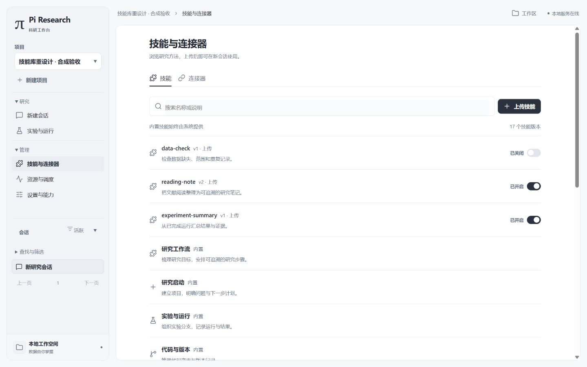
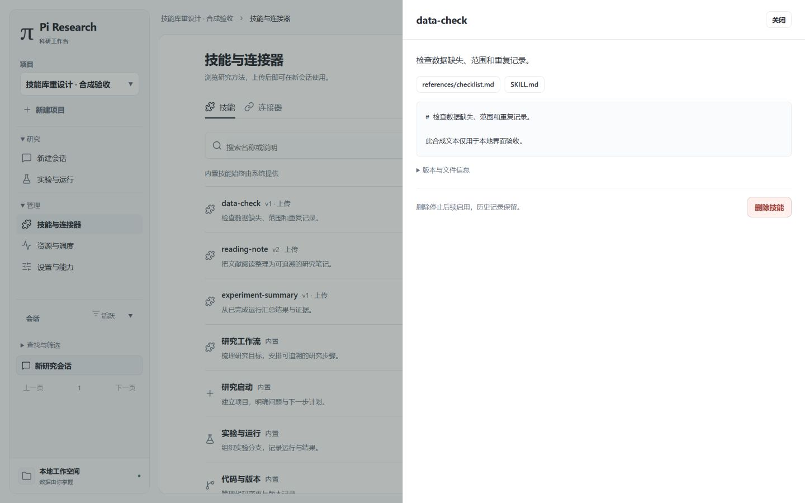

# 精简技能库与上传自动开启

2026-10-06；基线 `a00c3466cc00de20bef6218d105632a243180ffb`，分支 `implementation/pr01-reproducible-baseline`。

按用户最新要求，默认页面只保留搜索、上传、名称详情与自定义技能开关。中文简述替代重复技术说明，内置技能不显示灰色开关。原文、附加文件及删除放进单一原生详情侧栏；刷新、设置、审批、撤销、版本切换和预检按钮从此页移除，原后台接口与历史继续保留。

上传表单仅文件、名称和可选说明。用户一次上传即授权加载固定文本与静态资源并自动开启；这个授权不代表内容审查，也不增加工具、脚本、数据、计算或模型权限。上传、授权、配置和回执同一数据库事务，失败整体回滚；复用幂等键支持结果未知后的重试，成功清空原生文件选择和草稿，失败或取消保留。默认使用协调者角色，未声明的许可证保持未知，界面不推断文件中未解析的依赖。

本地状态复用 App 既有事件唤醒和 20 秒快照兜底；技能及连接器状态自动读取，后台刷新保留草稿与错误，并防止旧响应覆盖变更或跨项目。开启同名版本只替换未来配置，既有固定会话和技能包不改变。内置固定开启；旧禁用配置在活动项目打开时自动恢复，归档项目只读。

## 五项验收

1. 默认页面只显示必要控件，内置无取消入口：通过。
2. 上传后自动开启，失败、重复请求与输入边界正确：通过。
3. 无刷新按钮，本地和另一客户端变更自动同步，项目/响应隔离：通过。
4. 详情原文、资源、删除和历史可回查，授权不扩执行权限：通过。
5. 桌面与小屏无横向溢出，原生侧栏 Escape、焦点、草稿与成功复位可用：通过。

## 实际验证

新界面与自动上传回归在旧 dist 上实测失败。首次相关 62 项为 59 通过、3 失败：两个新测试夹具的问题（默认容量基线与不同请求误共用同一个幂等键）、一个详情空白匹配断言；必要修正后后端 9/9、界面 25/25 通过。

全量 1120 项中 1097 通过、0 失败、23 跳过，退出码 0。独立复核发现旧内置禁用配置缺恢复入口，已补自动恢复并通过相关 64/64 检查，无跳过；原全量其余结论适用，没有重复无关检查。恢复只清旧禁用并完整保留原自定义选择，失效自定义仍不能启动，归档不写。

干净 npm ci、构建、类型检查通过；必要修复后同步四个源文件重新构建，524 个产物完全一致。独立 Astra/xhigh 全范围复核与必要路径复查无剩余代码阻断。

实际浏览器使用隔离合成项目：原生 filechooser 带入名称与说明，一次上传即开启并关闭侧栏、清空表单；另一客户端关闭该技能，页面无需刷新自动更新；旧待审版本可直接开启；详情删除自动回列表，历史原文仍可读取。旧禁用项目打开后当前配置版本 1→2、禁用清空、内置 14 个；原固定会话仍保留旧包及 13 个目录项。

1440/1024/768/320px 主界面均满足 scrollWidth=clientWidth，内置输入控件 0 个、不必要可见按钮 0 个；320px 下根宽 305px、详情宽 304px、正文宽 289px，均无横向溢出。Escape 关闭侧栏并返回原名称按钮焦点，附加 SSH 资源可读。页面错误与警告为空，文献外部请求计数、检索、阅读均为 0；此页验收未启动实际科研模型或计算作业。

实施请求 Sol/high（前端）与 Astra/high（后端），独立复核请求 Astra/xhigh；参数已接受，运行时未回显，不宣称实际配置已核验。主会话配置保持。旧研究服务未重启；验收只重启了本批独立临时服务，正式服务需重启加载新后端。

原日志、数据库与完整机器证据留在 `.validation/skills-library-redesign-20261006`、`.validation/clean-build-1gvz7v`，未提交运行数据。用户五个原有在途文件不纳入提交。

