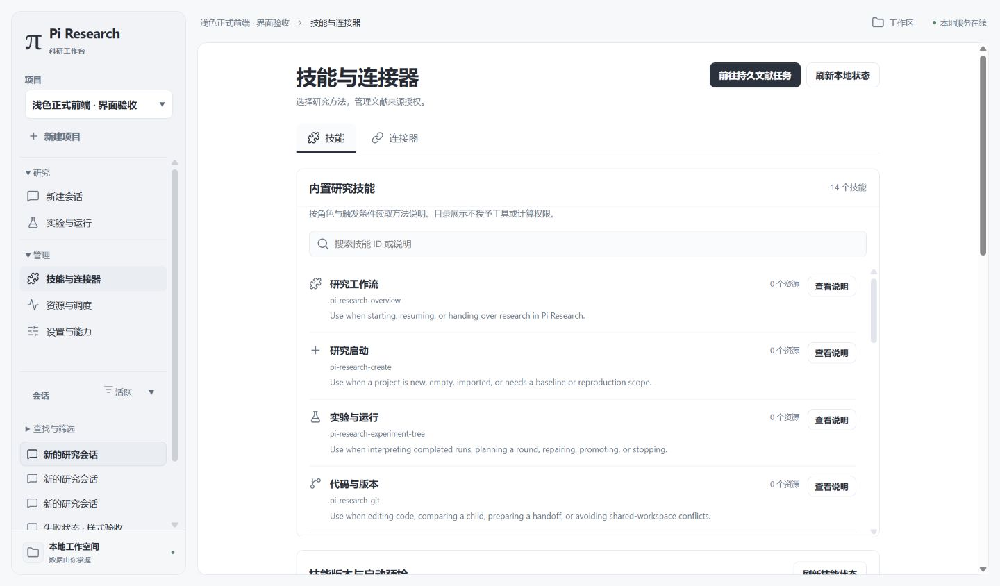
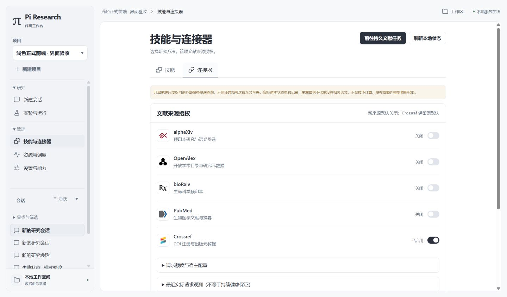
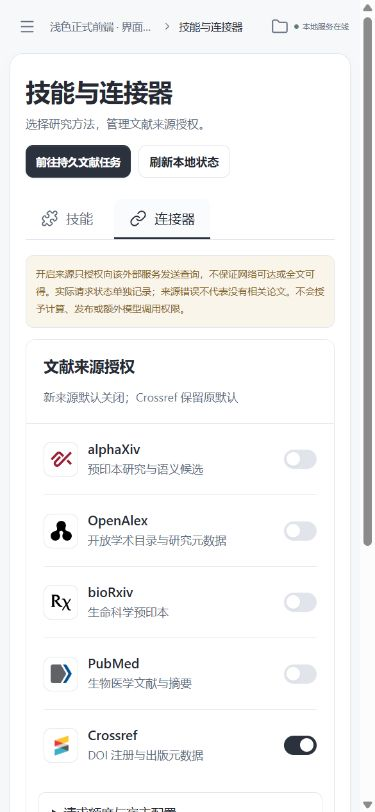

# UI-SKILLS-09 · 技能与连接器页

基线：`b09c11c41a00bcad8820e3a5a27f4b7c1402a9fa`。用户明确恢复该页面内部重设计；外侧导航、聊天、工具位置保持。沿用浅色石墨配色、React 与原生 CSS，没有新增依赖或后台接口。

## 参考与设计

核对官方固定版本 `alphaXiv/OpenResearch@3037f727e80e0ab20c61a87c613a50dde009a835` 的 [SkillsTab.tsx](https://github.com/alphaXiv/OpenResearch/blob/3037f727e80e0ab20c61a87c613a50dde009a835/ui/src/components/SkillsTab.tsx)、[LitSourcesPicker.tsx](https://github.com/alphaXiv/OpenResearch/blob/3037f727e80e0ab20c61a87c613a50dde009a835/ui/src/components/LitSourcesPicker.tsx)。该版是 Customize 页与聊天来源选择器，未找到独立合并页面或该页公开截图；本批适配其 840px 居中阅读列、细边框卡片、紧凑技能行及 logo/开关结构，不宣称逐屏复刻，也未引入上游模板或自动技能行为。

“技能／连接器”页签支持键盘切换，两面板保持挂载。技能提供中文名称、本地搜索、说明和原资源入口；导入、固定版本配置、会话预检仍使用原逻辑。保存配置按钮保留在修订列表之后，明确保存才生效。版本哈希和细节用原生折叠查看。

连接器以五个已存在的来源 logo、名称、介绍和授权开关排列；授权状态不表示健康。额度、宿主配置标志、最近观测、兼容检索、内容层级、记录和能力边界可继续查看。没有移除接口、密钥边界、许可证、未知能力或固定历史说明。

## 固定验收条件

1. 页内结构参照上述资料重新设计，桌面与手机清楚可读，外 shell 不变。
2. 导入待审、原文审阅、显式启用、固定版本配置、会话选择预检完整，原审批、撤销、许可证、资源校验和历史绑定规则不变。
3. 只有明确授权/检索行为才产生相应外部查询；不把授权当健康，预算、错误与历史信息保留。
4. 页签间保留草稿与选择，项目切换隔离及迟到响应保护不变，重开保留服务端配置，不启动额外模型或新能力。

## 验证

相关界面检查 16/16 通过，无跳过；原 10 项检查保留，新增 6 项覆盖页签、中文本地过滤、组件 key、精确授权 payload、文本安全与撤销后取消勾选。全量 1051 项中 1028 通过、0 失败、23 跳过，退出码 0。干净安装、构建及类型检查退出码均为 0，508 个分发产物一致。

实际编译页面使用 4796 合成项目：待审勾选禁用，读取固定原文并写理由后批准，再显式勾选与保存；会话选择后预检通过，既有原生会话 Bundle 保持。页签切换保留导入包 ID、检索草稿、原文与理由；重开后配置仍选中。来源开关切换后恢复，请求使用量与检索/阅读记录保持 0，没有外部请求。

1440×844、1024×844 的外侧导航、顶部栏、主面板位置与尺寸无偏移。390×844 的外侧位置及宽度保持，无横向溢出；页内重排会改变手机内容高度，未声称该高度保持。键盘 ArrowRight 切换并聚焦页签，仅一面板可见，五个本地 logo 正常加载。

独立 Astra/xhigh 复核确认旧业务方法与关键控件条件保持；实际许可值仍在审阅区，权限说明可展开。4794 已打开新页面，实际 main.js 与新样式的 HTTP 200 哈希匹配本批产物。原始日志与机器证据摘要见 [evidence.json](evidence.json)。

未运行物理文件选择器、其他浏览器引擎及真实外部文献查询。导入表单文件编码/范围由原单元检查覆盖；GUI 导入数据通过原业务 API 播种，不冒充物理上传。五个在途文件仍不暂存，未重启服务、启动模型、删除历史或改写真实研究数据。

