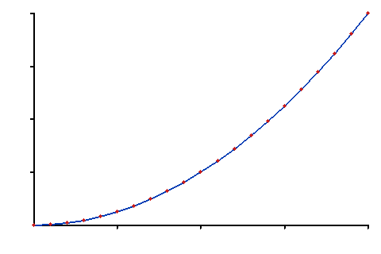

# 技能审阅、固定版本与启动预检

2026-09-28。本批实现并实测 PR11 的技能管理、运行绑定及一个真实图形产物流程。固定条件见[交付记录](../../DELIVERY-FLOWS.zh-CN.md)；原生文件选择器提交仍为环境待验，完整 diagram/paper 执行能力及 PR01–14 其他范围继续保留。

## 新增可用能力

用户可通过工作台/API/CLI 导入 SKILL.md 与文本资源或受限 ZIP，形成不可变 `SkillPackageRevision`；正文、资源、许可证声明、适用角色和工具/后端/数据需求都进入内容摘要。文件上限 64 个、每个 128 KiB、展开和压缩包各 2 MiB、每项目最多 128 个修订。拒绝不规范路径、大小写冲突、父文件与子路径冲突、链接/特殊文件、压缩展开超限、非 UTF-8 文本，以及 `.pi`、AGENTS、hooks/扩展等配置路径。ZIP 只在内存解析，不执行或解包到调用者指定目录；当前仅支持普通 stored/deflate，ZIP64、多卷、加密及其他算法明确拒绝。

审阅与撤销分别留记录，决定绑定内容摘要。只有已批准的版本可启用；回滚切换配置指针，不改旧修订。许可证空值保持未知，文本审阅不授权执行脚本。脚本资源可作为文本保存和读取，执行仍走现有独立计算批准。

Session 与 TaskAttempt 固定 `skillBundleId`，任务上下文和按需读取使用同一包。新配置不替换已绑定会话，显式重试继承原尝试版本；旧原生 Pi 历史只有在绑定字段或既有事件能够证明唯一版本时才恢复，不能静默取最新版。撤销阻止后续启动，历史读取仍可解释。

能力预检仅对显式选用的技能生效，不让整个目录阻塞普通聊天。检查实际角色/自动分析工具列表、已有数据访问范围和后端条件，不增加权限。当前 Docker 预检只接受 `default` context 最近 30 秒的真实引擎观测；过期需显式核对目标，实际作业仍另做执行前检查。SSH/Slurm/LaTeX 等没有实现的后端明确缺失。缺条件时不创建 Worker、不消耗尝试额度。

## 真实 Pi、容器和浏览器

自有 v1/v2 验收技能分别要求 480×320 与 640×360 图形，使用相同包名、不同内容摘要。两个 ZIP 实际由 Windows `Compress-Archive` 生成，经 owner CLI 的 JSON 文件入口导入；服务保存的每个文件与 ZIP 原始字节一致。浏览器读取正文、资源与许可后批准 v1、启用并为会话显式选择；缺 Docker 观测时正确阻塞，用户在资源页核对目标后才发送真实 Pi 请求。

`zai-coding-cn / glm-5.3` 实际读取 v1 正文和参考资源，两次受控读取均返回 v1 bundle/digest；随后写入代码并保存开发任务 `cc40da8c…`。该 Pi 会话之后以 **`PROVIDER_FAILED: This operation was aborted`** 结束，没有成功的最终回复。保留这一真实状态，没有将它改为成功，也没有自动重发模型请求。

已经保存的代码和批准清单仍可独立审阅。浏览器批准并提交后，固定 Docker 作业 `a2e21ae4-d85f-4326-b91c-203536464dac` **succeeded / complete / exitCode 0**，实际生成三个必需产物：

| 产物 | 实测 |
|---|---|
| [figure.png](figure.png) | 480×320 RGB，2,021 字节；PNG 块 CRC、尺寸、21 个红色点及可见坐标轴独立核对 |
| [points.csv](points.csv) | 21 点，表头 x,y；逐行验证 x=i/20、y=x² 与有限值 |
| [figure-check.json](figure-check.json) | 协议 `acceptance-figure/v1`，尺寸/点数与实际文件一致 |

源码 [figure.py](figure.py) 与作业固定快照逐字节一致，sourceDigest 为 `235bd3dba62c79c540a9da8ad3efd7b1cdc831f6270ea19d3791aeed8a530a5f`。生成通过已有开发执行器完成，不是正式科研 Run，也没有新增通用宿主脚本执行入口。此次会话没有受管 Git/sourceRevision 绑定，不把固定文件快照说成已完成源码整合。

浏览器另固定第二个会话到 v2，随后回滚项目配置到 v1 并撤销 v2；新消息在启动前被阻止，第二会话 generation=0、agent starts=0、model-usage records=0。390px 下显示明确原因，内容宽度 375px；刷新后仍保持绑定与撤销记录。见[真实执行证据](live-evidence.json)和[浏览器记录](browser-evidence.json)。

独立的[真实 IPC 证据](ipc-evidence.json)进一步覆盖在途变化：实际仅 fork 一个子进程，两次 `research_skill_read` 都经过 Host/Dispatcher/Registry；中间启用 v2、撤销 v1，第二次仍读到 v1 摘要。旧进程完成后，新启动被拒，槽位已释放。该项明确不使用 SDK/模型，不冒充真实 Pi。

## 验证与剩余范围

独立审查发现一项 P2：原生 SDK `/skill:` 会绕过服务摘要校验，直接按 filePath 读可变文件。现已关闭共用 ResourceLoader 的原生技能注册，目录和受控读取保留；初始 prompt、steer、followUp 及历史恢复共用此边界。真实固定 SDK 的离线检查确认命令不会展开未审字节，独立复核关闭该问题。

首次统一回归 519 通过、2 失败、3 跳过，分别是旧通知夹具没有原生技能绑定证明、旧传输测试未将新增管理动作归为 owner-only。仅修正测试前提/分类，未放松产品边界；再次统一回归 **521 通过、0 失败、3 跳过（524 项）**。之后新增真实 IPC 检查 **1/1 通过**，未改产品源码。干净安装、构建、类型检查通过，**352 个 dist 文件完全一致**；末尾空行清理后的重建也与同一清单一致。见[验证摘要](verification.json)。

旧文档/报告数据库先做在线备份，在副本验证 78 条原记录字节不变，历史报告仍 current/verified；原库未修改，见[兼容记录](legacy-evidence.json)。

原生文件选择器的提交未确认成功：自动化定位没有可靠命中确认按钮，已用 Escape 结束，实际 ZIP 导入改经 CLI 完成；这项 UI 上传验收继续保留。本文图形为合成数据的软件验收图，不是科学发现或带完整标注的出版图。二进制技能资源、完整 diagram/paper 产物、其他后端与更大审阅历史分页未以本批代替；下一批推进 PR12 固定文稿的隔离 LaTeX/PDF 构建及错误回查。
