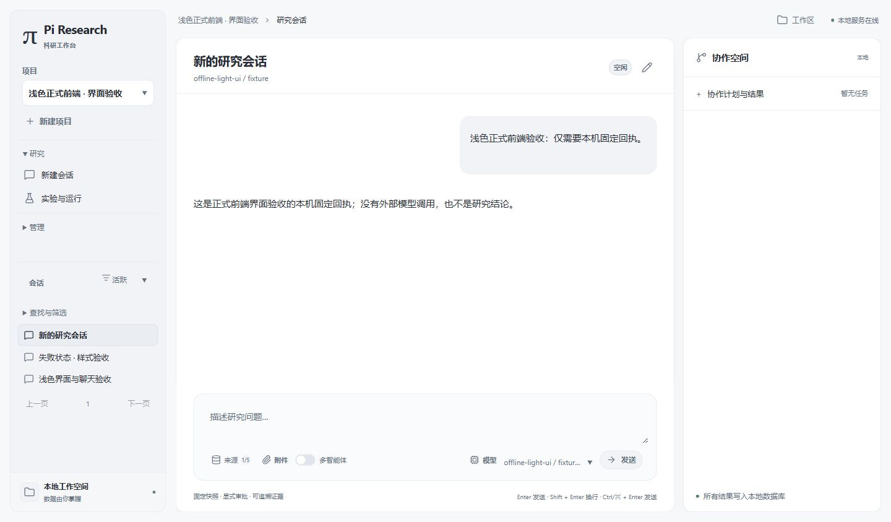
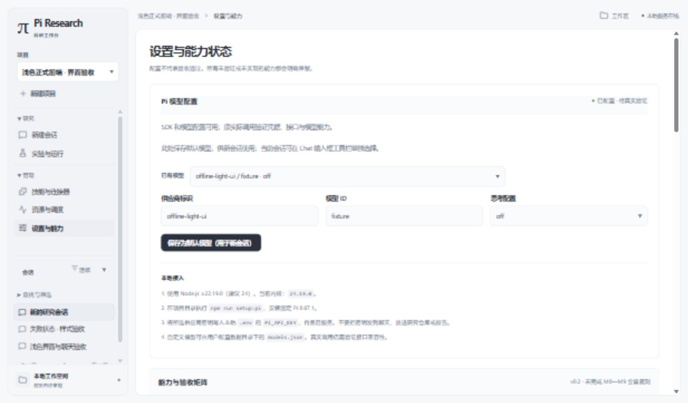
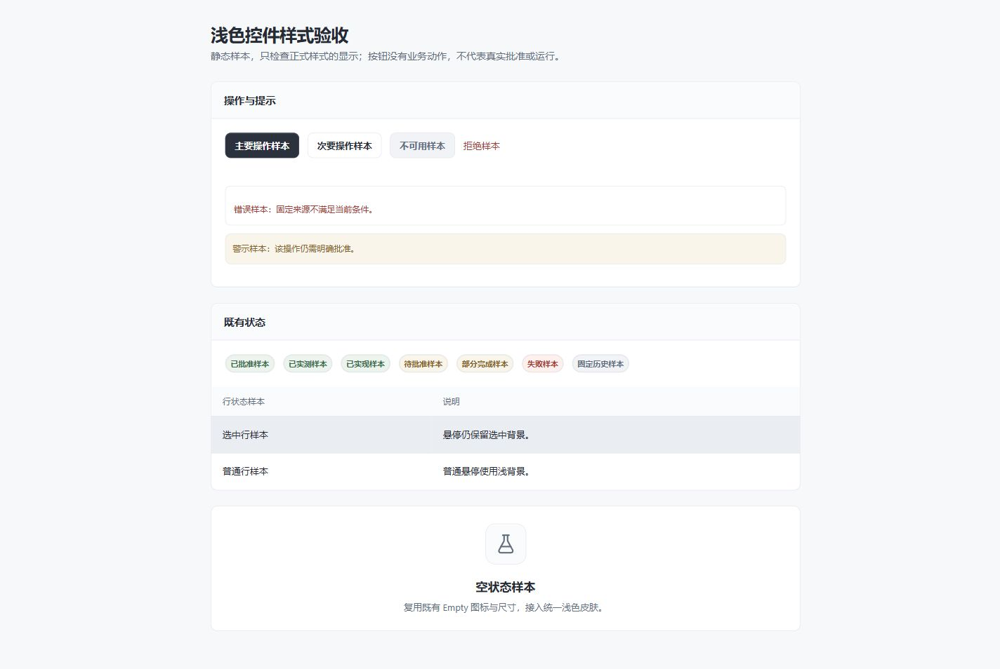

# UI-POLISH-07 · 浅色界面细节

基线：`309c4b382909fa713f226e7c2f2363fcf70744f7`。只修改最后加载的 `light-workbench.css` 及对应分发文件，没有 DOM、业务、依赖或布局重构。

## 验收条件

1. 聊天、既有工作区页面及共享控件保持统一浅色，面板、按钮、空态、列表及状态层次清楚。
2. 导航、筛选、草稿、disabled 与错误语义保持。
3. 1440×844、1280×720、1024×844、390×844 下主面板、输入区及原 select 的位置尺寸保持，键盘焦点与减少动态效果规则保留。
4. 正式 4794 页面加载本批编译皮肤，既有下拉增强和回退行为继续可用。

## 改动

- 收敛为冷灰背景与石墨主色，面板使用微阴影和柔和圆角；字号、字体族、间距及面板尺寸保持。
- 统一按钮 hover、按下及禁用显示；表单背景与焦点边框保持清晰。没有新增位移或缩放动画。
- 恢复已有成功、等待、危险状态的语义颜色，修正危险文本与任务错误被通用灰色覆盖的问题；表格选中行悬停继续保持选中背景。
- 清理空态图标、警示条与 inspector 的旧绿色残留。数据区域数字使用等宽数字，滚动条只调整颜色。

## 证据

核心回归：1036 项，1013 通过、0 失败、23 跳过，进程退出码 0。干净安装、构建、类型检查均退出 0，507 个分发产物一致。独立复核基于同一 CSS 快照。

四个视口的 44 项位置/尺寸对比均为 0；比较时保持相同导航展开状态。草稿切换设置页后保留，真实失败消息标记仍可见；键盘焦点为 2px 可见轮廓。模型菜单打开与 Escape 关闭验证通过。4794 实际返回 CSS 的 SHA256 与 source/dist 一致。

危险操作、错误提示、徽章和选中行使用正式 CSS 的静态样本核对级联；这些样本没有业务动作，不代替真实批准或执行流程。减少动态效果规则经 CSSOM 与独立读源核对，当前系统偏好为 false，未切换系统偏好。原生下拉回退复用前一批证据：相关 DOM、支持条件与尺寸规则未改；其他浏览器引擎未实测。

非阻断边界：等宽数字可能改变局部字符宽度；已限定数据区域，现有主布局无偏移，未扩展到所有带数据页面的逐字符比较。

机器摘要见 [evidence.json](evidence.json)。五个在途文件继续保留且不暂存；没有外部模型请求、服务重启或真实研究数据写入。

