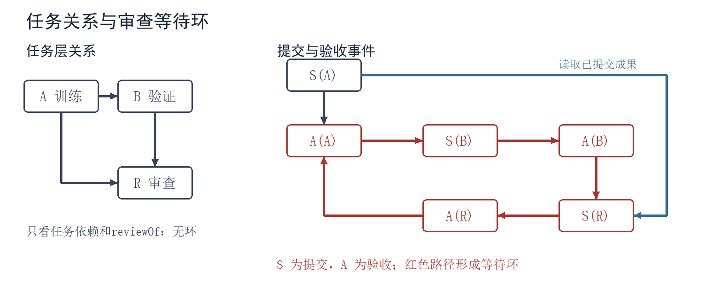
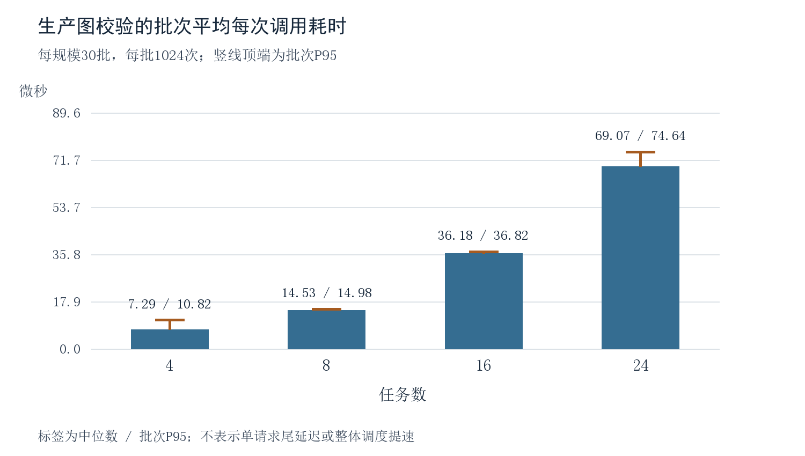

# 研舟π 可追溯科研协作智能体

2026 AIC AI与开源主题赛技术报告初稿

申报方向：开源赋能的AI应用创新。技术主线：基于双阶段依赖图的科研任务编排与证据追溯。版本日期：2026年10月25日。

本文依据当前项目代码与本批E1—E4实验撰写。机器学习任务名称和原文材料为自有工程夹具，不包含真实模型训练、模型性能测量或新的科学结论。团队名称、编号、成员分工和最终授权信息由参赛团队在正式提交前核实填写。

## 摘要

多智能体科研流程需要区分成果已经提交与成果已经通过审查。若把两者压缩为一个任务完成状态，任务图可能看似无环，却因审查依赖而无法推进。研舟π基于Pi执行内核实现科研协作工作台，将任务提交、成果验收和审查依赖分别表达，并在派发前检查事件等待环；执行阶段继续核对上游验收、并发、预算和授权。成果引用绑定固定原文及位置，以便回查来源和保留历史。

本批以机器学习流程为工程示例，在冻结工作副本上完成图校验、审查状态、校验开销和证据追溯实验。E1包含325个预先定义或固定种子生成的案例，生产校验接受82个合法案例并拒绝243个非法案例；弱任务图对照漏检81个审查等待环。E2的5个服务场景与E4的2组追溯场景均通过断言。E3的实测数据见第5章。这些结果支持本案例集合内的依赖建模和服务行为，不构成对任意科研任务的完备验证，也不代表机器学习精度、模型幻觉率或整体调度效率的提升。

关键词：科研智能体；任务依赖图；独立审查；等待环检测；证据追溯；可复现评测

## 1 作品概述

### 1.1 用户与问题

研舟π面向需要组织资料、分析数据、核对结果和形成报告的研究者。以机器学习项目为例，研究者先确定数据切分协议，再训练模型、检查验证方法、形成比较结果和撰写报告。训练程序执行结束不代表实验设计正确；分析文字生成完毕也不代表结论已经通过审查。系统需要表达这种区别，并在材料、任务和成果之间保留固定联系。

本作品聚焦三个具体问题。第一，研究任务及其审查任务之间可能出现不易从任务列表识别的等待环。第二，多个审查者尚未全部完成、意见冲突或者上游只有部分成果时，下游不应被提前放行。第三，资料更新后，过去的引用和报告仍应指向原版本；新检索资格、内容完整性和历史可读性需要分别处理。

### 1.2 作品形态与贡献范围

作品采用本地科研工作台形态，以Pi作为Agent执行内核，通过统一业务服务连接任务、资料、实验、审查与报告。本报告按官方赛题中的科研辅助应用方向组织[1]，以可运行机制、明确实现边界和可核验结果说明项目价值。

本项目的技术贡献集中在科研审查语义的任务建模、与实际服务一致的放行机制，以及固定来源的交付链路。DFS、词项检索、MMR等基础方法均有既有来源，不作为本项目原创算法申报。本批没有新增关键路径优先调度，也没有把不同模型的思考档位视为可直接比较的性能等级。

## 2 需求分析与总体方案

### 2.1 机器学习流程示例

正常流程可表述为：数据协议准备，训练任务，验证分析，独立审查，最终报告。这里的“训练”和“验证”在E1、E2中仅用于解释任务角色，提交内容由确定性夹具提供，不会启动训练程序。真实科研场景还需要固定数据集、切分、随机种子、模型源码和评价指标；这些工作属于后续E5演示。

任务之间存在两类消费关系。分析或报告任务消费已经验收的上游成果；审查任务消费已经提交、尚待验收的被审成果。如果审查者也被要求等待被审成果先验收，流程就会产生循环等待。

### 2.2 系统组成

| 组成 | 作用 | 本批涉及范围 |
| --- | --- | --- |
| Pi与模型适配 | 理解研究目标、规划任务、执行工具并返回结果 | 只说明架构，本批不调用真实模型 |
| 协作与任务服务 | 校验任务图，维护尝试、提交与验收状态 | E1、E2、E3 |
| 权限与资源准入 | 判断已有批准、预算和并发约束 | 复用原机制，未新增授权范围 |
| 文本证据服务 | 归档原文，词项检索，提供固定区间引用 | E4使用自有UTF-8文本 |
| 报告与存储 | 固定引用、持久化记录、重开回查 | E4服务层验证 |

API、CLI与Agent工具沿用现有业务服务。本批实验直接调用真实ResearchApp服务，使用独立临时SQLite数据库。它验证服务行为，不等同于浏览器操作、真实Pi供应商交互或者端到端科研任务验证。

### 2.3 实现成本与隔离

本批沿用项目既有Node.js、TypeScript和锁定依赖，没有增加产品依赖或修改生产功能。实验前将当前源码、测试、示例、技能和构建输入复制到忽略目录中的独立副本，排除凭据、运行数据库和原生对话。构建在副本内执行，原工作区的dist和原有服务保持不变。

## 3 AI与开源资源融合

### 3.1 AI的具体作用

AI负责理解用户问题、组织任务目标、分析资料及生成候选成果。业务服务负责核验输入、任务关系、权限和已持久化状态。模型提出的计划需要满足可执行性约束；模型提交成功也不能自动证明科学结论成立。此分工使科研用户能够使用自然语言启动工作，同时让关键状态有可检查的服务依据。

### 3.2 已核对的主要资源

| 资源 | 本地依据及版本 | 使用方式与边界 |
| --- | --- | --- |
| Pi coding-agent与pi-ai | 已安装包元数据，0.87.1，MIT | Agent内核与模型适配；本批不调用模型[2] |
| React | 已安装包元数据，19.3.0，MIT | 现有工作台界面；本批不修改布局 |
| TypeScript | 已安装包元数据，5.8.3，Apache-2.0 | 既有源码构建与类型检查 |
| PaperQA选段逻辑 | 固定提交57e89f7，项目NOTICE记载Apache-2.0 | MMR选择循环的TypeScript适配，不包含PaperQA完整Agent[3] |
| MMR方法 | Carbonell与Goldstein，1998 | 平衡查询相关性与内容冗余的既有方法[4] |

该表是本报告相关的主要资源说明，并非完整依赖许可审计。OpenResearch适配技能、Scientific Agent Skills方法资料、解析与编译镜像依赖等已有记录仍需在正式资源清单中逐项核对。项目级第三方声明不能替代实际交付包的检查。

### 3.3 项目实现与工具辅助的边界

本项目实现了任务状态、审批和运行记录、证据与报告之间的业务整合；第三方库及既有算法保留相应来源说明。本批实验脚本和技术文稿使用Codex辅助编写，主会话核对实际运行结果，并安排独立代理复核。人类团队的最终审核、成员分工、权属与参赛授权尚需单独确认，不以AI生成或代理复核替代。

## 4 核心算法分析与设计

### 4.1 双阶段事件模型

设任务集合为T，每个任务i具有提交事件S(i)与验收事件A(i)。普通依赖表示下游使用已验收成果，reviewOf关系表示审查者读取已提交成果。约定边u→v表示u必须先发生，建立以下必要关系。

| 关系 | 事件边 | 含义 |
| --- | --- | --- |
| 自身提交先于验收 | S(i) → A(i) | 不接受未提交的成果 |
| 普通任务依赖 | A(j) → S(i) | i等待前置j验收 |
| 审查读取被审成果 | S(i) → S(r) | r可以读取i的提交 |
| 审查约束被审验收 | A(r) → A(i) | i的验收等待审查r完成 |

事件图表达必要顺序，不编码所有运行期结果。审查结论是否通过、成果是否完整、权限是否仍有效，继续由运行时服务核验。多个审查者对应多条验收前置关系，不能合并成“任意一人完成”。

### 4.2 隐性等待环及其识别

考虑训练任务A、验证任务B和审查R。B依赖A的验收，R审查A且又依赖B的验收。在只包含普通依赖与reviewOf的任务图中，顺序A、B、R看似可行；展开后则存在A的验收等待R、R等待B、B等待A验收的闭环。



图1中A、B、R仅是机器学习工作流标签。右侧环经过验收与提交事件，表明问题发生在流程语义；它与训练算法本身是否收敛无关。现有实现位于packages/collaboration/graph.ts，先校验基础关系，再检查提交和验收事件的等待环[5]。

### 4.3 校验流程与正确性范围

算法先检查任务标识、依赖对象及审查角色，随后检查任务关系中的循环，最后以提交和验收事件为节点再次执行带访问栈标记的深度优先遍历。访问到当前递归栈内事件即拒绝计划；已完成事件不重复展开。

```text
Validate(tasks)
  校验标识、依赖存在性、reviewOf和关键任务审查要求
  对任务关系执行有向环检查
  对每个任务i的验收事件A(i)执行Visit
Visit(event)
  若event已在当前访问栈中，则报告等待环
  若event已完成检查，则返回
  标记event正在访问
  递归访问event所需的提交、验收或审查前置事件
  将event标记为已完成检查
```

在已声明且固定的依赖关系下，访问栈重入意味着存在有向等待环。无环则存在满足这些必要先后关系的事件顺序。后一个结论依赖“相关任务能够完成且审查成功”等条件，不保证供应商可用、外部资源充足或实际成果正确。

E1使用另一种实现作为判定依据：维护已提交集合和已验收集合，按照操作语义不断加入可发生事件，直到状态不再变化。它不调用生产校验器，不构造同一事件图，也不复制DFS代码；人工反例和生成案例的预期标签在调用生产实现前固定。该判定方法依旧遵循相同业务语义，因此实验是实现核对，不是对业务语义本身正确性的独立证明。

### 4.4 复杂度与现有实现

设V为任务数，E为普通依赖和审查关系数。展开后节点数为2V，边数为O(V+E)。若前置关系以邻接表存储，环检测为O(V+E)。但当前代码会为每个验收事件扫描任务列表寻找审查者，关键任务检查也包含列表扫描，因此整体实现按O(V²+E)分析，不能直接套用线性DFS结论。

本批保留现有实现，以4、8、16、24个任务测量实际开销。反向索引或邻接表优化尚未实施；本文不报告由该优化带来的收益。常数开销、JIT、垃圾回收及图结构都会影响小规模计时，实测曲线不能替代渐近分析。

### 4.5 执行准入与成果状态

图校验通过后，TeamService仍检查团队是否活跃、任务是否待处理、必要上游是否验收、审查输入是否已经提交，以及并发、尝试次数和授权约束。当前派发沿现有任务列表扫描，不是关键路径优先或全局最优调度。

E2分别覆盖单审查待审、多审查全部通过、审查意见冲突、部分成果和审查执行失败。成功提交、成果验收和团队完成是不同状态。审查通过也仅表示约定审查流程作出了结论，不自动证明机器学习实验没有数据泄漏或统计错误。

### 4.6 固定证据与历史追溯

文本引用绑定artifact ID、原件摘要及UTF-16字符区间。E4从自有机器学习协议文本检索原句，将其关联到已采纳的工程观察和报告，再核对报告中的固定引用。同标题新文本具有不同字节与身份，不能悄悄替换旧引用。

三类变化需要分别解释。移出语料或关闭检索只改变新检索资格，历史证据和报告仍可保持有效；底层原件被篡改属于完整性错误，新检索及新结论使用应被拒绝；任务来源撤销后的影响传播是另一机制。本批直接验证前两类及数据库重开，不把它们包装为全部来源撤销路径的验证。

本地词项检索采用TF-IDF、精确去重和可选MMR。MMR属于既有方法及适配代码，本批没有进行检索消融，也不报告回答正确率、token节省或检索质量提升。

## 5 实验设计与效果验证

### 5.1 环境与复现边界

实验使用Windows x64和Node.js 24.19.0。原工作区HEAD为0fee9ec4b064cf58f64ad1fc5e7208e46b34d410，但存在在途差异，不能仅凭该SHA复现本批代码。冻结副本逐文件清单位于evidence/source-manifest.json，原始副本与日志留在本地忽略目录。正式结果按E1、E2/E4、E3分别保存，脚本拒绝覆盖已有证据目录。

E1和E3直接调用冻结构建中的生产图校验函数；E2和E4使用真实业务服务及新的隔离测试库。实验材料不访问用户科研数据库，测试输出和审查意见为确定性夹具。临时库结束后清理，逐案输入、观察、固定原文和关键摘要保存在JSON中。

### 5.2 E1 图校验正确性

案例由5个手工案例和80个固定种子分别生成的4类图组成，共325例。合法类别有82例，其余普通循环、审查隐环及未知依赖各81例。固定种子图覆盖4至24个任务，但主要由有限的结构模板生成，不能视为真实用户任务分布或所有可能图的穷举。

| 案例类别 | 数量 | 生产校验 | 仅任务图对照 |
| --- | --- | --- | --- |
| 合法计划 | 82 | 82接受，0误拒绝 | 82接受 |
| 普通循环 | 81 | 81拒绝 | 81拒绝 |
| 审查隐环 | 81 | 81拒绝 | 81错误接受 |
| 未知依赖 | 81 | 81拒绝 | 81拒绝 |

对照仅检查普通依赖与reviewOf构成的任务图，故意不表达验收阶段。它用于展示建模遗漏，不代表完整的竞品，也不能支持“领先现有调度器”的结论。生产实现对本集合无误收或误拒绝；81例隐环全部检出是集合内结果，不外推为任意流程100%可靠。

原始证据：evidence/E1-graph.json。另有负向自检将生产校验替换为“全部接受”的假实现，确认实验结果为失败、runner退出码非零且manifest记录failed，避免只记录脚本执行成功。

### 5.3 E2 审查放行与失败状态

| 场景 | 检查内容 | 本批结果 |
| --- | --- | --- |
| 单审查待审 | 提交后维持pending，审查通过后才派发报告 | 通过 |
| 多审查全部通过 | 第一份accept不能放行，全部通过后继续 | 通过 |
| 相反审查意见 | 被审成果为disputed，下游不派发 | 通过 |
| 部分成果 | 不得手工伪装为完整验收，下游不派发 | 通过 |
| 审查执行失败 | 被审成果未验收，下游不派发 | 通过 |

五个场景均使用真实TeamService状态转换、批准和任务领取接口。它们没有运行AgentHost或请求真实模型，也不是用户试用。每个场景均核对模型用量记录与Run记录为零；该观察与测试代码的执行路径一致，不是网络抓包计数。

原始证据：evidence/E2-E4-service.json中的E2行及状态轨迹。

### 5.4 E3 图校验运行开销

每个规模生成32个固定种子合法图。每种实现先预热1024次，然后执行30个批次，每批1024次调用；轮换两种实现的计时先后顺序。使用process.hrtime.bigint记录总纳秒数，逐批除以调用数。保留全部样本，不删除较慢批次。

| 任务数 | 批次数 | 每批调用数 | 中位数（微秒/次） | 批次均值P95（微秒/次） |
| --- | --- | --- | --- | --- |
| 4 | 30 | 1024 | 7.29 | 10.82 |
| 8 | 30 | 1024 | 14.53 | 14.98 |
| 16 | 30 | 1024 | 36.18 | 36.82 |
| 24 | 30 | 1024 | 69.07 | 74.64 |

表中P95是30个“批次平均每次调用耗时”的第95百分位，不是单请求尾延迟；重复计时也不等于独立进程或独立机器实验。较弱任务图对照不执行相同的schema和事件检查，其数据仅放在原始JSON中，不计算加速比。本实验只测同步图校验，不包括调度等待、模型调用、网络或数据库成本。



原始证据：evidence/E3-benchmark.json，包括全部输入图、种子、批次、迭代次数和原始计时。

### 5.5 E4 来源固定与重开保持

第一组场景导入自写机器学习协议文本，核对检索原句与UTF-16区间一致、重复查询保持固定记录身份；再导入同标题新版本，确认旧证据仍指向旧原文。移出旧语料及关闭检索后，新检索分别被拒绝，原证据和固定报告仍保持原内容。关闭并重新打开数据库后，原件字节、证据和检索ID、报告ID、引用ID及引用内容均保持一致。

第二组场景仅在新建临时库中篡改CAS原件字节。生产服务拒绝缓存检索重放与新结论创建，返回ARTIFACT_CORRUPTED；历史已存引文仍作为记录存在。两组场景通过，并保留原始文本与摘要。该结果不覆盖PDF解析、浏览器刷新、任务来源撤销传播或所有类型的报告失效。

原始证据：evidence/E2-E4-service.json中的E4行。

### 5.6 构建回归与证据适用性

冻结副本完成干净安装、构建和类型检查，重建的767个文件与实验使用的构建输出逐字节一致。此结果只证明所比较输出的一致性，不替代功能或科学验证。

直接相关回归执行52项，52通过、0失败、0跳过，覆盖文本证据、报告来源和流程推进。附加全量单元与集成回归曾启动，但既有科研方法用例长时间执行，主代理在确认进程身份后主动停止本轮测试树，保留全部日志。全量状态为未完成，不能称为全仓通过，也没有据此诊断产品失败。E3在该进程树退出、直接相关回归完成后单独执行。附加回归中出现的隔离Docker及子进程用例不计入E1—E4科研效果。

脚本、结果和输入摘要共同确定本批证据。原始运行日志留在.validation/contest-e1-e4-20261025，评审材料只包含必要的精简结果与索引。被测试的工作副本含其它在途修改，本批提交只包含实验脚本和材料，不会将这些其它修改一并交付；对外完整复现还需发布对应源码快照或等待项目基线收口。

## 6 创新性与开放复用价值

本作品将科研成果提交、审查和验收之间的语义区别落实到任务图与实际执行状态中。E1的反例说明，仅对任务层做无环检查会遗漏某些审查等待环；E2进一步检查多审查与失败情况下的放行规则。固定来源、引用和报告的联系则使流程结果具有可回查依据。

创新边界是场景建模、服务整合与可复现验证，不是重新发明DFS或MMR。系统已有能力也不全部由本次实验覆盖。对算法效率的进一步优化，只有在保持相同约束、完成代码实现并测得结果后才可作为新增贡献。

可复用成果包括实验runner、确定性案例、独立状态判定方法、计时样本、结果索引和本报告。参赛阶段沿现有私密仓库提供受限材料；后续开放范围与许可由团队确认。本批没有公开仓库、提交赛事、上传科研数据或承诺上游社区已经采纳代码。

## 7 安全合规与适用边界

实验仅操作新建测试数据库和自有原文夹具，不使用真实论文PDF、个人数据或模型凭据。原始失败信息保留；验收状态与科学判断分开。来源定位正确只能证明引用一致，不能证明被引用文本正确，也不能证明模型解释合理。

报告为技术初稿。机器学习示例中的训练、验证与数据切分是流程标签，不能被读作完成了真实训练。本批没有E5真实模型科研演示，也没有E6独立语料检索消融，没有费用、用户效率或模型准确率的新测量。

正式提交前还需完成第三方资源清单、团队审核与权属确认、评审材料匿名检查、成果访问方式及开放计划。已安装包元数据的license字段和已有NOTICE只是许可核查依据之一，不能替代完整再分发判断。AI辅助开发说明应如实记录实际工具与团队工作，不把代理复核写成人类团队已审定。

## 8 总结与后续计划

本批以当前项目为对象，补齐E1—E4的可执行评测和机器证据。有限案例集合内，双阶段事件校验识别出任务图对照遗漏的审查等待环；服务实验确认了选定的审查放行、原文固定、完整性拒绝与数据库重开行为。计时实验给出当前实现的小规模开销，而不主张全局最优调度或科研性能提升。

后续优先完成一条真实机器学习科研流程：固定数据及切分协议，执行明确的模型对照，由真实Pi解释结果，经审查后生成可回查报告并录制视频。该演示需单独记录模型、数据许可、用量、失败与人工操作。关键路径优先调度、邻接索引优化和检索消融作为后续需求，不属于本批已实现内容。

## 参考资料

[1] AIC大赛组委会. 2026 AI与开源主题赛赛题、竞赛规则及技术报告参考大纲. https://www.aicomp.cn/tracks/tracks-5/4924.html （访问日期2026-10-25）.

[2] earendil-works. Pi项目与本地固定SDK包0.87.1. https://github.com/earendil-works/pi . 版本与MIT声明核对自本地已安装包元数据，不声称核查全部传递依赖.

[3] FutureHouse. PaperQA固定提交57e89f7223b0960d5ee5ea048c69e3c47e088572. https://github.com/Future-House/paper-qa/blob/57e89f7223b0960d5ee5ea048c69e3c47e088572/src/paperqa/llms.py . 适配范围及许可记录见项目third-party/paperqa.

[4] Carbonell J, Goldstein J. The Use of MMR, Diversity-Based Reranking for Reordering Documents and Producing Summaries. SIGIR, 1998. https://www.cs.cmu.edu/~jgc/publication/The_Use_MMR_Diversity_Based_LTMIR_1998.pdf .

[5] 研舟π项目代码与本批实验. packages/collaboration/graph.ts；packages/collaboration/team-service.ts；scripts/contest-e1-e4；evidence/source-manifest.json及各实验JSON.
