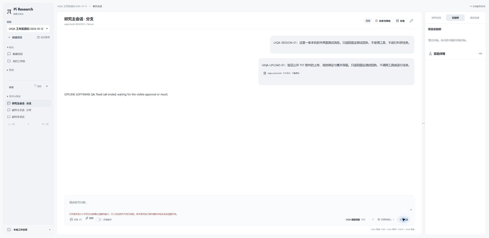
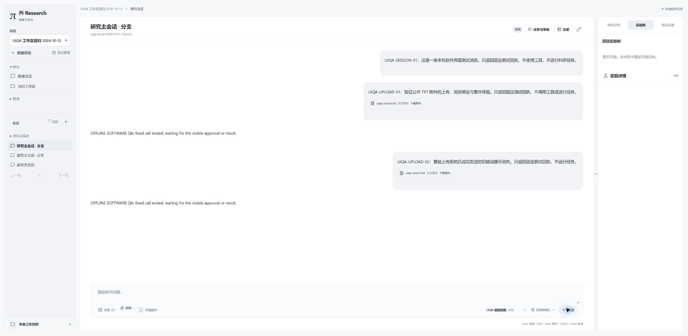

# 发送成功后清理过期附件错误

上传有效 TXT 后尝试不支持的 PDF/BIN，原稿和有效附件可以保留；但随后成功发送仍留下旧错误提示。现在首次发送捕获当时错误及上下文，收到匹配成功回执才清旧提示。幂等重放沿用原快照，新上传、新诊断、同文案新错误及模型/会话变化不会被旧回执清除。原稿、附件引用和后端持久化逻辑没有修改。

- 修复前聚焦回归暴露 2 个失败；补充能力读取反例后最终 10/10、相关 UI 39/39、集成 10/10及独立 Sol/high 10/10 通过。
- 最终冻结整合候选全量 1809 项：1785 通过、0 失败、24 跳过。干净安装、构建与类型检查通过，661 份产物一致。
- Chrome 修后重现 TXT + 无效 BIN，再发送并等待新增用户历史卡：错误为空、草稿为空、待发附件 0、历史下载按钮 2。
- 原件下载与重开已实测，两份文件均 265 字节、SHA256 与输入相等。固定模型回复不证明理解附件；file:// 预览被工具策略禁止，文件完整性校验不等同浏览器文本预览。

实施者提到的无输出 typecheck 原日志未生成；本报告使用后续干净环境实际日志补齐，不伪造该文件。源码哈希、命令、独立复核和证据边界见同名 evidence.json；原日志保留本机。原有 UI 在途改动不纳入。模型/档位已请求，运行时未回显。
