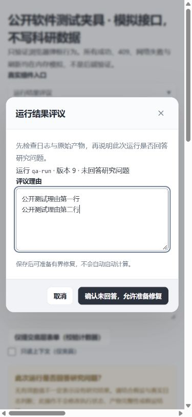

# Chrome 功能巡检、缺陷修复与验收边界

2026-10-12。使用用户指定的 Chrome 实际点击、输入、上传、下载及键盘操作。**UI及Windows停止修复已交付，完整浏览器验收仍在继续**：部分外部集成和科研闭环尚未完成本轮人工验证。前端布局改造继续暂停。Windows停止的后续闭合证据见[WINSTOP-01](2026-10-12-windows-host-stop.md)。

## 发现的问题与改动

| 问题 | 已实施的修复 | 证据 |
|---|---|---|
| 工作区切页丢草稿、迟到保存回执清除新编辑或误报成功 | 保持编辑器、保护未保存草稿、按提交快照处理回执，隔离旧项目反馈 | [工作区巡检](2026-10-12-chrome-audit.md) |
| 会话改名后目录未同步；消息分支没有立即进入新会话 | 同步目录和标题、插入并选中新分支，保留历史及分页 | [会话](2026-10-12-session-management.md) |
| 归档“查看历史资料”只改按钮文字，抽屉未打开 | 一击展开、滚动、聚焦；关闭回焦；避免历史会话补齐时重挂载 | [归档资料](2026-10-12-archive-history.md) |
| 有效附件成功发送后仍显示旧上传错误 | 仅匹配本次成功回执时清旧错误，保留新错误、草稿和附件历史 | [附件](2026-10-12-attachment-feedback.md) |
| 原生 prompt/confirm 阻断 Chrome 操作，视觉及键盘行为不一致 | 当前可达的6类入口、7处调用改用项目既有 Modal：改名、工作区放弃/新建、模型/提供商删除、人工验收、唤醒重试、运行结果评议 | [改名](2026-10-12-native-rename-dialog.md)、[工作区弹框](2026-10-12-native-workspace-dialogs.md)、[删除确认](2026-10-12-native-model-delete.md) |
| 非法文件路径提前清空草稿；移动导航遮挡确认 | 路径通过校验才切换草稿；确认可见、取消保稿、焦点返回可见入口 | [工作区弹框](2026-10-12-native-workspace-dialogs.md) |
| 人工验收缺少页内失败留稿、旧关闭回调可影响新窗口 | 多行依据、4000字限制、固定版本提交、失败留稿、窗口身份隔离 | [人工验收](2026-10-12-native-manual-review.md) |
| 重试结束后上下文变化可能锁住窗口；父操作跳过时无反馈 | 正确释放本次锁，失效窗口可关闭；跳过明确显示“未提交，请稍后重试” | [唤醒重试](2026-10-12-native-wakeup-dialog.md) |
| 结果评议在运行/版本/只读状态变化后，首次按钮可能无响应 | 更新后重新渲染有效入口，保留版本及旧回调隔离；失败保留理由 | [结果评议](2026-10-12-native-outcome-review.md) |
| OpenResearch 能力清单引用旧技能路径 | 更正两处固定清单引用，原对标检查4/4通过 | [引用修正](2026-10-12-parity-reference.md) |
| Windows停止命令超过4秒时过早记unknown、清理目录EPERM | 分别确认taskkill完成与目标close；超时/失败仍保留unknown，撤权和旧代次隔离不变 | [Windows停止](2026-10-12-windows-host-stop.md) |
| Windows OpenSSH 扫描服务器指纹时报 unsupported KEX | 仅明确兼容错误时尝试已安装的 Git 扫描器一次，共享原超时并保留指纹校验 | [SSH 与真实 CPU 作业](2026-10-12-ssh-ui.md) |
| 外部增删文件后，返回工作区仍显示旧目录 | 显示时只刷新列表，保留编辑器、草稿与版本；避免切项目时保存等待不释放 | [目录刷新](2026-10-12-directory-refresh.md) |
| 改名或发送忙碌时，已配置模型却提示“配置模型” | 提示依据实际运行时/模型配置，忙碌和发送锁不再误判缺配置，原发送限制不变 | [输入提示](2026-10-12-composer-copy.md) |
| 两个附件测试的PNG样本IDAT校验和损坏，不能真实解码 | 换成独立解码验证的8×8 RGB样本；原有字节传输与权限断言保留 | [PNG整文件附件](2026-10-12-native-png.md) |
| 本地来源连接提示密钥可留空保留，实际首次保存却失败 | 首次管理保存明确要求填写；空/空白本地拦截并保稿，已管理连接仍可留空保留 | [连接密钥提示](2026-10-12-legacy-provider-key.md) |
| 新建项目失败只在遮罩后显示；旧创建选择可能在新窗口出现后提交 | 项目专用失败反馈进入弹框、锁定提交、保留重试身份；状态提交时重验窗口意图，避免旧选择影响新窗口 | [项目创建](2026-10-12-project-create-feedback.md) |
| 切换已有项目时误显示首次创建页；读取恢复后旧错误残留 | 区分读取中、读取失败及真正空态；提供只读重试，读取错误与操作错误分离 | [项目读取](2026-10-13-project-loading.md) |
| Windows大小写不同的路径绕过备份/恢复目录重叠检查，嵌套恢复使备份失效 | 共享检查在Windows按大小写等价比较，并保留目录边界；创建临时目录前拒绝，原备份保持可校验 | [备份恢复](2026-10-13-data-backup.md) |
| 模型设置页的隐藏GitHub面板仍自动读取账号并刷新状态 | 保留组件和草稿，用可见状态门控读取与轮询；回到GitHub分区再刷新，已有同步身份不丢失 | [设置页查询](2026-10-13-settings-github-visibility.md) |
| 已撤销技能被正确阻止启动，但会话只显示“失败”而无原因 | failed会话展示可读说明，技能撤销提示新建会话，原错误折叠纯文本显示；不改队列、权限或旧绑定 | [技能版本与失败提示](2026-10-13-skill-fixed-revisions.md) |
| 证据回查已载入正确原文页，但抽屉仍停在顶部 | 当前页组件用本地ref在准确页和引用就绪后滚动一次；轮询/旧响应不抢位置，目标变化等新状态提交 | [固定原文检索](2026-10-13-fixed-text-corpus.md) |

旧 ImplementationView/PrivateWorkspace 与 CampaignView 没有当前页面宿主，5处遗留 prompt/confirm 未扩批修改。浏览器刷新/关闭时的 beforeunload 留稿保护保留；它不能由异步页内弹框替代。

## 实际测试范围

| 范围 | 本轮直接证据 | 不能由此推出 |
|---|---|---|
| 导航、项目、会话、工作区、右侧面板、环境/模型/技能/模板、历史原文/证据/报告 | 11类导航巡检、真实工作区保存重开、会话分支改名、归档资料、运行日志/产物及已有PDF下载 | 不等于每条写入、失败恢复及外部服务均已走通 |
| 附件 | 公开TXT上传、发送、原件下载与刷新后哈希一致；不支持的PDF/BIN被拒并留稿；PNG及支持模型的PDF成功路径见下表 | 固定回复不证明模型理解附件，未验证所有媒体类型或解析路径 |
| 自定义技能、模板 | SKILL.md两修订上传、启用互斥、禁用重开；ZIP主路径错误修正后上传/预览/配置保持 | 未运行技能，也未使用新模板编译实际稿件 |
| 技能固定版本与回滚 | [公开两修订](2026-10-13-skill-fixed-revisions.md)：Chrome升级/回滚/重开、原资源与摘要；owner API固定A/B到不同版本，关闭与撤销语义分开；真实Chrome启动在worker前被拒，修后失败原因可见 | 高级绑定/撤销无GUI，明确用owner API；旧任务/重试复用自动证据，未执行科研使用或删除修订 |
| 模型删除 | 经用户当次授权删除唯一专用QA模型，刷新后删除历史保留、其他模型与默认设置不变 | 未实际删除提供商 |
| 环境变量 | [真实Chrome添加/替换/删除](2026-10-12-environment-ui.md)、非法/保留/重复名拒绝、空值阻止、错误留稿、刷新隐藏值；删除测试键后历史遮罩保留 | 未在Chrome启动新任务核验变量消费 |
| SSH/远端 CPU | [腾讯云真实连接与单次运行](2026-10-12-ssh-ui.md)：指纹确认、环境准备、权限诊断、固定审批、真实容器、指标/日志预览及重开历史 | 未验证远端 GPU、断线/取消恢复和全部计算失败路径；metrics 下载未取得完成回执 |
| 消息队列 | [真实Chrome队列与重试](2026-10-12-message-queue.md)：21条分页、刷新、全文编辑、移出、立即引导、FIFO、领取保稿、停止、失败重试及历史；实际25次请求与全文哈希核对 | 使用本机固定供应商，不证明外部模型质量；未遍历全部多客户端竞态或不可达固定历史锚点 |
| PNG整文件附件 | [真实Chrome PNG成功路径](2026-10-12-native-png.md)：有效上传、伪装格式拒绝、原件native固定引用、真Pi精确wire字节、普通HTTP成功账目、刷新重开及实际下载文件哈希/解码一致 | 下载事件工具超时，已核对实际文件；不证明外部模型理解图片或其他媒体均通过 |
| 本地模型连接首次保存 | [真实Chrome密钥提示修复](2026-10-12-legacy-provider-key.md)：修前失败、空/空白零请求、显式保存、已管理留空改名、刷新重开；原目录、凭据版本、模型与默认保持 | 公开占位值及本机夹具；未测试真实供应商认证或凭据迁移 |
| PDF整文件附件 | [真实Chrome双页PDF成功路径](2026-10-12-native-pdf.md)：上传、伪装格式拒绝留稿、真Pi一次请求的精确文件块、普通HTTP成功账目、刷新重开及原件下载摘要/严格解码一致；原默认与五个会话保持 | 下载事件工具超时但实际文件核对通过；仅Chat Completions/openai适配，不证明理解PDF或解析/OCR成功 |
| JPEG/WebP/GIF与数量边界 | [真实Chrome三格式与5件上限](2026-10-12-image-formats.md)：3+3超限零新增上传、5件成功后禁用入口、移除副本保留项目原件、一次真Pi请求只发送三原件、刷新重开及三份实际下载摘要/解码一致 | 仅静态24×18测试图；下载事件工具超时但实际文件核对通过；未验证动态图、大小上限或外部图像理解 |
| MP4与大小边界 | [真实Chrome视频与20MiB上传边界](2026-10-12-native-video.md)：20MiB成功、20MiB+1及合计超限零新增上传、伪装格式拒绝留稿、8510字节MP4单次精确wire、刷新重开及实际下载完整解码20帧 | 20MiB只验证上传，不是模型传输；仅本机Chat Completions/qwen适配；不证明视频理解或全面损坏检测，下载事件工具超时单列 |
| 本地项目创建 | [Chrome失败留稿与成功重开](2026-10-12-project-create-feedback.md)：400窗口内可见、同内容同键重试、修正后只建一个项目/主会话、取消保留旧草稿、README刷新重开与旧八会话保持 | 网络/部分成功与迟到提交为真实App方法检查；未启用GitHub建仓，未改两步请求的事务边界 |
| 已有项目读取及真正空态 | [Chrome项目切换](2026-10-13-project-loading.md)：延迟读取、公开503失败、重试/自动重连、快速切回、刷新重开；独立空数据目录验证欢迎与全局入口，恢复后2项目/9会话/99条消息及文件摘要保持 | 重试可复用正在进行的轮询；全部调度交错未穷尽，操作错误/草稿保持补以App方法检查；启动侧栏占位文案未改 |
| 本地源码副本导入 | [CLI导入与Chrome重开](2026-10-13-project-import.md)：非法目录/LFS拒绝且无残留；复制dirty/untracked源码及中文路径，Chrome单次保存副本、刷新重开；原源目录33文件和既有2项目/9会话/99消息保持 | 网页暂无导入表单，导入动作使用现有CLI；未执行源码或访问测试远端，原有7条导入自动检查复用 |
| 项目归档与回收还原 | [经授权的Chrome四步验收](2026-10-13-project-lifecycle.md)：归档只读与重开、取消归档、回收后退出普通视图、取消还原、还原后原ID/文件重开；10会话/99消息及其他项目记录保持 | 仅公开QA项目、从活动状态回收；初始无旧grant/队列，只证明观察到的权限代次；不含永久清理或全部并发/忙碌拒绝路径 |
| 离线备份与异址恢复 | [CLI备份恢复及Chrome重开](2026-10-13-data-backup.md)：旧QA源停机，只启动新副本，17张SQL表精确投影及39保留文件比较；3项目/10会话/99消息、README/PDF重开及下载一致；缺密钥提示与发送拦截 | 网页没有备份表单；`--offline`是操作人停机承诺，不自动排除所有存活控制器；POSIX原生分支未跑，不代表所有文件系统别名、跨平台迁移或重新授权路径 |
| 科研证据与文稿交付链 | [当前Pi与Chrome固定报告](2026-10-13-scientific-flow.md)：同项目真实Anscombe两Run和原编译PDF当前有效；Pi准备来源、用户确认后生成新报告，指标/方案/TeX/PDF回查、刷新重开及离线包下载；38条目/36文件核验 | 复用已通过的真实计算、绘图、编译，不称本轮重跑或从零AI科研；固定模型只驱动软件，未独立论文审查；原科学判断仍需研究者审阅 |
| 报告前提撤回与保留 | [单任务前提撤回](2026-10-13-report-premise-revocation.md)：Chrome改变公开测试团队目标后，绑定结论/报告失效，新包禁用；服务端新报告/新包409拒绝，原文与引用可读，刷新后历史Markdown下载字节一致 | 单任务公开夹具，不触及原科研团队；旧包仅核验固定字节与产物读取，重开无旧包列表；其他grant/解析批准撤销不据此全通过 |
| 人工验收、结果评议、唤醒重试 | 真实组件的Chrome夹具验证成功/409/网络失败/父操作跳过、取消、多行输入、固定版本、事件隔离、键盘焦点及390×844布局 | 夹具API为内存模拟且禁止网络；未接受真实科研任务、评议真实Run或发起真实科研重试 |

原覆盖账本保留21项能力、73条用户流程。上一阶段新增部分证据涉及其中18条流程，Windows停止和环境变量续测见各自记录，不能把73条全部标为通过。可恢复的详细本机账本位于 `.validation/full-ui-coverage-20261012/resume-delta.json`；原日志和私有科研截图留本机，没有纳入Git。

2026-10-13按用户要求[合并已完成证据与未验范围](2026-10-13-coverage-checkpoint.md)，后续不重复已通过路径；普通修复只做相关回归、一个Chrome关键场景和一次独立复核，全量与干净构建集中到阶段性交付。设置页批次后优先补齐一条科研运行→证据→报告→编译流程，非阻断项集中待办，权限/保留/关键并发检查不删减。

## 检查结果与未解决的问题

- 最终三个弹框整合检查：**52/52通过，0跳过**。各批独立复核及必要定向复查已完成；请求的模型/档位记录在对应证据中，运行时未回显。
- 最终交付候选的干净安装、构建和类型检查通过，**661份构建产物一致**。后续仅去除测试文件末尾空行，没有改变可执行测试内容。
- 上一已交付完整冻结快照全量：**1909项，1885通过、0失败、24跳过**，包含最终唤醒反馈、Windows停止、SSH扫描、C2目录刷新、输入提示、PNG测试样本及本地连接密钥提示修复；各批独立复核、真实Chrome关键路径和干净构建均通过。SSH定向检查为17通过/1项POSIX跳过；C2独立复查62/62通过；输入提示独立检查53/53通过；PNG相关独立检查7/7通过；连接密钥提示独立检查38/38通过。
- 旧Windows定向复验的**12项9通过、3失败**日志仍保留：HTTP撤权曾得到unknown、两条清理路径曾出现EPERM。修前确定性反例再次复现；WINSTOP-01修后原检查及新增顺序检查通过，没有削弱断言或改写旧失败日志。
- 原自有进程探针中，taskkill约4.26秒，超过旧4秒期限。现在分别有界等待helper和目标close，真实进程树约4.32秒后确认取消并完成清理；无法确认仍保留unknown及权限隔离，不保证清除脱管进程。
- 项目创建批次初次集成全量为**1919项，1895通过、0失败、24跳过**；独立复核发现的R1队列问题修补后，最终相关与独立检查**88/88通过**，最终干净构建661份一致。该全量属于初次集成快照，未称最终R1候选重跑全量；未受影响检查复用，最终Chrome成功创建/重开已补齐。
- 项目读取批次初次全量：**1927项，1901通过、2失败、24跳过**。两处项目管理测试仍读取旧操作错误字段；测试专属修正保留原数据断言，补充错误隔离/恢复断言，最终相关检查**110/110通过**。产品代码/构建产物不变，复用其余通过结果与661份干净构建；没有把最终测试快照称为重跑全量全绿。
- 备份恢复批次：修前四个Windows大小写子例失败；修后相关检查**28项，27通过、0失败、1项POSIX跳过**，真实CLI确认嵌套恢复被拒、备份完整不变且兄弟目录恢复成功。干净构建661份一致，未重复无关全量。历史会话加载过程中短暂显示空欢迎页另记为非阻断显示待办。模型页还会挂载隐藏的GitHub状态组件，可能后台查询既有账号；本批日志未覆盖GET/gh进程，不声称零外联，未进行GitHub建仓/同步写入。
- 设置查询修复后，科研交付链阶段集中运行常规unit+integration全量：**1938项，1913通过、0失败、25跳过**；干净安装、构建和类型检查通过，661份产物一致。包含最终Windows备份保护及设置可见状态修复；跳过的POSIX和未启用的可选Docker/编译矩阵不计通过。原日志留在候选目录，不重跑已通过的Chrome路径。
- 当前科研链的非阻断观察：刷新会回到首个项目，手动选回后同一报告仍有效；“新建会话”复用无消息空白会话时保留旧标题。未扩修布局或改变复用策略。两个下载事件工具超时，但新PDF/离线包实际文件与摘要验证通过；旧设置夹具关闭时覆盖一份raw快照的证据更正详见本批记录。
- 前提撤回分支未发现新增阻断；无产品修改，复用上阶段全量与干净构建。旧任务已失效但右栏仍显示历史“1/1任务已验收”，同时保留旧版本/历史警告；与旧离线包缺少重开列表一起列非阻断待办。原科学150条业务记录不变，本批只操作新公开夹具。
- 技能版本批次修复会话失败原因缺失：新回归修前3失败、修后3通过，正常产品构建及构建后相关64项通过；修后Chrome只重开原失败会话，未重发或启动模型。原40条记录与固定资源保持，两个QA修订最终关闭，v2撤销；全量/干净构建不重跑。
- 其余已知待办：部分状态英文，SSH/Docker实验标题仍写“本地”；首次启动侧栏项目选择器的“尚未创建项目”占位；网页没有本地项目导入表单；旧E2E脚本使用退役入口。GitHub创建窗口账号刷新时的请求键绑定需单独验证。目录自动刷新、忙碌输入提示、PNG样本、本地连接密钥提示、新建项目错误反馈及主面板切项目误空态已修复。
- 唤醒retry接口没有原子expectedVersion，跨客户端竞态仍属后端限制。恢复回退需关闭重开；未来更换Perform宿主时须复查具体错误保真。结果评议未来若绕过App的忙碌/读取屏障推送数据，也须重验时序。

固定原文批次已补[精确授权、本地检索、原页回查与撤销](2026-10-13-fixed-text-corpus.md)，并修复回查位置；已有真实PDF解析不重跑。原单次授权被撤销后，新查询明确拒绝，旧来源和证据仍可回看。新解析镜像就绪、OCR/视觉、PMC及其他授权组合仍未据此通过。

[固定页图批次](2026-10-13-document-vision.md)进一步补齐Chrome准确视觉范围审批、真实Pi向本机模型传输原PDF页2、同授权页1越界拒绝和重开历史；降为只读后旧图片在HTTP前被拦截，原102条记录及28文件保持。无产品修改；8次本机HTTP包含1次已保留的夹具续接失败，修正夹具后续接原批准。专用提供方已禁用、进程已停止，当前应用未重启。软件图像传输不证明视觉理解，旧只读视图残留的禁用“带入”按钮列入待办。

[结论状态批次](2026-10-13-claim-status.md)复用旧Chrome采纳，仅补争议→旧版本卡失效→新卡拒绝→重开只读历史“未通过”。旧147条记录、28固定文件及原默认保持，无产品修改；11次本机HTTP全部成功，专用提供方已禁用并停止。失效卡仍计待确认、完成卡没有具体决定文案列为非阻断待办，不把软件状态决定当科学采纳。

[独立Run结果分析批次](2026-10-13-owned-run-analysis.md)补真实固定Node运行→独立生产Pi读取本Run/日志/证据→Chrome回查→原会话重开。首次分析因QA夹具解析终尾标记错误而失败；严格修正夹具后，新意向及新单次预算再次经过两道Chrome批准，第二Run分析完成。首失败/unknown、旧195条记录、28文件和默认保留，总计21次本机HTTP（20成功、1夹具失败）；提供方已禁用停止，8个准入释放。无产品代码修改，权限/并发复用未变后端的既有检查，不重跑全量/干净构建；不把固定回复当作科学推理。

未完成范围仍包括附件解析/视觉路径、其他语料/授权分支、技能删除及其他未覆盖历史组合、项目生命周期的复杂失败/已归档来源还原及永久清理。已补齐复用同项目既有实测与编译的当前交付链；从零Pi科研生成和独立论文审查不据此记为通过。SSH断线/取消恢复、产品内GitHub建仓同步、GPU新Run、完整无障碍和全站移动端也未在本轮全面验收。现存QA技能保持禁用，测试模板未用于科研稿件；未恢复暂停科研团队。腾讯云 ubuntu 的 docker 组成员关系按用户明确要求保留。

## OpenResearch 对标与交付

固定对照为 `alphaXiv/OpenResearch@3037f727e80e0ab20c61a87c613a50dde009a835`，沿用[当前能力和差异](../openresearch/CURRENT-SKILLS.zh-CN.md)。本机OpenResearch参考页离线，未做实时交互对照。云算力/完整远程工作台、Overleaf同步和科研成果远端发布等仍有差异，不能用本地PDF或本项目代码推送替代。

所有本轮已验收代码按批次推送至私密仓库 `hailuohl/pi-research` 的 `implementation/pr01-reproducible-baseline`。本次续接交付：人工验收 `de3e0d8bf1c0d8cb7f04ec100a85fa62bdea1c1b`、唤醒重试 `55b2d793d449f265235a8fcd00c22232ea462ffb`、结果评议 `b4bd84215e9da5c391bc964b023f3af6dec58079`，均核对远端包含对应提交。原有5份无关样式/文档改动仍保留在工作区，未混入提交；临时浏览器夹具页已关闭，两个临时静态资源已移除。

