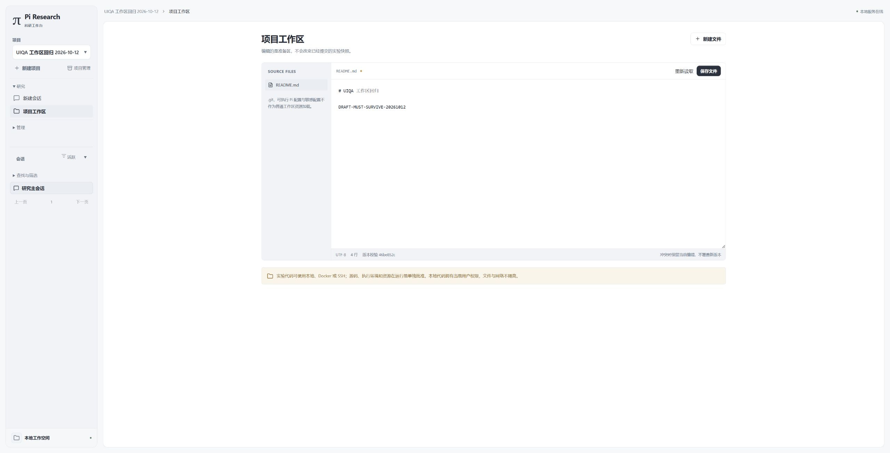
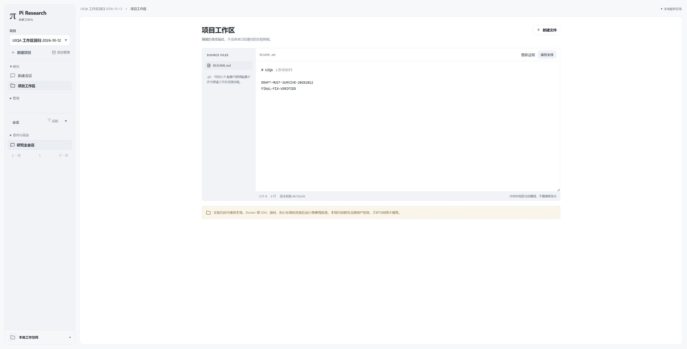

# Chrome 功能巡检与工作区草稿修复

日期：2026-10-12。浏览器为用户指定的 Chrome。代码基线 `ee9844f30313310f3a24d73dd7b3387c09ffa130`；原有 9 个在途文件不纳入本批提交。前端布局仍暂停。

Chrome 检查的是当前工作版；正式提交候选使用 HEAD 加本批三个源/测试文件构建。浏览器中的 App 与 Workspace 模块和最终候选字节一致，原有未提交聊天界面改动保留在工作区。

本轮采用“全部导航表面巡检 + 现有全量自动回归 + 一条工作区编辑流程修复”。不是全部功能、全部外部环境均已人工走通，也不表示已达到完整 OpenResearch 行为或视觉一致。

## 发现与处理

| 编号 | 级别 | 问题、复现与结果 |
|---|---|---|
| W1 | P1，已修复 | 工作区编辑后切到其他页面，旧版会卸载编辑器并丢失未保存内容；新建文件也可直接清空草稿。现在同项目跨页面保留编辑器，普通项目切换、新建文件、重读与浏览器卸载有丢弃保护。取消新项目对话框不清草稿。 |
| W2 | P1，已修复 | 保存 A 后、回执到达前继续输入 B，旧回执无条件清 dirty；可能导致 B 未落盘却不能再保存。现在按路径、内容、摘要提交固定快照，串行保存，保留回执后的编辑；迟到读写不能覆盖其他文件或已卸载项目。 |
| W3 | P2，复核发现并修复 | 初版修复吞掉失效保存异常后，仍由全局通知在新项目显示“文件已保存”。已移除无条件成功通知；两条真实 App.perform 组合回归覆盖迟到成功和网络失败。 |
| C1 | P2，待办 | 重命名当前会话后标题对象更新，目录仍使用旧缓存；消息分支返回新会话后，目录也未立即显示。生产组件内存模拟已复现，显式重读目录能显示；Chrome 原生重命名提示触发控制连接超时，未完成该浏览器路径。 |
| C2 | P2，待办 | 工作区保持挂载后，外部工具新增文件不会在同项目切页返回时自动重新列目录。当前“重新读取”只读所选文件。独立复核列为非阻断后续项；浏览器刷新可重新列目录，刷新前先保存。 |
| C3 | P2，待办 | 归档项目点击“查看历史资料”只切换成“收起历史资料”，没有展开承载内容的任务抽屉，页面看不到资料。再点“任务与审批”后原文/证据/报告才出现，已在 Chrome 复现此额外步骤。 |
| U1 | P3，待办 | 归档项目已禁用新会话、编辑、附件和发送，但消息的“从此处分支”按钮仍呈可点击状态；本轮未点击执行。应统一归档态的操作反馈。 |
| U2 | P3，待办 | 历史独立审查显示英文 `passed`，固定构建结果显示 `succeeded`；Docker 实验详情顶部仍固定标“本地”。实际计算方式另有 Docker 标注，但标题文案容易误读。 |
| U3 | P2，待办 | 创建项目输入纯空白名称时，服务端正确拒绝，但错误条显示在对话框遮罩后，被虚化而难以阅读；表单内没有对应错误提示。取消可正常恢复。 |
| T1 | 验证缺口，未修 | OpenResearch parity 检查的旧能力矩阵仍引用 `skills/openresearch/manifest.json`，该目录已迁移。4 项中 3 通过、1 失败。旧 e2e/workbench.py 仍点击已移除的独立实验/报告入口，不能用作当前 UI 通过证明。 |

## Chrome 实际覆盖

仅在新建的 `UIQA 工作区回归 2026-10-12` 测试项目编辑文件和调整项目来源/会话模型等级。真实科研项目只读回查，未恢复暂停团队、未启动新科研任务、未改密钥、未创建 GitHub 仓库。另在独立 4800 服务创建了一个确定性模型测试项目；该标签后续发生 Chrome 控制超时，未假称对话成功。

| 步骤 | 范围 | 当前结果 |
|---|---|---|
| 1 | 首次项目、模板/空项目创建、空名称 | 成功创建两个软件 QA 项目；空名称提交被浏览器阻止，纯空白名称被服务端拒绝（错误位置见 U3）；未勾选远端建仓。 |
| 2 | 项目切换、项目管理、归档和回收站目录 | 读取活动/归档列表和空回收站；归档项目显示只读并禁发。未执行回收/永久删除。 |
| 3 | 会话、消息输入、分类 | 活跃/归档切换及空状态正常，当前打开的历史保留；Shift+Enter 换行正常。改名/分支缓存问题见 C1；未向外部模型发测试消息。 |
| 4 | 来源、模型、权限、附件 | 来源 1/5→2/5，刷新仍保留；思考等级键盘 End 保存成功；固定授权会话锁模型。附件 chooser 已打开，但扩展未允许本地文件 URL，上传未完成；未扩大宿主权限。 |
| 5 | 任务抽屉、协作和键盘 | 任务/审批历史可展开；Escape 关闭后焦点返回触发按钮；右侧标签方向键正常。读取已暂停团队和保留的失败历史，未重新批准、重试或恢复科研团队。 |
| 6 | 实验树、运行、日志、产物 | 树/列表切换、成功/失败/无效指标区分、固定 Run 详情正常；stderr 正确显示非空日志及字节范围。未新启动真实 Run。 |
| 7 | 项目目录和编辑保存 | 文件目录正常；修复后真实点击：编辑草稿→环境页→返回→内容仍在且可保存→保存→刷新，内容与保存状态一致。截图见下。竞态、失败、跨项目及取消分支由组件回归覆盖。 |
| 8 | 技能及计算连接器 | 13 项技能列表、搜索无匹配、详情和资源入口正常；Escape 可关闭详情。Docker 检测显示连接正常；SSH 空状态正常；未新增 SSH/GPU 接入。 |
| 9 | 环境、模型管理、模板 | 环境空状态与无效名阻止提交；模型密钥不回显，默认模型禁停，未确认费用时测试禁用；三引擎模板列表/选择正常。未保存真实供应商配置或环境变量。 |
| 10 | 原文、证据、固定编译、报告历史 | 归档历史入口有 C3；手动打开抽屉后，原文和报告空状态、9 份产物及证据索引可读，metrics.json 可打开并显示 SHA256 和实际 JSON。已有固定稿诊断、7 页选择与第一页页图可打开，实际下载 PDF 成功。未重新解析/编译/审查/导出新成果包。 |
| 11 | UI 和响应式 | 桌面截图已检查；暂未改布局。尝试 390×844 viewport 后实际仍为 2560×1305，已撤销 override，不能声称移动端验收通过；未做完整读屏/对比度合规检查。 |

下载工具未收到完成事件，但本机确有本次下载的 `manuscript (4).pdf`，224270 字节，SHA256 `ce1f2057d00277a60573ae379910c3b26690ef6ef9a7048b5d8bce14dc1b72e7`。原文件和真实科研截图不提交到 Git。

## 本批验收与证据

验收条件：合法保存重开一致；同项目切页保留草稿且普通丢弃操作可取消；旧保存回执不清新编辑；迟到/失败响应不串文件项目；归档、敏感路径和历史边界不放宽。

- 原 HEAD 两份源码运行新增初版回归：10/10 失败；初修相关检查 66/66 通过。
- 独立复核提出 W3，新增两条组合回归修复前 2 失败、其余 66 通过；修复后 68/68 通过。
- 首次冻结候选全量回归：1773 项，1749 通过、0 失败、0 取消、24 跳过，1175404 毫秒。
- 后续必要修复仅删除前端通知参数，并修正测试 mock 清理及新增两条回归；主代理在最终候选重跑受影响检查 68/68 通过。未重复无关全量，未改变公共接口、依赖、后端或运行环境。
- 干净安装、构建、类型检查通过；最终修复沿用同一干净依赖环境重建及类型检查，全部 661 份 dist 与最终候选一致，清单 SHA256 `ac96e4a48e907833a76e2227fa0db7bf366da564c129fc139747289a918c159c`。
- parity：3 通过、1 失败（T1）；live 默认套件：7 项全部跳过，不算真实环境通过。
- 独立 Astra/xhigh 复核与定向复查：W3 已解除，无剩余本批阻断；C2 非阻断待办。

基线、补丁摘要、检查命令、最终结果及来源哈希保存在 `2026-10-12-chrome-audit.evidence.json`。原日志和截图保留于本机 `.validation/chrome-audit-20261012/`；实施红绿日志留在其原临时目录，不重复复制。

实施和常规盘点请求 Sol/high，关键独立复核请求 Astra/xhigh。原生工具接受配置但未回显实际运行档位，记录为“已请求，运行时未回显”。

## 截图

同项目切到环境再返回，未保存草稿仍在：

保存并刷新后，内容保留且保存按钮恢复禁用：

## OpenResearch 对标边界

Chrome 中本机 OpenResearch 0.2.14 页面显示“无法连接 OpenResearch，此页面已不再实时同步”；不把它当作可交互的实时对照。仓库已有固定 `alphaXiv/OpenResearch@3037f727e80e0ab20c61a87c613a50dde009a835` 的来源与适配记录，见 [当前能力和差异](../openresearch/CURRENT-SKILLS.zh-CN.md)。

本项目的协作审批、实验冻结、原文证据、固定稿构建与本地交付均有对应能力；云算力/完整远程工作台、Overleaf 同步、远端报告发布仍是已知差异。本轮不以本地回归代替上游行为测试，也不把未配置或跳过的外部环境标为通过。
