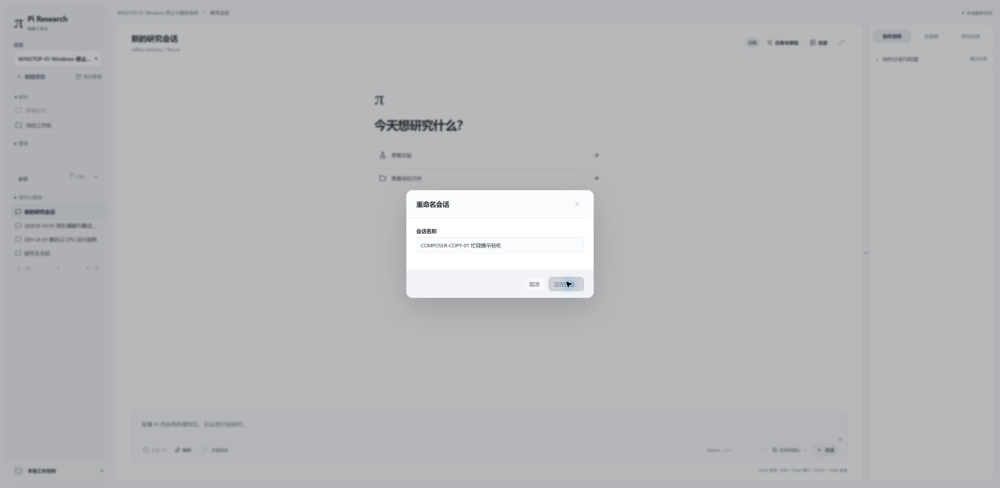
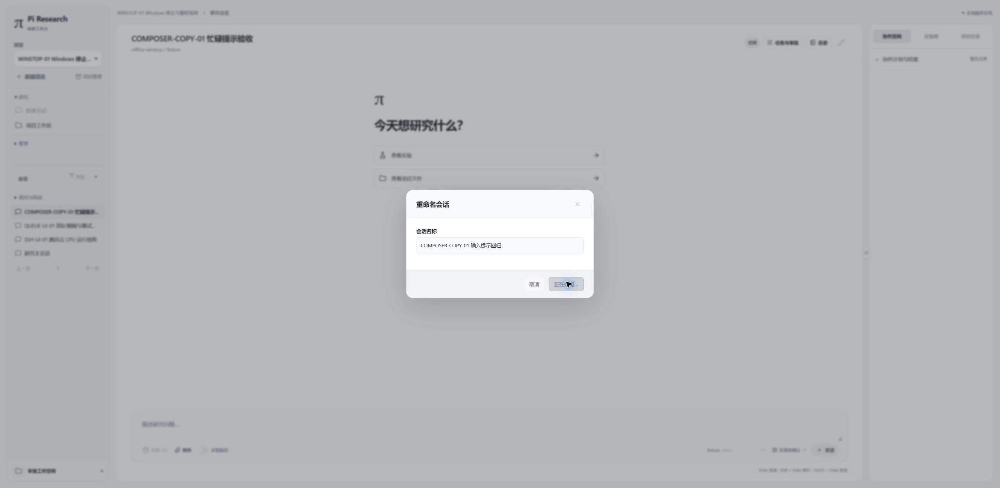
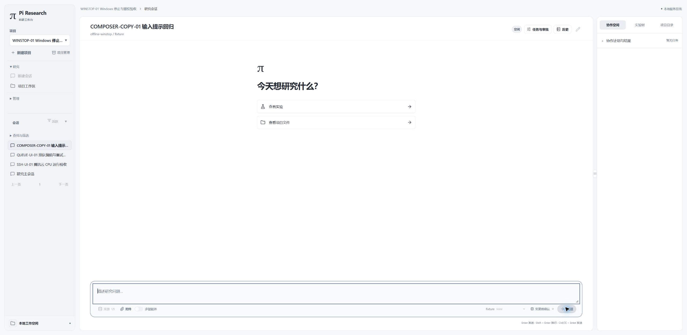

# COMPOSER-COPY-01：忙碌时不误提示缺少模型

2026-10-12。Chrome 中，已配置 `offline-winstop / fixture` 的会话在改名或发送请求处理中，输入框会短暂显示“配置 Pi 供应商和模型后，在这里开始研究…”。这是提示错误，不是实际模型配置丢失。

## 修复

原 placeholder 直接把 canSend=false 当成未配置模型，但 canSend 同时包含忙碌、发送锁、运行时、项目归属、归档和历史等条件。修复仅改 `workbench.tsx` 的一处提示表达式，复用 render 已有的 runtimeAvailable/sessionModelAvailable：

- 可用模型在普通、忙碌和发送处理中保持“描述研究问题…”。
- Pi 未就绪提示查看上方说明；无会话提示选择或新建；实际缺少/不可用模型保留配置提示。
- 归档项目、团队任务、归档会话和固定历史提示的优先级保持不变。

没有改变 canSend、实际提交校验、DOM disabled、审批、附件、草稿保护或布局。提示文字不代表获得发送权限。

## 验收

1. 在原有发送保稿检查中补充忙碌及 pending 提示断言，同时确认 canSend=false；原请求体、后续草稿和附件断言全部保留。
2. 扩充原有越界发送检查，覆盖无会话、空/不可用模型、Pi 未就绪；仍验证零发送和留稿。全局默认未配置但当前会话模型有效的原允许行为也保留。
3. 归档、任务、历史和项目归属的发送限制保持不变；相关检查与实际差异支持。
4. 真实 Chrome 专用会话改名和发送均做修前/修后验证。仅在隔离夹具中给该会话的两个 POST 路径延迟 1500ms，生产 handler、校验和存储仍真实执行。修前待处理按钮存在、模型为 fixture，但提示缺配置；修后同状态提示正常。发送过程中按钮锁定、输入框可编辑，新草稿在回执后保留；清除测试草稿后刷新，原消息及回复各一条、标题与模型保持。

修前两项扩充检查失败；修后相关检查和独立 Sol/high 复核均 **53/53 通过**。干净安装、构建、类型检查通过，661 份产物一致。最终全量 **1908 项：1884 通过、0 失败、24 跳过**，日志哈希与实际结果记录在同名 evidence.json。

独立复核无代码阻断或非阻断发现，锚定冻结源码及补丁哈希。主代理实施时保持原主会话配置；复核请求 gpt-6.1-sol/high，接口接受、运行时未回显。原有五份无关样式/对标文档修改未混入。

无会话、模型不可用和 Pi 未就绪组合由相关自动检查覆盖，未为每种组合另行修改真实模型或运行时配置。Chrome 使用本机固定模型；没有外部模型调用、宿主命令或新远端作业。本修复仅前端，已有页面刷新即可获取新资源；没有重启主服务 4794。

