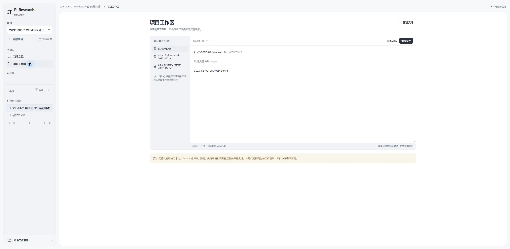
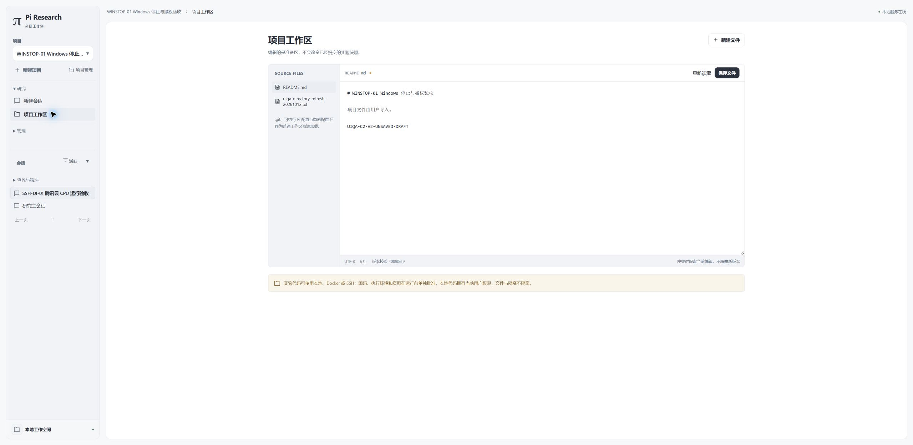

# C2：返回工作区时刷新目录并保留草稿

2026-10-12。修复同项目工作区保持挂载后，离开再返回仍显示旧文件列表的问题。外部工具新建或移走文件时，用户原本必须保存、重读或刷新整页才能看到变化。

## 最小改动

App 向既有 WorkspaceView 传入 active，Chat 的工作区入口使用与其他导航相同的 selectTab。隐藏到显示时只重新读取目录，不重挂编辑器、不重新读取当前文件、不清除草稿。请求序号、项目身份和挂载状态同时保护接收与 React 提交，失败保留旧目录；首次自动选文件仍受路径、dirty、同步 edited、读取及保存状态保护。不增加轮询、文件监视器、缓存框架或依赖，也不改变布局。

独立复核在第一候选发现新增回调等待会使保存卡住：保存写入完成后，目录响应与已确认的项目切换交错，父组件移除编辑器，React 不会执行被移除子组件的待提交回调，导致 loadFiles → save → App.perform.busy 不释放。v2 移除了这处新增等待，保留提交时身份检查。方法级测试在 v1 上失败、v2 上通过；原候选和失败证据保留，没有削弱原断言或扩大改动到其他保存逻辑。

## 五条验收及证据

1. **返回时目录反映外部增删**：真实 Chrome 修前显示只有原目录，后端已返回新增文件；修后在同一公开 QA 项目，带未保存草稿离开工作区，外部创建测试文件，返回后立即显示；再次离开，将该文件移到证据目录留存，返回后列表移除。没有整页刷新或保存触发目录更新。
2. **保留编辑状态**：两次返回均保持 README 路径、原版本校验 `40890ef9`、未保存草稿与可用保存按钮，确认弹框数为 0。结束后恢复原始 README 并保存，未保存标记消失；新建文件移出准备区留存，没有删除研究文件。
3. **失败与时序隔离**：相关自动检查覆盖列表失败、迟到响应、快速隐藏/显示、项目 ABA、提交时身份变化、隐藏时文件读取，以及上述保存后目录与项目切换交错。旧列表和新草稿不被覆盖。该竞态证据为方法级队列测试及已安装 React 删除路径核对，不声称已在真实 DOM 调度中强制复现。
4. **原行为不回归**：初次选取、新建、保存、冲突、归档只读、匿名草稿及放弃保护相关检查保留并通过；Chrome 实际保存原内容完成，busy 释放。
5. **入口一致**：App 导航、ConversationPanel、Chat 均使用统一入口；独立接线检查通过，真实 Chrome 主导航回归通过。没有把方法级接线检查写成每个入口均单独做了 Chrome 实测。

## 检查与交付边界

原缺陷最初 6 条检查中 5 条修前失败；新增保存卡住回归在 v1 的 1 条检查失败。v2 相关检查与独立 Sol/high 定向复查均为 **62/62 通过**。干净安装、构建与类型检查通过，661 份构建产物一致。最终全量 **1908 项：1884 通过、0 失败、24 跳过**；主代理在完整回归结束后生成同名 evidence.json，记录日志哈希与实际结果。

实现和独立复核均请求 gpt-6.1-sol/high，接口接受、运行时未回显。复核锚定冻结 source-v2 和文件哈希，SSH 已验收文件哈希保持不变；原有五份样式/对标文档改动不属于本批。

未新增真实浏览器网络故障注入或强制 React 调度；这些边界由相关自动检查覆盖。当前正在运行的旧主页面可能仍缓存旧前端，需要正常刷新加载新资源；没有重启主服务 4794。

