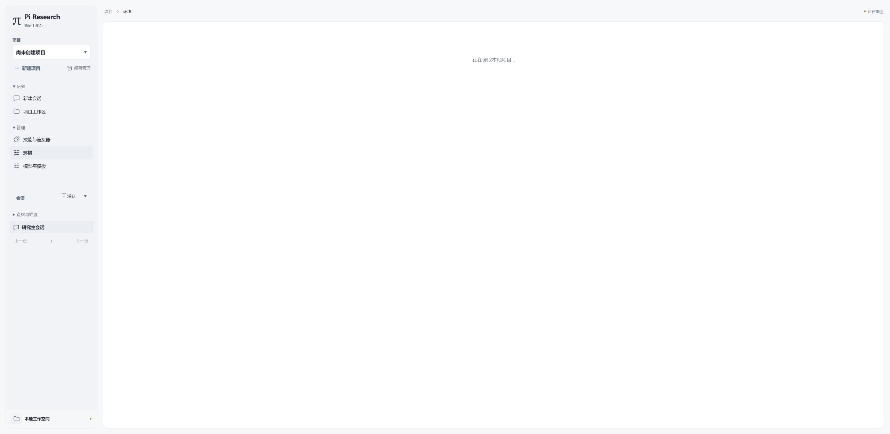
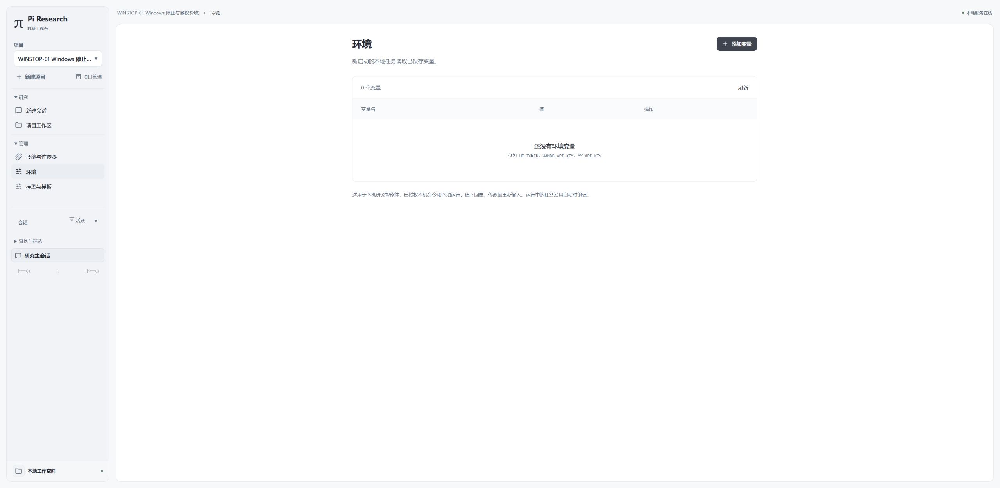

# 环境变量：Chrome增改删与留稿验收

2026-10-12，ENV-01。使用61937独立软件测试环境，真实生产页面与API；没有新产品改动。唯一键UIQA_ENV_20261012使用公开非凭据字符串，未触及科研环境或启动新任务。

Chrome实测：非法格式由表单阻止；PATH被服务端拒绝，错误显示在弹框内并保留输入；空值阻止；合法添加后名单1行、值隐藏；重复添加被拒，取消不覆盖原记录；替换窗口变量名只读、旧值不回显、必须重新输入，显示本次输入开关可用；替换并刷新后仍1行且两次值均不出现在页面文本中。

删除确认先取消，记录仍在。用户当次明确批准精确测试键后删除；刷新显示0变量。补充检查本批自有配置：版本3、当前变量0、历史遮罩保留两条，说明失败与取消没有产生额外版本，删除没有丢弃历史输出保护。没有读取或发布真实凭据。

[机器证据](2026-10-12-environment-ui.evidence.json)。代码快照2a2bfb9，其集成全量1898项、1874通过、24跳过、0失败与干净构建沿用[WINSTOP记录](2026-10-12-windows-host-stop.md)，不为纯UI证据重复运行。未在Chrome启动新任务核验变量消费；该范围不冒称完成。
