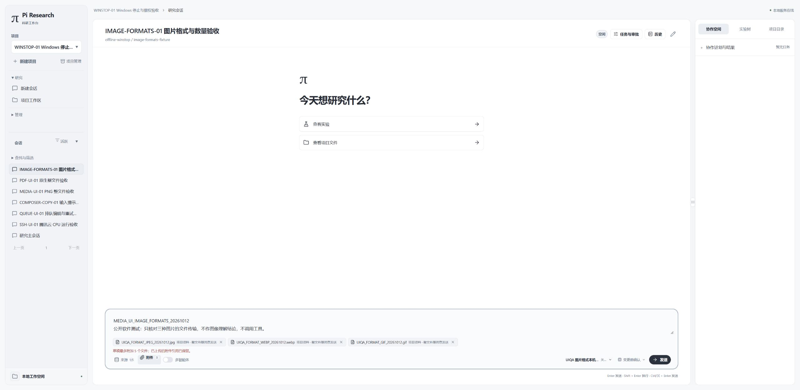
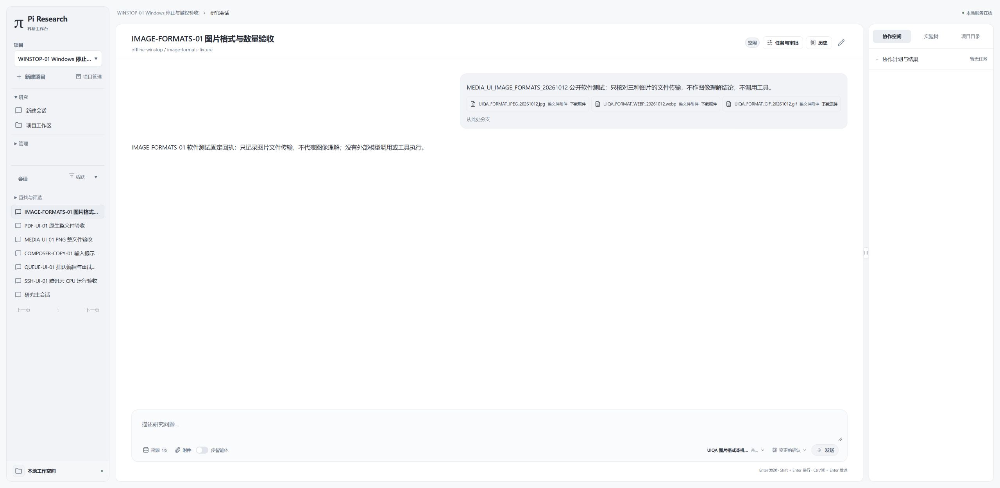

# JPEG、WebP、GIF 与附件数量边界的 Chrome 验收

IMAGE-FORMATS-01，2026-10-12。产品基线 `77a1beee842907b32cde5365f72d1080a0338da7`。本批未修改产品源码、依赖、测试或构建产物；补齐多图片格式及草稿数量边界的实际操作证据。

## 四条验收结果

1. 三份公开静态图片均独立解码为 24×18、单帧：JPEG 811 字节、WebP 52 字节、GIF 1269 字节。Chrome 在专用普通会话批量上传三份文件成功；类型、大小和固定摘要正确，模型请求仍为 0。
2. 当前三件时再次选择三件，界面提示“草稿最多附加 5 个文件”，草稿和原三件保留，上传 POST 计数仍为 3，文档/产物未新增。改为添加两份有不同名称的副本后达到 5 件，上传入口禁用。移除这两份草稿引用后回到 3 件、入口恢复；项目仍保留 5 份原件和对应产物，上传 POST 计数为 5。
3. 点击发送，真实 Pi 仅发起一次本机固定供应商请求，恰好 3 个 `image_url` 块。三种 MIME、解码大小及 SHA-256 分别匹配原件，消息引用不含已移除副本。Chrome 消息 UUID 与观察器一致，普通 HTTP 账目成功，草稿清空、会话空闲。
4. 刷新、切到 PDF 会话并重开后，消息及固定附件身份保持，模型请求仍为 1。三份原件各点击一次下载，实际文件均在点击后新生，大小/摘要匹配，并由 Pillow `verify()` 和完整 `load()` 再次解码。全局默认及原六个 QA 会话的状态、代次、模型均保持。

全部下载事件工具均在 10 秒内未返回完成通知。此缺口单列保留；实际下载由点击前文件不存在、点击后新文件时间、精确摘要和独立解码确认，没有重复点击下载。

## 验证与交付边界

- 主代理状态/字节验证通过；机器身份、摘要、普通 HTTP 时序及独立复核见 [证据记录](2026-10-12-image-formats.evidence.json)。
- 独立复核支持四条验收通过、无阻断；32 份冻结文件前后哈希一致。复核者另行运行观察器自检、只读验收断言、八份原件/副本/下载图片的独立解码，并查看三张截图，没有重复操作 Chrome。
- 测试观察器限定专用模型、最新用户消息标记及末尾 UUID，只读取实际协议的嵌套 `image_url.url`。其自检覆盖错误类型/MIME/base64/字节、错误消息绑定、缺失和重复候选；另用产品编译后的 `attachmentPayload` 生成三格式请求交叉核对，避免仅用自制样本证明观察器自身。
- 本批产品代码没有变化。服务完整构建清单仍与上一已验收版本相同，复用 **1909 项、1885 通过、0 失败、24 跳过**及 **661 份干净产物一致**的记录，没有重复运行无关全量。
- 观察器实施请求 Luna/max；独立复核请求 Sol/high。运行时未回显，不把请求配置当作已核验的实际档位。

未发现本批产品缺陷。原件与三种图片格式的传输通过不代表外部模型理解图片；本次只使用静态小图、Chat Completions 与本机固定回复，不覆盖动态图、文件大小上限、视频或其他 API。

公开样本： [JPEG](2026-10-12-image-formats/UIQA_FORMAT_JPEG_20261012.jpg)、[WebP](2026-10-12-image-formats/UIQA_FORMAT_WEBP_20261012.webp)、[GIF](2026-10-12-image-formats/UIQA_FORMAT_GIF_20261012.gif)。原始状态、截图、下载核对与夹具留在本机 `.validation/image-formats-ui-20261012/`；未提交数据库、凭据或原生对话。完整项目的 73 条浏览器流程仍未全部完成。
