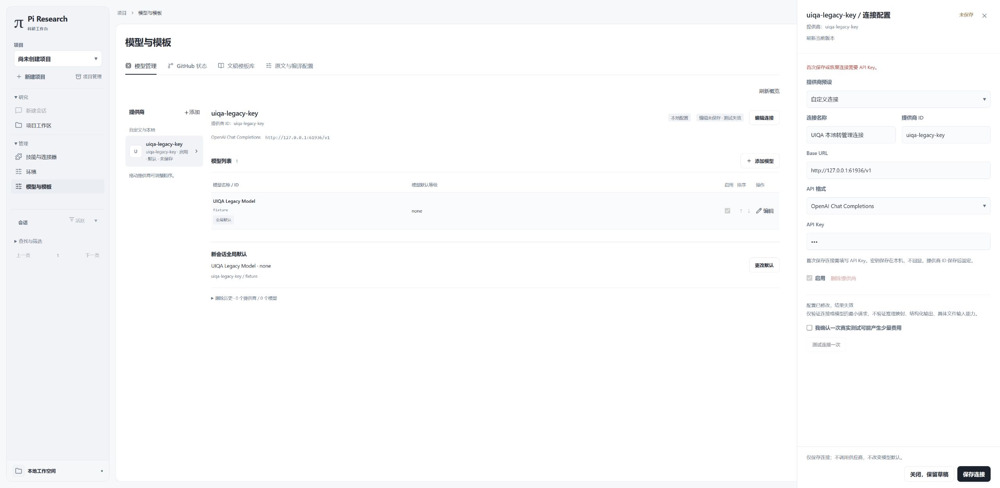

# 本地模型连接首次保存的密钥提示

LEGACY-KEY-01，2026-10-12。代码基线 `822be4884e338f5db85b654a1a217cf5c622d40c`。本批只验证“本地来源连接首次保存→已管理连接留空修改→刷新重开”这一条流程。

## 问题与修复

本地目录已有模型时，连接编辑栏显示“现有本地配置；留空保留”，而管理连接实际尚未保存密钥。Chrome 留空提交会发出请求，随后返回“API Key 必须是非空且不含空白的文本”。用户按页面说明操作却无法保存。

移除前端对本地来源的必填例外：没有已保存密钥的连接明确提示首次填写，输入框必填，本地提交守卫拦截空值及全空白并保留草稿。已管理连接仍允许留空保留现有密钥。改动只有现有组件两处和一条回归测试，未增加依赖，也未改后端、凭据存储、默认模型或布局。

## 四条验收

1. 本地来源、无管理密钥：首次填写说明及必填状态正确；空值/全空白零 POST，连接名称草稿保留。旧 Chrome 页面确实复现误导提示及服务器错误。
2. 新连接、恢复连接仍要求填写；已管理连接留空请求不带 `apiKey`，显式替换及读取遮罩仍通过原有单测。没有自动导入、解析或复制目录/环境/命令凭据。
3. 专用公开夹具用不同于目录种子的占位值首次保存，管理版本成为 1；随后留空改名，版本成为 2，保存值与凭据版本 1 保持。原目录文件不变，模型推理请求为 0。
4. Chrome 刷新重开后名称保留、密钥不回显、留空提示正确，原模型 `fixture` 与默认选择不变。旧 WINSTOP/SSH/QUEUE/COMPOSER/MEDIA 五个会话状态和代次保留，先前 PNG 消息及附件摘要保留。

Chrome 使用生产 HTTP、实际 SDK 目录和独立测试数据目录；只用公开占位值，无外部模型请求。浏览器空值验证文本未从 DOM 返回，但观察到 `required=true`、`valueMissing=true` 及零 POST；全空白的页内错误已实际显示。

## 检查与证据

- 修前回归：旧构建产物的新增用例 1 项失败，`required=false` 与预期 `true` 不符。实施原工具结果未另存日志，引用保存在本机补充说明；Chrome 修前失败另有截图和请求计数。
- 实施相关检查与独立 Sol/high 复核均为 38/38，通过且无跳过；独立复核没有代码阻断。实施请求 Luna/max、复核请求 Sol/high，运行时均未回显，不声称已核验实际档位。
- 全量 **1909 项，1885 通过、0 失败、24 跳过**（约 21 分钟）；跳过项未计为通过。干净安装、构建、类型检查通过，661 份产物一致。
- 主代理的 Chrome/持久化验证脚本通过。独立复核只覆盖代码及相关检查，未冒充操作过 Chrome。

精简机器证据见 [验收记录](2026-10-12-legacy-provider-key.evidence.json)。原日志、Chrome 截图及夹具保存在 `.validation/legacy-provider-key-20261012/`，没有提交测试数据库或原生对话。原五份无关工作区改动未纳入本批。

未检验真实供应商认证、模型推理或凭据迁移；本修复要求本地来源首次管理保存时明确填写密钥。完整项目的 73 条浏览器流程仍未全部验收，沿用总体覆盖账本。
