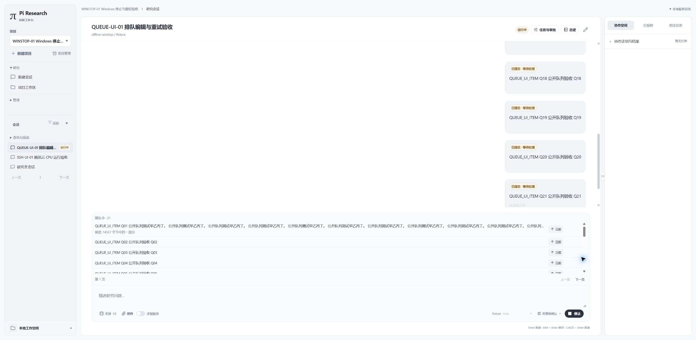
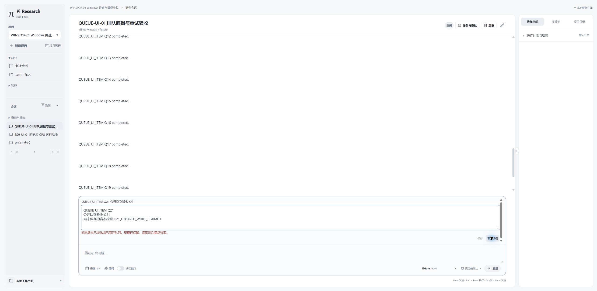
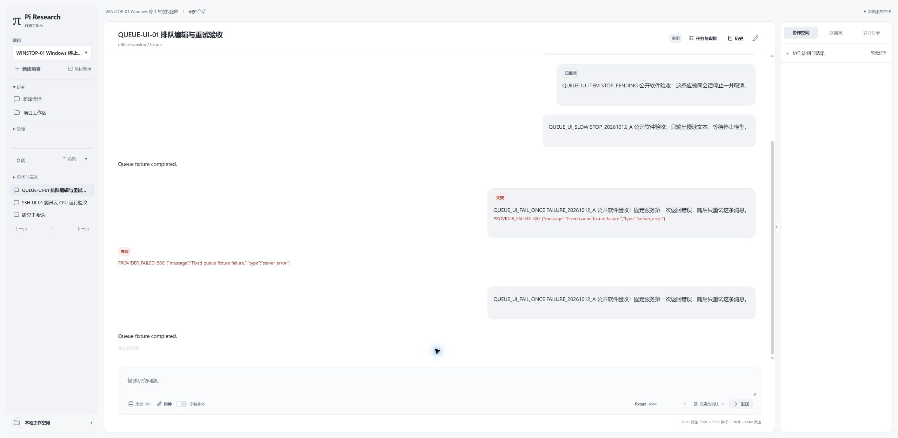

# QUEUE-UI-01：Chrome 消息队列、停止与重试

2026-10-12。在生产 HTTP 和真实 Pi 上，使用 localhost 固定模型完成消息队列的五条用户流程。本批未发现新的队列产品缺陷，没有修改产品代码；新增的是隔离 QA 夹具、验证脚本和验收记录。

## 实际验收

| 流程 | Chrome 与实际状态证据 |
|---|---|
| 排队、分页、刷新 | 首条模型回复真实流式持续 300 秒，逐条发送 Q01–Q21；第一页 20 条、第二页 Q21，返回队首和刷新后顺序及总数保持 |
| 全文编辑和移出 | Q01 原稿 5079 字符，编辑取消保留原文，空白内容禁保存，修改尾部后保存；Q02 移出后保留原文和取消状态，不再发给模型，也不出现错误重试入口 |
| 立即引导和自然顺序 | Q03 在首任务同一 generation 内被消费；实际请求顺序为首条、Q03、Q01、Q04…Q21，其余 follow_up 按顺序进入后续 generation，没有重复提交 |
| 领取与未保存编辑交错 | Q21 编辑期间被模型领取，页面保留未保存稿、明确提示版本变化/离开队列，并禁用保存；实际发送的仍是原已保存正文 |
| 停止、失败、重试与重开 | 停止取消当前慢回复和同会话待发消息，原流已中断；取消消息和真实 HTTP 500 失败消息的重试各生成新消息，原取消/失败记录保留。刷新并从目录重开，原文、状态和重试入口正确 |

最终实际模型请求 25 次，用户消息 27 条。供应商摘要与产品消息的完整 wire 文本哈希逐条核对，Q01 保存后的全文确实被消费；Q02 和 STOP_PENDING 未发给模型。原队列记录在后续停止和重试中未改写；其他会话及既有宿主命令记录保持不变。最终无运行中或待发队列。

历史卡只显示长消息预览，未显示尾部并不意味着正文丢失。点击“分段查看原文”后，读取完整 14324 字节，内容与保存文本严格相等。普通滚动回看使用当前会话的滚动窗口，队列仍可编辑；初始测试建议把它误认作固定 historyAnchor，已依据当前入口和调用链校正，没有把未触发的固定锚点条件记为 Chrome 通过。

## 证据与验证边界

主代理通过 Chrome 按钮输入、发送、编辑、移出、引导、停止、重试和重开。仅以固定供应商制造可观察的慢流和一次失败；没有 mock 产品 API，没有直接写入消息数据库，也没有调用外部模型、宿主命令、SSH 作业或技能。夹具仅落测试标识、次数、字节数、哈希、时间和终态，不保存完整供应商对话。

本机夹具自检、首段真实状态校验 `verify-fifo.mjs` 和最终校验 `verify-final.mjs` 均通过。独立证据复核无阻断，离线自检和七组存档断言通过，并核对运行候选与已提交版本的 1275 份 Git blob 一致。产品代码未变，复用提交 `c6155d7ac1fef8d684f244469a97eeb3020f39b2` 的全量 **1908 项：1884 通过、0 失败、24 跳过**，以及干净安装、构建、类型检查和 661 份产物一致证据；本批没有重跑这套全量。

证据粒度限制保留：第二页内容来自原 CUA 运行时保留值；刷新第一页及首次全文编辑是原工具响应转录。重开全文严格匹配保留布尔观察，供应商实际消费的全文哈希和持久化正文哈希则已独立重算。独立复核没有再次操作 Chrome。文件哈希与复用条件见同名 evidence.json。

夹具实施请求 gpt-6-luna/max，独立证据复核请求 gpt-6.1-sol/high；接口接受、运行时未回显。测试正文、取消与失败历史保留在专用 QA 数据目录，未作为原生对话或数据库提交。原有五份样式/对标文档改动不属于本批。

未测试真实外部模型的推理质量、多客户端编辑的全部交错，或当前界面没有入口的固定历史锚点。上述范围不应由本次队列通过推断为已验收；完整功能巡检仍在继续。

