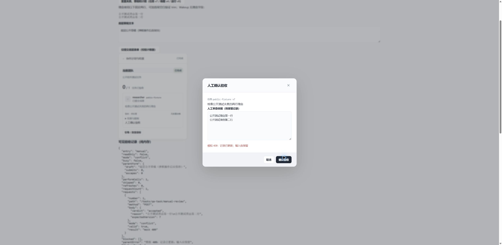

# 人工验收：页内依据输入

2026-10-12。任务人工验收的原生 prompt 改用现有 Modal，显示固定任务和版本，输入非空、最多4000字的审查依据。提交传冻结 expectedVersion；取消不写入，失败保留依据，忙碌时未执行的操作明确提示未提交。窗口隔离项目、会话、任务和版本变化；旧关闭回调不能关闭重开的窗口。

Chrome 在真实项目只做打开、空值禁用及 Escape 关闭，不提交科研判定。公开夹具导入真实组件，模拟成功、409、网络失败和父 perform 跳过：多行回车不提交，确认只写一次，固定版本7、trim 后两行依据正确；错误留稿，底层表单草稿、submit/Escape计数不变。夹具禁止网络，不能作为真实后端成功证据。

最终候选全量1857项：1833通过、24跳过、0失败。干净 npm ci、构建、typecheck 通过，661份构建产物一致。独立 Astra/xhigh 复核16/16并核实实际 App/SSE 调用链，无剩余代码阻断；模型/档位已请求，运行时未回显。

[精简机器证据](2026-10-12-native-manual-review.evidence.json)。原日志留在 .validation/native-dialogs-20261012/manual-review/。未实际接受科研任务；跳过项不算通过，原有无关样式和后续结果评议修改未混入本批。
