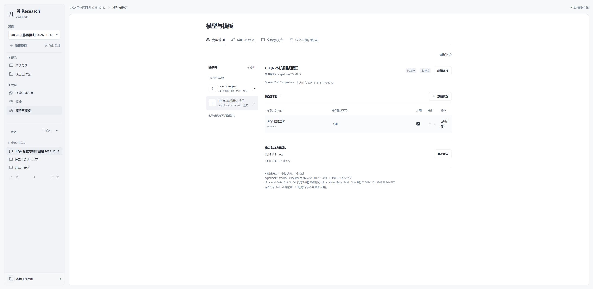

# 模型目录：页内删除确认

2026-10-12。模型及提供商删除的原生 confirm 已改为编辑器内的现有 Modal，显示准确名称和 ID。确认位于 HTML dialog 顶层内、原表单之外；底层编辑内容暂不可操作，Escape/X/取消只关确认并返回删除按钮。冻结目录版本和选择，实际 POST 前重验，重复点击只写一次；错误留在确认中，保留原配置草稿、默认模型限制与删除历史。

Chrome 桌面和390×844窄屏验证了可见性、命中、长标识换行、Escape隔离、焦点及取消留稿。用户对唯一专用测试模型 uiqa-local-20261012/uiqa-delete-dialog-20261012 给出当次明确许可后执行删除：列表2→1，固定回复 fixture 保留，删除历史0→1；刷新后测试模型仍已删除且历史在。全局默认模型保持原状。未实际删除提供商。

最终快照全量1846项：1822通过、24跳过、0失败；独立Astra/xhigh相关35/35、无源码阻断。干净npm ci、构建、typecheck通过，661个dist文件一致。模型/档位已请求，运行时未回显。精简证据见 [evidence](2026-10-12-native-model-delete.evidence.json)，原日志留.validation/native-dialogs-20261012/model-delete/。

网络失败、409及迟到回执由隔离检查覆盖，没有在真实浏览器注入故障。跳过项不算通过；其他科研任务、提供商、密钥、默认模型与后续待验收弹框不随本批更改。
