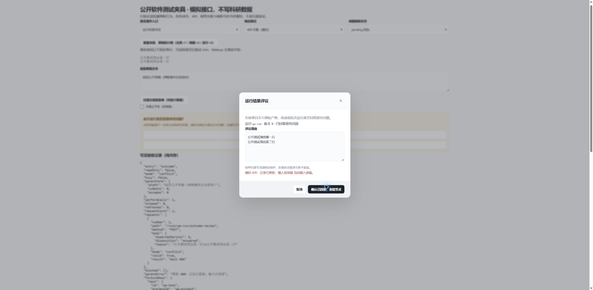

# 运行结果：页内评议

2026-10-12。运行结果评议改为页内多行输入，固定运行、版本与评议方向，非空且最多4000字。成功只更新是否回答研究问题，保留执行状态、完整性和假设判断；失败保留理由。修复了只读恢复可写或记录更新后，按钮捕获旧代次导致首次点击无响应的问题；Chrome真实React中旧版复现、新版同序列通过。

Chrome公开夹具验证已回答/未回答两方向、trim多行理由、回车不误提交、409/网络失败/父perform忙时留稿，固定expectedVersion=9。390×844弹框完整可用。真实科研运行未被评议。 所有这些提交使用模拟API，禁止真实网络，不等同真实后端或科研验收。

冻结快照全量1891项：1865通过、2失败、24跳过。失败涉及Windows宿主进程停止/清理，定向补证见同名evidence；原全量不改记全绿。最后必要UI修复后，最终整合弹框检查52/52通过；独立Astra/xhigh定向复核通过。干净安装、构建、类型检查通过，661份产物一致。模型/档位已请求，运行时未回显。

[精简机器证据](2026-10-12-native-outcome-review.evidence.json)。原日志留 .validation/native-dialogs-20261012/outcome-review/。没有恢复暂停科研任务或变更额度、审批、历史留存语义。

保留限制：未来若新增绕过App忙碌/读取代次屏障的宿主，需要重新评估保存中外部更新Run的时序。 外部模型、SSH、Docker及全部科研闭环未由本弹框批次重新验收。
