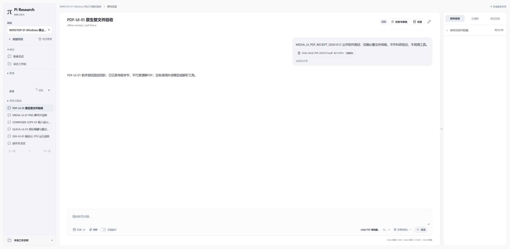

# 普通聊天原生 PDF 的 Chrome 验收

PDF-UI-01，2026-10-12。产品基线 `f7f3f5e17ba6e40a4925d0820220d550d56b2b66`。本批未修改产品源码、依赖、测试或构建产物；补齐一条真实 Chrome 的 PDF 成功路径。

## 实际结果

1. 通过页面创建专用 `pdf-fixture` 模型和普通会话，使用本机 Chat Completions、`openai` 原生适配，只声明文本/PDF。全局默认及原有五个测试会话保持。上传 [公开双页 PDF 夹具](2026-10-12-native-pdf/UIQA_VALID_PDF_20261012.pdf) 后显示“整文件随消息发送”，发送前模型请求为 0。
2. 把无 PDF 签名的公开文本文件改成 `.pdf` 后上传，被明确拒绝。有效附件和文字草稿保留，文档与产物数量不增加，模型请求仍为 0。该结果不代表产品能够识别所有内部损坏的 PDF。
3. 点击发送，真实 Pi 发起一次本机固定供应商请求。请求包含恰好一个嵌套 `file` 块，文件名、MIME、2838 字节及 SHA-256 与原件一致；末尾输入 UUID 对应 Chrome 用户消息。用户消息完成，关联的普通 HTTP 账目成功，未创建 PDF 解析任务或独立原生请求。
4. 刷新、切换到已有 PNG 会话并从目录重开后，消息、文档版本和原件身份保持，没有自动重发。点击一次“下载原件”后，下载目录中新文件的大小/摘要一致，严格 PDF 解码及两个页面标记核对通过。

固定原件 SHA-256：`e65d8cf01227438e08b97b7822807835a9b35ae8fb93919e49621dda3cf9add3`。两页均已渲染并目视检查，没有文字裁切或重叠。

Chrome 下载事件工具在 10 秒内没有返回完成通知；这是明确保留的工具证据缺口。另行核对了点击前文件不存在、点击后新文件的创建时间、字节摘要和严格解码结果，不把超时当成成功回执，也没有重复点击下载。

## 验证与边界

- 主代理的状态/字节验证脚本通过；精简身份、时序、检查和独立复核见 [机器证据](2026-10-12-native-pdf.evidence.json)。
- 独立复核支持四条验收通过、无阻断；24 个冻结文件前后哈希一致。复核者另行运行观察器自检、保持原断言的只读验证，以及原件/下载文件的严格解码；没有重复操作 Chrome。
- 测试观察器初稿误读了顶层 PDF 字段，主代理用实际 Chat Completions 结构复现失败；修正为 `block.file`，补充拒绝顶层及 Responses 形态的检查，随后与产品真正的 `attachmentPayload` 输出核对通过。这个问题属于临时测试夹具，未改产品实现。
- 本批产品代码与已验收基线相同，复用其全量 **1909 项、1885 通过、0 失败、24 跳过**及 **661 份干净构建一致**的证据，没有重复运行无关全量。
- 实施观察器请求 Luna/max；独立复核请求 Sol/high。运行时未回显，不声称核验实际模型档位。
- 固定供应商回执只证明传输链路，不证明模型理解 PDF。没有调用外部模型、接受科研结论、运行解析/OCR/视觉工具或新的计算作业。

最终稳定截图已核对会话标题、PDF 文件名、原件下载入口及空闲状态。切换后立即捕获的一张截图仍显示旧 PNG 绘制帧，保留为原始记录，但未作为本批 PDF 视觉证据。

原始日志和夹具位于本机 `.validation/pdf-ui-20261012/`。本批不覆盖其他 PDF 协议、密码保护/损坏文件、解析和逐页视觉处理；完整项目 73 条流程仍未全部验收。
