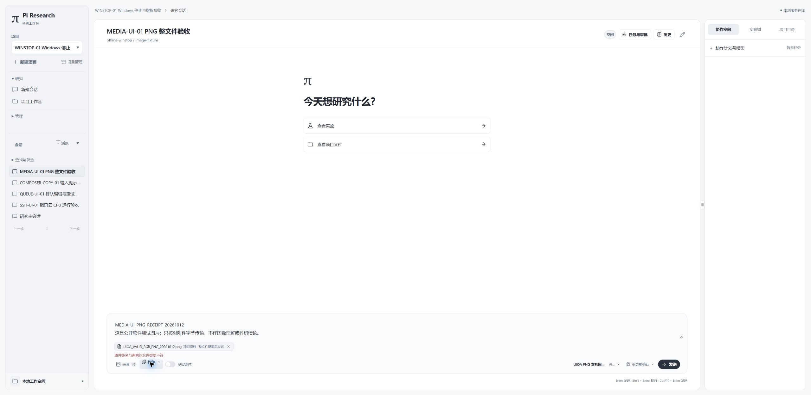
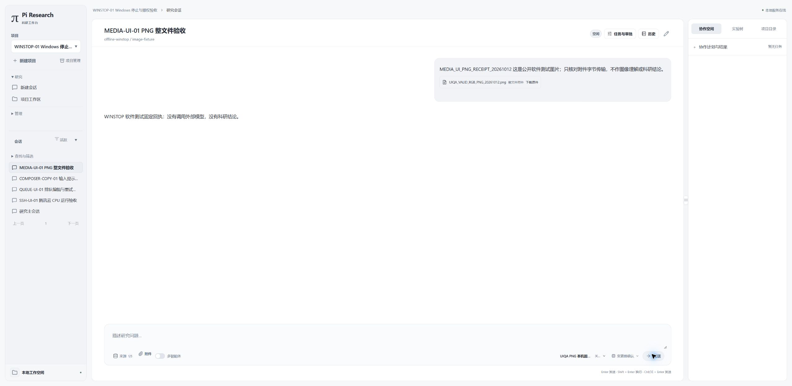

# MEDIA-UI-01：Chrome PNG 整文件附件

2026-10-12。使用真实 Chrome、生产 HTTP/Pi 和本机固定模型，完成有效图片上传、非法格式拒绝、整文件传输、历史重开与原件下载。成功范围为 PNG，不代表所有媒体类型或模型图像理解质量均已验证。

## 修复与准备

两个附件测试使用相同的损坏 PNG 常量：图像查看器拒绝，Pillow 明确报告 IDAT 校验和错误。原检查只验证字节传输，没有发现图片无法解码。本批仅把两个常量换成新生成且可真实解码的 8×8 RGB PNG，77 字节，SHA256 `b72516fa52266fe54fcffb6e71ab67b17840c42bd10f7a3fd300581eb5d51567`。保留全部既有断言，不增加依赖，也不改变产品解码器、权限、PDF/视频语义。

专用模型 `offline-winstop/image-fixture` 通过模型管理界面保存文本与图片能力，再由专用会话选择；全局默认仍为 `fixture`，旧会话模型配置保持。实际配置前遇到两种前置条件：本地来源连接需先保存为可管理连接；保存连接后，旧模型草稿版本需刷新。两次失败均保留输入，最终配置成功。

另发现待修问题：本地来源连接的 API Key 字段提示“现有本地配置；留空保留”，实际保存拒绝空值。本次仅用本机测试服务的公开占位值继续，没有读取或使用真实用户密钥；该提示问题单独留待下一批，不把工作绕过算作缺陷已修复。

## 五条验收

| 流程 | 直接证据 |
|---|---|
| 能力声明与会话选择 | UI file accept 和真实 attachment-types 均含 image/png、native=true；会话选择 image-fixture，全局默认及其他会话模型三元组不变 |
| 有效原件上传 | Chrome 文件选择器上传已解码 PNG；待发栏显示准确名称及整文件发送说明，保存的原件为77字节且摘要一致；未发送时模型请求数0 |
| 伪装格式拒绝 | 纯文本伪装为.png，页面显示签名不符；有效附件和文字草稿保留，没有新增文档或产物，没有模型请求 |
| 实际整文件发送 | 真Pi的单次请求包含一个image_url PNG块；解码77字节及SHA与原件一致，末尾输入身份与真实Chrome消息ID相同；消息completed，唯一普通HTTP账目succeeded/200，时间与供应商观察对应 |
| 刷新、重开与下载 | 刷新并从目录重开，固定文档/产物身份、摘要、历史消息保持，供应商请求仍为1；实际下载文件77字节、哈希一致，图像解码校验通过 |

浏览器下载完成事件在10秒后超时，页面无错误；没有重复点击。系统登记的下载目录中实际生成了同名测试PNG，创建时间对应这次下载操作，读取文件的长度、SHA和解码均与原件相同。因此下载文件已验证，工具完成事件仍记为未观察到；没有把超时直接当作产品下载失败。

用户消息 `e6c016fb-4d42-4246-8350-3d806d9ec34f` 固定附件为 `inputMode:native`，文档 `2d9b0b31-efc8-449f-9284-aadd6d011853`、原件产物 `e999b208-273d-43f0-b7c8-4a44623e7f79`。当前普通会话附件沿普通消息与HTTP账目记录，不依赖已经退休的独立native-request回执。

## 检查与边界

修后两个附件套件 **7/7通过**。独立 Sol/high 复核再次运行7/7，并独立核对CRC、zlib解压、行过滤及全部像素，确认新样本有效；本机观察器自检通过，只保存标识、MIME、字节数、哈希和时间，不保存图片base64或完整对话。观察器实施请求 Luna/max，复核请求 Sol/high；接口接受，运行时未回显。

全量 **1908项：1884通过、0失败、24跳过**；干净安装、构建、类型检查通过，661份产物一致。主代理另用保存的实际状态核对固定附件、wire、HTTP账目、重开身份与下载哈希，结果在同名 evidence.json。源码与原始观察留在本机 `.validation/media-ui-20261012/`；密钥、数据库和原生对话不提交。

未测试本轮真实外部模型的图像理解、其他图像格式、PDF、MP4、解析/OCR或全部大小/数量边界；这些不能由本次PNG传输成功推断为通过。本地来源连接的空密钥提示问题尚未修复。原有五份无关修改保留，未重启4794主服务。

