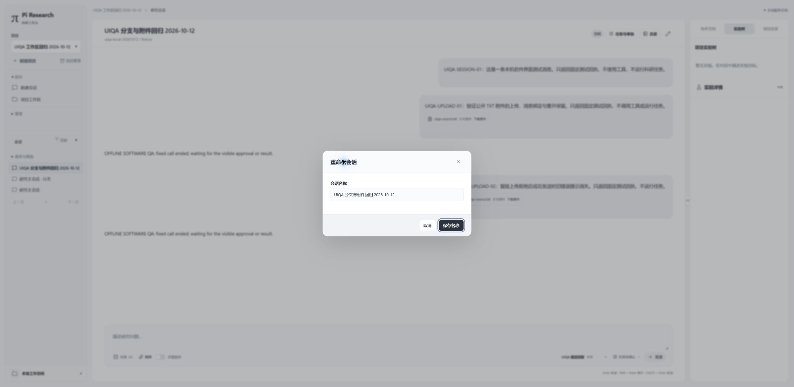

# 会话改名：页内弹框验收

2026-10-12。本批把会话改名的浏览器 prompt 改成项目现有 Modal，支持预填名称、160 字符限制、空白拦截、取消、提交中锁定和窗内错误提示。冻结会话与版本，保留严格回执校验、历史和未发送草稿；成功后立即同步标题及目录。

Chrome 实测发现并修复两个焦点问题：成功时按钮仍忙导致焦点落到 BODY；弹框 section 聚焦后 Shift+Tab 可以离开。现已等待按钮启用后关闭，并将非控件焦点的 Tab 导回弹框，避免抢走其他弹框的焦点。最终 Chrome 确认成功与取消均回到改名按钮，精确弹框范围检查通过，原生对话框为 none。390×844 窄屏下输入与按钮完整可见，测试后恢复原尺寸。

验收五项：成功及即时同步；取消/失败保留输入；版本/上下文/ABA/卸载隔离；归档与历史语义不变；焦点、事件边界和现有 Modal 默认行为。相关回归覆盖以上条件，Chrome 覆盖成功、取消、空白、草稿、焦点和窄屏；网络失败及竞态由自动检查覆盖。

验证：初始冻结快照全量 1821 项，1797 通过、24 跳过、0 失败。其后必要焦点修复的最终构建相关检查 107/107，通过独立 Sol/high 定向复查 32/32；最终 npm ci、构建、类型检查通过，661 个 dist 文件一致。运行时未回显模型/档位，记录为已请求。机器摘要见 [evidence](2026-10-12-native-rename-dialog.evidence.json)，原日志留在 .validation/native-dialogs-20261012/rename/。

未改布局、后端 API 或既有 OutcomeReview 在途内容。本批只交付改名流程，其余应用原生弹框仍在逐批迁移；刷新/关页的 beforeunload 防丢稿提示保留。跳过项及实际模型理解、外部系统和全部科研流程不能记为本批验收通过。
