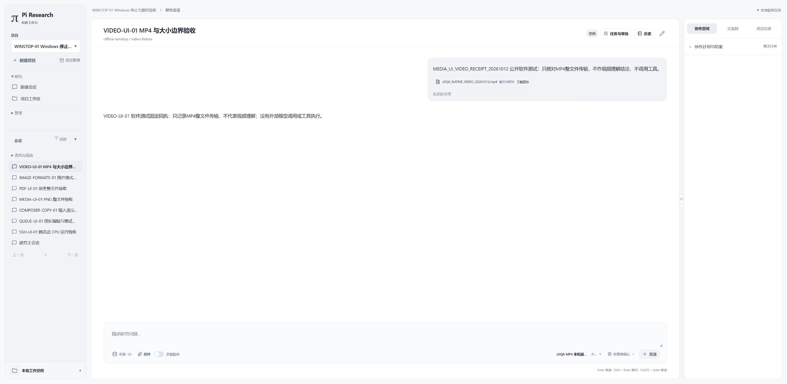

# MP4 原生附件与 20 MiB 上传边界的 Chrome 验收

VIDEO-UI-01，2026-10-12。基线 `76821489fd49c9a2805af11e6e16aefa65579553`。本批补齐一条视频附件流程，没有修改产品源码、依赖、测试或构建产物。

## 实际验收

1. 用已有 FFmpeg 生成 [公开视频测试样本](2026-10-12-native-video/UIQA_NATIVE_VIDEO_20261012.mp4)，H.264、96×64、2 秒、20 帧、8510 字节，经过完整解码及首尾帧检查。Chrome 创建专用普通会话，模型使用 Chat Completions/qwen，仅声明文本和视频，上传后显示“整文件随消息发送”。
2. **20 MiB 边界**：给同一有效 MP4 追加合法 `free` box，全部仍可完整解码。恰好 20 MiB 上传成功；从草稿移除后，项目原件保留。20 MiB 加 1 字节，以及两份各 11 MiB 的合计超限，均在浏览器端拒绝，上传 POST 计数保持 1、无新文档/产物，文字草稿保留。之后上传 8510 字节的小视频；再上传无 MP4 签名的伪装文件，被服务器拒绝且不新增记录，原有效附件和草稿保留。
3. **发送**：真实 Pi 只发起 1 次本机固定供应商请求，恰好 1 个嵌套 `video_url.url`，MIME、8510 字节及 SHA-256 与原件完全一致。输入 UUID 对应 Chrome 用户消息，唯一普通 HTTP 账目成功。20 MiB 原件没有发送，旧错误清除，草稿清空、会话空闲。
4. **重开与下载**：刷新、切换到图片会话再从目录重开后，消息及原件身份保持，没有自动重发。点击一次下载后，实际 MP4 在点击后新生，摘要/大小相同，再次完整解码为 20 帧。全局默认和旧七个 QA 会话的状态、代次、模型均保持。

原件 SHA-256：`eac745341edf199272ccd365a35cfb0d5be05dd483d0cf1937ed8edbee26758a`。用于边界的四份较大软件样本留本机，不纳入 Git。

浏览器下载事件工具超时，未将该事件记为通过。实际下载以点击前文件不存在、点击后新文件创建时间、字节摘要及独立完整解码确认，没有重复点击下载。

## 验证与限制

- 主代理的状态、边界、引用及传输断言通过；身份、请求时间和复核结果见 [精简机器证据](2026-10-12-native-video.evidence.json)。
- 独立复核支持四条验收通过、无阻断；45 份冻结证据前后摘要一致。观察器自检、只读验收断言、原件/四份边界样本/实际下载共六份视频的独立探测及完整解码均通过；复核者没有重复操作 Chrome。
- 观察器仅接受本批专用模型、最新消息的精确标记与末尾 UUID；读取产品实际使用的嵌套视频字段，错误块不被过滤成成功。自检及“产品编译适配器→观察器”交叉检查通过，不保存原始对话、Base64 或凭据。
- 本批产品未变；核对实际服务完整构建清单后，复用前批 **1909 项、1885 通过、0 失败、24 跳过**和 **661 份干净构建一致**的证据。
- 观察器实施请求 Luna/max，独立复核请求 Sol/high；运行时未回显，不声称已核验实际模型档位。

未发现本批产品缺陷。只验证本机固定供应商的 Chat Completions/qwen 视频传输，不证明真实外部供应商接受视频或模型理解视频。20 MiB 原件只验证上传；实际发送为 8510 字节。签名拒绝不代表能够识别所有损坏视频，其他 API/适配未在 Chrome 遍历。

原始日志、截图、大小样本和状态记录留在本机 `.validation/video-ui-20261012/`；未提交数据库、凭据或原生对话。完整项目 73 条流程仍未全部验收。
