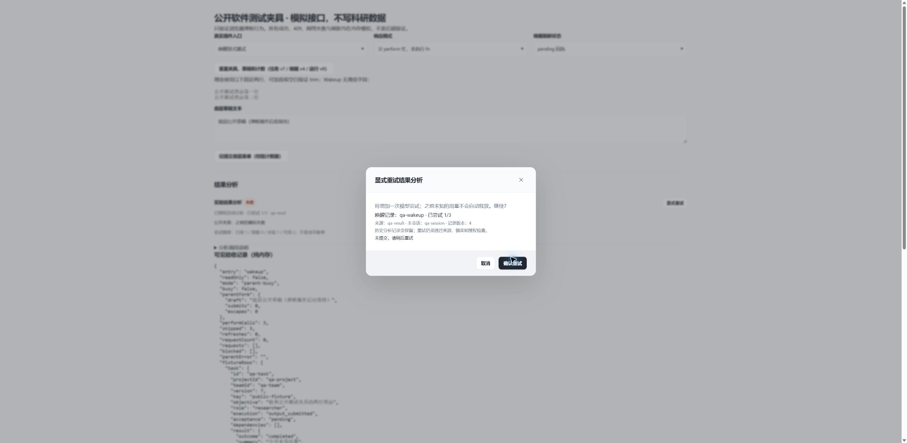

# 显式重试：页内确认

2026-10-12。显式重试结果分析改为页内确认，显示固定记录、来源、版本与尝试次数，明确未知用量不会自动释放。取消不写入，重复确认仅发一次；正常排队、运行和终态能收起窗口并恢复焦点。失败在窗口内提示，记录失效后可关闭重开；迟到回执不能释放新请求的锁。Chrome还发现父perform跳过操作时无反馈，现已补上“未提交，请稍后重试”。

Chrome公开夹具验证取消0请求、成功单POST、pending/queued/running/completed/同次failed推进、409和网络错误、连续忙碌跳过提示、键盘Tab环绕及Escape返回。390×844弹框未水平溢出。 所有这些提交使用模拟API，禁止真实网络，不等同真实后端或科研验收。

冻结快照全量1874项：1848通过、2失败、24跳过。失败涉及Windows宿主进程停止/清理，定向补证见同名evidence；原全量不改记全绿。最后必要UI修复后，最终整合弹框检查52/52通过；独立Astra/xhigh定向复核通过。干净安装、构建、类型检查通过，661份产物一致。模型/档位已请求，运行时未回显。

[精简机器证据](2026-10-12-native-wakeup-dialog.evidence.json)。原日志留 .validation/native-dialogs-20261012/wakeup/。没有恢复暂停科研任务或变更额度、审批、历史留存语义。

保留限制：后端retry无原子expectedVersion；恢复回退需关闭重开；未来Perform宿主在fn前直接拒绝时，具体错误可能退化成通用未提交提示。 外部模型、SSH、Docker及全部科研闭环未由本弹框批次重新验收。
