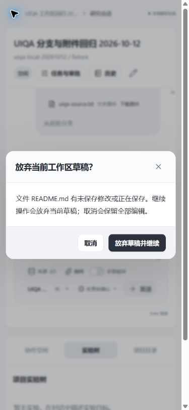

# 项目工作区：页内弹框与草稿保留

2026-10-12。本批将工作区新建文件、重新读取和离开项目的原生 prompt/confirm 改为现有 Modal，完整接通 App 的异步调用链。确认只针对打开窗口时的草稿、项目与目标；第二步路径窗取消不会提前清稿。保存版本校验、归档只读和 beforeunload 防丢稿继续保留。

独立复核与 Chrome 找出并修复两项阻断：Windows 尾点/尾空格等无效新文件路径会提前清空原稿；窄屏导航遮挡项目切换确认。现在先校验路径，再改变草稿；移动导航先收起，取消后焦点回到可见导航按钮。普通 result~1.md、中文、多点文件名等合法输入保持支持。

Chrome 已验证：两步骤取消、项目创建取消、隐藏工作区的项目管理确认/取消均保留草稿；非法路径同例复验保留内容；390×844 确认按钮可点击、取消焦点正确；正常新建文件保存、文件树更新、刷新回读完整；确认切项目并返回保留已保存文件。仅在 UIQA 项目写入公开测试文本，真实研究项目未作文件写入。

初始冻结快照全量 1837 项：1813 通过、24 跳过、0 失败。必要修复后最终相关检查 123/123，独立 Astra/xhigh 定向复查 82/82，干净 npm ci、构建、类型检查通过，661 个 dist 文件一致。模型/档位已请求，运行时未回显。精简机器证据见 [evidence](2026-10-12-native-workspace-dialogs.evidence.json)，原日志保留 .validation/native-dialogs-20261012/workspace/。

未运行真实网络故障注入或故意刷新未保存页面；对应失败/竞态与 beforeunload 有自动检查。全量中的跳过项不代表通过。模型删除等其他流程不随本批提交，布局和无关既有 WIP 保留。
