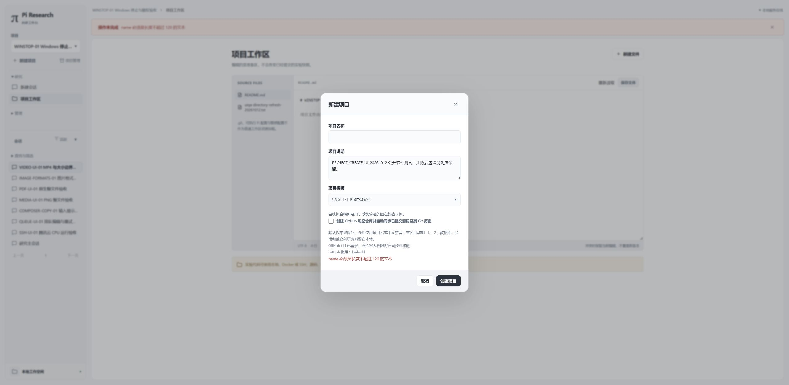

# 项目创建失败反馈与迟到更新保护

PROJECT-CREATE-UI-01，2026-10-12。基线 `f2175aef0c5da3c9cc954bb2363c64b5b9b72ab9`。本批完成“本地空项目失败→留稿重试→成功重开”流程，不涉及 GitHub 建仓或项目删除。

## 问题与修改

Chrome 复现了既有 U3：空白名称触发真实服务器 400，新建窗口却没有错误；提示被显示在遮罩后的全局区域。父层 `perform` 捕获异常后不再抛出，弹框的 `catch` 因而得不到失败结果。

在项目专用回调中传回失败或“未提交”，保持全局 `perform` 约定不变。弹框现在用现有错误样式及 `role="alert"` 呈现提交错误，与 GitHub 状态检测错误分开；检测刷新不会清掉提交失败。提交期间锁定表单、创建和关闭入口，保留原草稿及请求键。

独立复核进一步复现 R1：旧创建选择已经入队后，新窗口意图变化，旧对象更新仍能切换项目。修补为在状态更新真正应用时再次核验窗口意图，失效返回 `null`，并保留完成回调以释放等待。该反例与回归是实际 App 方法加延迟提交队列，未冒称真实 React DOM 调度复现。

项目 POST→会话 POST 的顺序及 `key`/`key-session` 保持。原文重试复用身份，修改表单换键；创建已经完成后，即使刷新失败，也不会误报成未提交。旧窗口回执不再关闭新窗口、切换其项目或产生成功提示。没有改后端事务、权限、依赖或 CSS。

## Chrome 五项验收

1. 修前 400 只有全局错误；修后窗口内错误可读、具备 alert 语义，空白名称、说明、empty 模板及未勾选 GitHub 保留，项目和会话无新增。
2. 不改内容再次提交仍为 400，两个请求身份摘要相同。改正名称后换新键，恰好新增一个本地项目和一个主会话；提交期间创建/取消/关闭入口禁用，成功后窗口关闭并选中新项目。
3. 取消后重开没有旧错误；旧项目未保存 README 草稿完整保留。测试后已显式重新读取，清除本批临时草稿，没有写回原文件。父 busy、网络失败、部分成功及迟到回执分支由真实 App 回调检查补足。
4. 成功后刷新、切回旧项目再打开新项目，README 与主会话可读，没有重复创建。GitHub 状态为 local、enabled=false；模型请求为 0。
5. 旧项目名称、工作区文件摘要、八个会话状态/代次/模型及消息摘要保持。

Chrome 分阶段执行：初次集成候选验证了失败、取消重开和旧草稿保留；最终 R1 候选再次验证 400/重试/修正创建、README、刷新和项目切换。临时服务对项目/会话 POST 延迟 1 秒以观察按钮锁定，实际处理器、校验和存储仍为产品实现。

## 验证记录

- 修前新增回归 11 项中 7 项失败；初次集成相关检查 87/87 通过。
- 初次集成的冻结快照全量：**1919 项，1895 通过、0 失败、24 跳过**。这不是最终 R1 快照的全量重跑。
- R1 新队列回归在旧构建产物上失败；最终相关四组 **88/88 通过**，独立关键复查也为 88/88。修补只涉及一行状态 updater 和对应回归，沿用未受影响的全量证据。
- 最终候选干净安装、构建、类型检查通过，**661 份产物一致**。
- 实施请求 Sol/high；因两步创建与迟到提交边界，由本批唯一独立 Astra/xhigh 复核并定向复查 R1。最终五项证据核对通过，30 份验收文件摘要一致；运行时档位未回显，不声称核验实际配置。

详细身份、摘要及检查边界见 [机器证据](2026-10-12-project-create-feedback.evidence.json)。初审阻断和修前失败原日志留在 `.validation/project-create-ui-20261012/`，没有改写为通过。

既有 GitHub 账号刷新与请求键绑定问题留待该独立流程验证；项目和会话仍是两个请求，没有改为事务。真实浏览器未注入网络中断或 React 提交队列；这些用定向检查覆盖。完整项目验收仍在继续。
