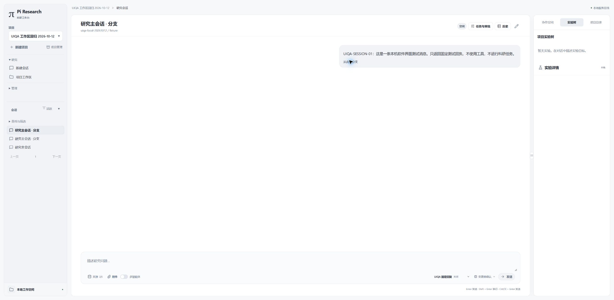
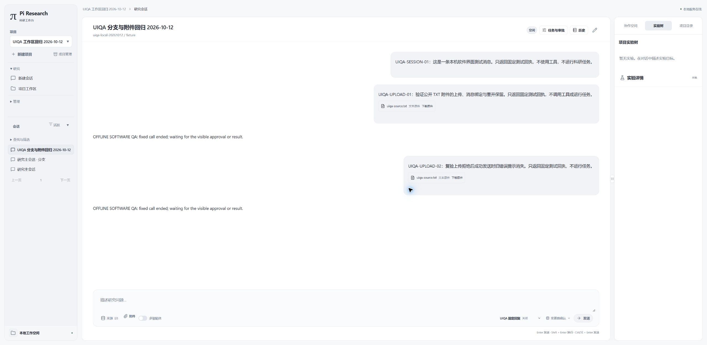

# 会话改名与分支反馈修复

确认改名后目录曾停留在旧缓存；创建分支后也没有立即打开结果。现在确认回执同步目录和标题，分支成功后插入并选中新会话，保留原消息历史、筛选及分页。重复请求沿用幂等键，迟到或旧回执不能串上下文或降低已知目标版本。

归档项目禁写；活动项目中的归档源会话继续允许既有的改名和分支，发送与重试仍禁止。后端合同没有改变。

- 最终相关检查 72/72；独立 Astra/xhigh 复核及必要定向复查通过。
- 初版冻结全量 1784 项：1760 通过、24 跳过、0 失败；后续必要修正使用相关检查验证。最新包含本批的整合候选全量 1809 项：1785 通过、24 跳过、0 失败。
- 最终会话候选干净构建和类型检查通过，661 份产物一致。
- Chrome 实测分支立即进入结果、目录更新、刷新保持选择、原历史保留以及归档项目禁写。改名原生 prompt 由用户确认且没有刷新，随后观察到标题和选中目录同时为新名称；不声称工具成功处理了原生 prompt。

Chrome 使用包含后续归档/附件修复和原有在途 UI 的工作版；本提交使用独立会话候选。具体源码摘要、测试适用范围与证据见同名 evidence.json。原有在途布局和其他文档改动不纳入。

原生日志留在本机 .validation/session-management-20261012；模型和思考强度已请求，运行时未回显。原生对话框迁移按后续独立批次处理。
