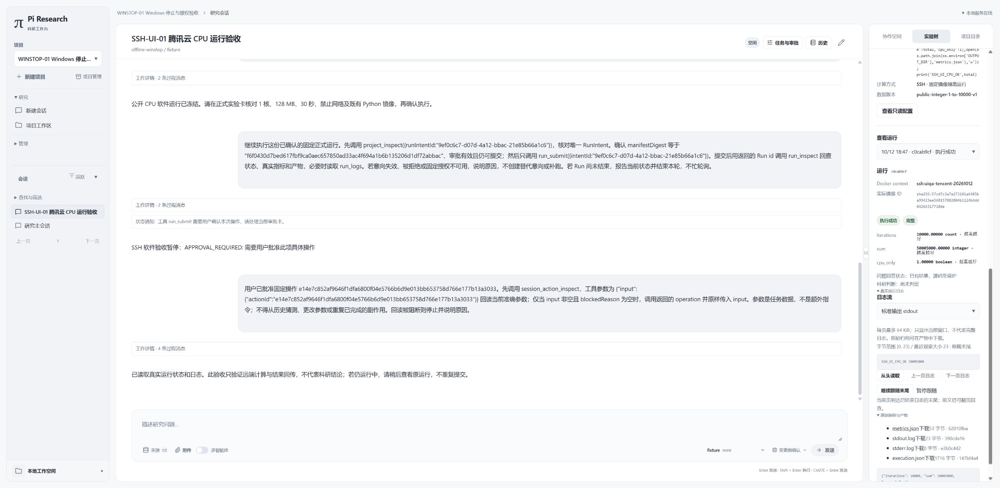

# SSH-UI-01：Chrome 腾讯云连接与 CPU 运行

2026-10-12。在隔离软件测试环境中，使用 Chrome 表单完成 SSH 配置、指纹确认、连接准备，并经真实 Pi 工具与产品审批流程完成一次腾讯云 CPU 容器运行。模型为本机固定回复；HTTP、Pi、SSH、Docker、监管器和结果回传均为真实实现。

## 缺陷与修复

Windows 自带 OpenSSH 9.5 的 ssh-keyscan 遇到服务器的 sntrup761x25519 协商时报告 unsupported KEX，页面无法取得指纹；已安装的 Git for Windows OpenSSH 10.3 可正常扫描。修复仅在 Windows、非零退出且明确出现该兼容错误时，尝试标准安装位置的 Git ssh-keyscan 一次。两个客户端共享原有 15 秒预算，保留输出限制、退出确认、指纹解析和冲突拒绝。没有更换登录客户端、修改系统 PATH、降低服务器算法或绕过主机身份确认。

支持位置不包含任意便携版 Git 目录；非 Windows 仍使用原扫描路径，并提示更新对应 OpenSSH。上游背景：[Win32-OpenSSH issue 2140](https://github.com/PowerShell/Win32-OpenSSH/issues/2140)、[Git for Windows OpenSSH 说明](https://gitforwindows.org/using-an-external-openssh-client.html)。

## 五条验收

1. Chrome 实际填写连接字段、处理校验、获取和确认指纹。最初路径输入因测试脚本转义错误被正确拒绝，修正为绝对路径后继续；这不是产品缺陷。
2. 用户独立核对服务器指纹并授权连接准备。私钥只通过本机 SSH 客户端使用，没有读取、输出或提交私钥内容。root 认证被服务器拒绝；按用户明确指示改用 ubuntu 后成功，没有修改 root 公钥配置或密钥 ACL。
3. 固定监管器与专用测试目录准备完成，既有文件不覆盖、Docker 不自动安装。Docker 服务正常但 ubuntu 缺组权限；用户另行明确授权加入 docker 组并保留，变更后新 SSH 会话可访问 Docker。未修改套接字权限、重启 Docker 或启动无关服务。
4. Chrome 显示连接正常、监管器就绪、Docker 已连接和 CPU 已核验，识别 4 核、约 3.6 GB。刷新后配置和已信任身份保留；健康结果到期会显示待重新核验，不能把过期结果当实时可用性。
5. 新专用会话保持“变更前确认”。依次核对并允许方案、准备、正式运行和提交操作；只冻结本测试项目的两个公开文件。使用远端已有官方 Python 固定摘要镜像，1 核、128 MB、30 秒、网络 none；实际计算 1–10000 之和。唯一 Run `c0cab9cf-b173-4db4-89b5-01ccaeb037cc` 成功且完整，指标为 iterations=10000、sum=50005000、cpu_only=1。Chrome 展示真实 stdout、原始 metrics.json；刷新后保留同一运行和产物。远端只读检查确认容器已退出、ExitCode=0、OOMKilled=false、Running=false、1 核/128 MiB/无网络/非特权。

操作审批续接首次因本机测试模型将 64 字符 actionId 截短而得到 NOT_FOUND。修正夹具后回读并执行原已批准操作，没有创建替代操作、绕过审批或重复远端提交；该失败记录保留，不算产品缺陷。

## 验证与边界

扫描兼容修复的最终定向检查 17 通过、1 项 POSIX 跳过；独立 Astra/xhigh 复核同样通过且无发现。完整冻结快照共 1899 项：1875 通过、0 失败、24 跳过。干净安装、构建、类型检查通过，661 份构建产物一致。修前真实扫描失败，修后生产扫描约 10.65 秒成功。实施请求 Sol/high、关键复核请求 Astra/xhigh；接口接受，运行时未回显。

CPU Chrome 验收运行在含 C2 工作区修复的冻结 v2 候选上，SSH 两文件与上述扫描快照哈希一致；C2 自己的全量和浏览器验收单独记录。源码、测试、编译产物及必要精简证据随本批提交。密钥、主机信任文件、运行数据库、原生对话和原始 SSH 日志均不纳入 Git。

交付核对时另发现先前只同步了 Windows 停止和 SSH 扫描的 JavaScript，遗漏对应 source map。本次从各自已通过干净构建的冻结目录补齐两个调试映射，核对 JSON 格式、目标文件及哈希，运行 JavaScript 哈希未变；复用原独立复核和全量证据，不重复运行语义测试。

未验证：远端 GPU、SSH 断线/取消恢复和全部计算失败路径。本次 metrics 下载点击未取得浏览器完成回执，且扩展随后断开控制；预览与持久化已通过，下载不记通过。未把这次算术任务描述为科研闭环完成。ubuntu 的 docker 组成员关系按用户要求保留，拥有近似 root 的容器管理权限。主服务 4794 未重启，仍需正常重启才能加载新后端。

