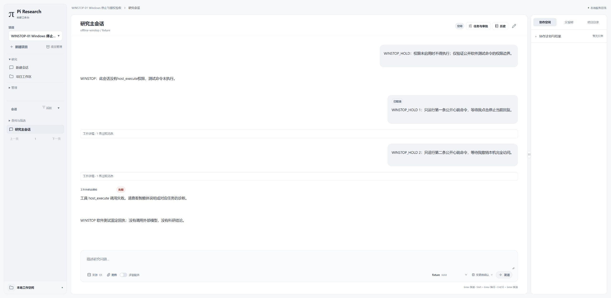

# Windows 停止与撤权：等待真实退出确认

2026-10-12。修复取消/撤权时过早产生 unknown 和清理目录 EPERM 的路径。原代码启动 taskkill 后忽略其完成/失败，4秒即结束等待；本机实际停止命令可超过4秒。现在 Windows 分开等待 taskkill（最多10秒）及目标 close（成功后最多4秒），两者确认后才记录 cancelled。helper失败、超时或缺少目标退出仍保留 unknown、PID和审计；重复取消只启动一次停止命令。撤权和旧代次隔离先行生效，历史不删除、不自动重试。

[Microsoft taskkill 文档](https://learn.microsoft.com/en-us/windows-server/administration/windows-commands/taskkill)说明本批沿用的 PID、/T子树和/F参数；上述时间界限来自本项目策略和实测，并非平台保证。

修前新增两项确定性反例失败；修后相关17/17、最终顺序/重复取消/单审计增量5/5通过，独立Astra/xhigh17/17通过且无代码阻断。最终冻结全量1898项：1874通过、0失败、24跳过。干净安装、构建、类型检查通过，661份构建产物一致。请求模型/档位已接受，运行时未回显。

Chrome使用真实生产HTTP和Pi、本机固定模型及独立数据目录。用户当次批准指定QA会话后，只运行两条公开心跳命令：第一条通过停止模型结束，第二条通过撤销完全访问结束。两条均由运行中变为cancelled；两个自有PID均不存在、心跳不再更新，active=0、unknown=0、enabled=false。刷新后权限仍为变更前确认，取消和工具拒绝历史保留。没有科研判定或外部模型调用。

[精简机器证据](2026-10-12-windows-host-stop.evidence.json)。原日志、时序及补丁留 .validation/host-stop-20261012/。五条验收见该目录plan.md；修前全量失败日志保留，不回写为通过。

主4794服务及原4795/4796夹具未重启，已运行的后端需正常重启后加载改动。POSIX动态验证未做；等待超界仍诚实保留未确认状态。完整浏览器验收继续，不能将本流程通过等同所有功能完成。
