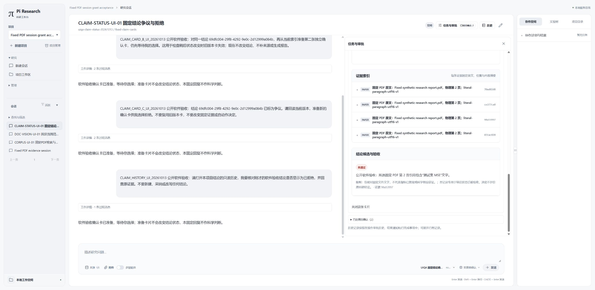

# 结论争议、旧卡失效与拒绝历史

CLAIM-STATUS-UI-01；基线 `38468a33a27bfda01bee95cc921890d405f7e80b`。复用既有真实固定 PDF 证据，只补当前 Chrome 的争议、拒绝和旧版本卡失效分支；[既有按需卡采纳](../acceptance/flow-on-demand-research/RESULT.md)及未变调用链直接复用，不重新检索或导出。

| 验收 | 实际结果 |
|---|---|
| 准确来源和起点 | owner API 准备一个已采纳的软件 Claim（v2），引用原 Evidence `98a53997…`；声明只核对固定第2页含“测试集 MSE”文字，不评价科学结论。此准备不冒称新的 Chrome 采纳 |
| 卡前不改变状态与旧版本拒绝 | 两条人工消息分别让真实 Pi 从 claims 索引读取当前版本，再准备两张 v2 确认卡；Claim仍accepted/v2。Chrome点“标为争议”后为disputed/v3，另一张v2卡变为失效，三种决定按钮全部消失 |
| 新卡拒绝与重开 | 新人工消息回读v3后准备新卡，Chrome点“拒绝此结论”，得到rejected/v4。刷新重开不改变记录；现有只读claims历史明确显示“未通过”，原声明、限制和证据ID保持 |
| 决定与数据保留 | 持久事件依次保留accepted/disputed/rejected；原争议卡仍有decision=disputed，旧未执行卡没有产生决定，新卡decision=rejected。旧147条业务记录和28份固定文件保持；没有新检索、解析、Run或报告 |

新Claim为 `69dfc004-29f8-4292-9e0c-2d12999a084b`。它是可识别的软件测试记录，拒绝不删除Claim或Evidence。旧版本卡的服务端拒绝、跨会话、幂等和事务守卫复用未变自动检查，没有绕过页面禁用状态强行点击。

本机固定提供方共11次成功HTTP，0夹具失败；前三个人工请求各为索引→准备卡→回复，只读历史另两次。完成卡只显示通用“已完成”，因此通过现有只读历史验证真实状态；没有新增产品入口。提供方在第9次后同端口切换到只读历史阶段，记录/卡/请求列表/模型目录保持，应用服务未重启。收尾禁用并正常停止专用提供方；原默认和已有模型配置保持，新增受管提供方仅使legacy显示序号增加1。

非阻断待办：失效但未关闭的卡仍计入“已知待确认”；已完成的结论卡缺少具体“争议/拒绝”决定文案，需要到只读历史看当前状态。没有权限绕过或结果丢失，不在本批扩大修复。

无产品代码修改，不重复构建、Chrome采纳或已通过回归。核心卡片/工作流/证据服务自按需卡交付 `66383a1` 未变，相关后端检查复用阶段全量证据。当前四条件的独立关键复核及哈希见同名evidence JSON，原始机器记录留本机 `.validation/claim-status-ui-20261013/`。

本批只验证软件状态和固定证据关联，不构成科学采纳或正确性审查；完整功能目标仍按有效覆盖清单保留剩余分支。

