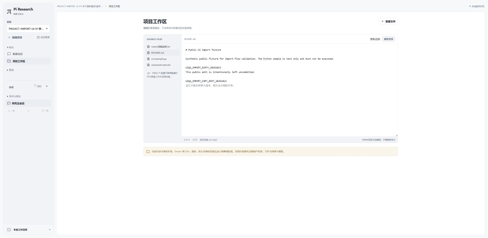
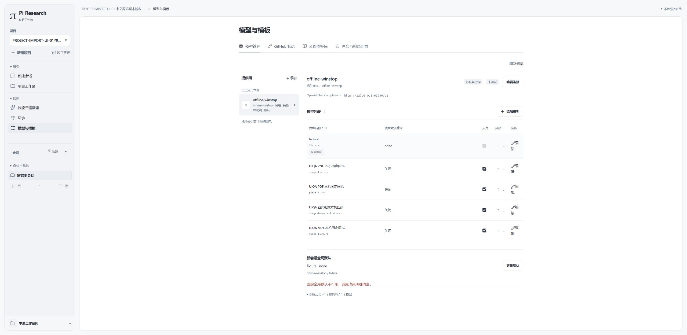
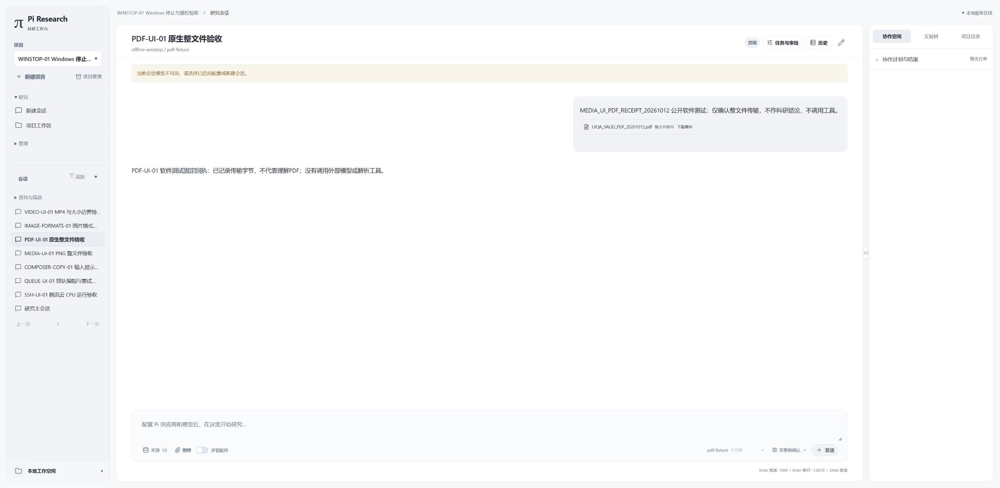

# 离线备份、异址恢复与 Chrome 历史重开

DATA-BACKUP-UI-01，2026-10-13；基线 `9bc4894be64f75aafdc821ead3d1e0fc7acc2f15`。本批使用已有公开 QA 数据，通过现有 CLI 备份/恢复，再用 Chrome 重开恢复副本。网页没有执行这些 CLI 命令的表单，不将该部分计作纯浏览器操作。独立关键复核无未解决阻断：条件1–3通过，条件4保留GitHub只读外联的观测缺口，不作无保留全通过陈述。

发现并复现了一个会使备份失效的 Windows 路径缺陷：恢复目标位于备份内部时，只要改变路径字母大小写，原有字符串比较便未识别重叠。独立备份副本上的真实 CLI 恢复退出0、生成嵌套目录；随后该副本完整性校验报 `BACKUP_INVALID`。原始备份与活动恢复数据没有用于该破坏性反例。

修复限定在备份和恢复共用的目录检查：Windows 比较时忽略字母大小写，目录根已有分隔符时不重复追加；保留目录边界，避免把 `backup` 与 `backup-copy` 误认成嵌套。实际访问路径、清单、历史内容、重定位元数据和错误码不变。重叠在创建临时目录之前拒绝。

| 验收条件 | 本轮实际结果 |
|---|---|
| 明确离线前置和完整备份 | 缺 `--offline` 返回 `BACKUP_USAGE`，未发布输出。实际备份前，自有旧服务正常退出、PID不存在、端口释放；无待执行/未知任务。备份40文件、90条目，校验成功 |
| 拒绝覆盖、隐式迁移与目录重叠 | 已有目标返回 `BACKUP_TARGET_EXISTS`，哨兵不变；缺 `--relocate` 返回 `BACKUP_RELOCATION_UNSUPPORTED`。修后真实CLI拒绝大小写嵌套，备份全部目录/文件摘要不变且校验通过；相邻兄弟目录恢复成功 |
| 只启用新副本并完整保留历史 | 对17张SQL表按真实字段类型逐行比较，仅允许明确的进程协调及数据位置差异。保留的39个非DB文件逐字节一致，其中8个原生JSONL；原源持续离线 |
| Chrome重开且不恢复凭据 | 3项目、10会话、99消息保持；导入项目README、既有PDF会话与附件可读，刷新保持；PDF实存下载与清单摘要一致。1连接/5模型为待配置密钥状态，未提交新模型请求 |

恢复后第一次启动仅新增本次控制器协调行；其余16张SQL表保持。原数据目录备份后未变。此数据集没有 Git 工作树和本地 Run，因此本次完整文件比较没有 Git 指针改写例外；相关迁移行为由定向自动检查覆盖。旧的绝对路径历史不被改写，读取时通过已有位置映射访问恢复副本。

备份按既有规则排除模型密钥、环境变量、SSH配置/私钥及会话认证目录等。恢复仅保留公开模型定义并要求重新配置凭据：Chrome显示“待恢复密钥”，编辑框为空且必填，填写普通草稿后发送仍被禁用，随后清空草稿。未重新授权、运行模型/计算、SSH操作或GitHub建仓/同步写入。该排除规则不等于扫描全部科研文本中的任意秘密。

独立复核发现本轮日志的一个边界：进入模型设置页会挂载隐藏的GitHub状态组件，并发起状态读取；本机CLI可用且已有登录时，后端可能访问GitHub查询账号。夹具只记录非GET请求，无法确定该次外联是否实际完成。因此撤回最初“零外联/无GitHub动作”的过宽陈述，验收条件4保留无执行、无写入和无新授权要求，同时明确既有账号的只读检查可能发生。未重新请求端点或读取凭据补造证据。隐藏页面的后台检测另记为后续体验检查项。

下载只点了一次。浏览器下载事件工具超时，但磁盘上点击后新建的PDF确已完成：2838字节，SHA256 `e65d8cf01227438e08b97b7822807835a9b35ae8fb93919e49621dda3cf9add3`，与备份清单一致；未重复点击或覆盖旧下载。

`--offline` 是操作人对停机的承诺，现有代码不保证自动拒绝所有空闲但仍存活的控制器。本轮以实际停机证明满足前置，不据此宣称存在全进程互斥保护。POSIX原生大小写行为未在当前Windows机器执行；不覆盖所有文件系统别名或跨平台恢复。

另记录一个非阻断显示问题：切入已有PDF会话时，历史尚未读完会短暂显示“今天想研究什么？”，随后原历史正常出现；不属于消息丢失。本批不扩展前端布局或会话加载修复。

最终相关检查28项：27通过、0失败、1项原生POSIX跳过，覆盖备份、CLI、异址迁移和无密钥模型目录。干净安装、构建与类型检查通过，候选661份产物一致。修前同一回归的四个Windows子用例失败，修后通过；早期测试自身的只读SQL检查产生WAL，调整了取基线的先后顺序，未删除保留断言，最终红绿均使用修正后的同一测试文件。按用户精简要求，本批不重复无关全量；之前1927项全量中的两个旧错误字段断言已由110项定向修正通过，不能将其写成最终全量重跑全绿。

预检及局部修复请求Astra/high，独立比较脚本请求Sol/high，最终独立关键复核请求Astra/xhigh；运行时均未回显实际模型/档位。最终复核核对代码、数据保留投影、截图/DOM、下载文件与构建产物，并在同一轮内完成配套source map同步和上述证据表述修正，没有重复启动应用或再做全量测试。

检查范围、精简日志摘要及独立复核记录见 [evidence.json](2026-10-13-data-backup.evidence.json)。原始CLI日志、DOM、数据库投影和复现副本保留于 `.validation/data-backup-ui-20261013/`，不提交数据库、原生对话或凭据。完整功能巡检尚未完成。

