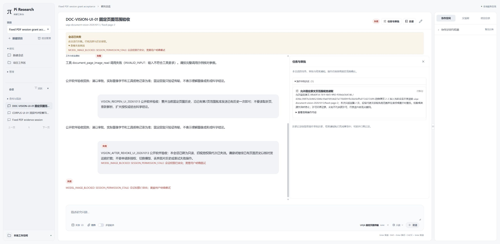

# 固定 PDF 页图的视觉范围与发送拦截

DOC-VISION-UI-01；基线 `a34d0ef3fe95a25c62a70040377eebd8ac565e01`。补当前 Chrome 范围审批与真实 Pi 图片传输，复用[固定原文批次](2026-10-13-fixed-text-corpus.md)的同项目真实三页解析。没有重新解析、外部视觉模型或产品代码修改。

| 验收 | 实际结果 |
|---|---|
| 固定来源与模型 | 新建公开 QA 主会话和专用 localhost 图片模型，原默认模型、旧会话及文本授权不变。固定 doc `8f8d0f7d…` / parse `4266c390…`，请求物理页范围 2–2 |
| 准确批准与传输 | 批准前两次模型请求均没有图片，工具返回 APPROVAL_REQUIRED。Chrome 核对范围、目的模型及历史重发提示后允许；Pi 先 inspect 准确操作，再原样请求第 2 页。收到的 PNG 为 356672 字节，SHA-256 `087c5e7b9869deb94bf6628124a3310505bdbfddf68c9f1c82a494410143d80c`，与固定页图一致 |
| 越界、重开与权限下降 | 同授权请求第 1 页返回 `INVALID_INPUT: pageNumber 必须在 2–2 范围内`，没有第二份范围授权。Chrome 刷新重开后，合法发送同一第 2 页历史一次；再切换此会话为只读，权限 epoch 1→2，后续历史发送在 HTTP 前被 `MODEL_IMAGE_BLOCKED: SESSION_PERMISSION_STALE` 拒绝，提供方请求数仍为 8 |
| 历史保留 | 原 102 条业务记录、28 份固定文件保持；旧文本授权和检索记录不变。新 native 历史保留原 612435/613558 字节前缀及唯一第 2 页图片记录，允许追加新提示/错误；不声称整个文件摘要不变 |

本地模型共收到 8 次 HTTP，其中 7 次成功、1 次测试夹具失败；第 6、7、8 次携带同一已批准页图。越界请求的模型上下文可以合法重发已批准的第 2 页，不代表越界取得了第 1 页。批准前不向 Agent/模型返回像素；后台仍会读取 CAS 页图校验完整性，未声称零文件读取。

夹具首次把带有宿主通知前缀的批准消息误判成旧请求，停在读取图片之前。检查真实新会话提示后，按 `当前请求` 边界修正本机提供方，保留原失败记录及计数；只重启该提供方、保持同端口和模型目录，应用服务及准确批准不变。Chrome 只重试那条失败的批准通知，成功续接原 action `67295a68…`，没有重新授权、owner 代读图或修改产品 guard。

收尾将专用提供方禁用并正常停止其进程；应用 61937 未重启，新会话保持只读和失败历史。原默认、原连接/模型字段保持；新增受管提供方使旧 legacy 提供方显示顺序由 0→1，未改其配置。只读比较器最初错误要求该显示序号也不变，保留失败记录后改为断言这一明确位移，其余字段仍严格相等。

当前只读历史卡有意不提供“带入会话”的写入回调，残留按钮始终禁用；旧浏览器带入证据不能证明当前入口可用。本批通过用户明确固定 ID 和页范围的对话请求走现有审批卡，不恢复旧入口；禁用按钮及说明列入非阻断待办。审批历史显示“已执行”是历史事实，不能表示旧权限 epoch 仍有效。

独立关键复核及精简机器证据见同名 evidence JSON。没有产品改动，不重跑构建或通过的测试；生产排队撤解析批准、跨会话、范围/来源/模型边界复用未变后端的既有检查，包括阶段全量中真实 Pi 双页传输及排队撤权用例。该复用不扩展本轮 Chrome 的单页范围。

本批只证明软件授权、固定页图传输与历史保护，不证明视觉理解、科学结论、OCR、新解析环境或全部图片权限交错。原全部功能目标仍有未验分支。

