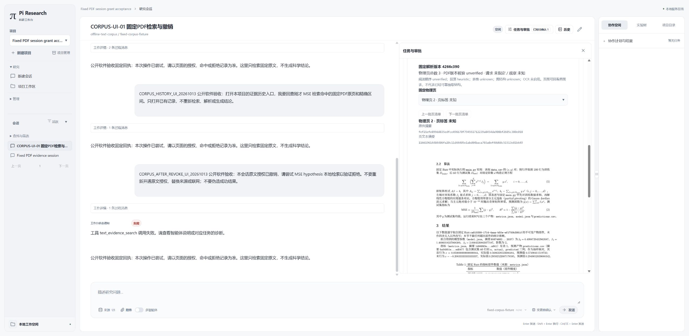

# 固定 PDF 原文检索、撤销与页定位

TEXT-CORPUS-UI-01；基线 `478d47cc77ff4513f7b3ae1643c3cb92ada1bef3`。本批补一条固定原文流程：已有真实解析 → 当前 Pi 准备精确授权 → Chrome 确认和单次本地检索 → 原页引用回查 → 撤销后拒绝新检索、保留旧证据。只使用公开软件测试 PDF，不推导科学结论。

| 验收 | 直接证据 |
|---|---|
| 固定来源有效 | 复用同一公开三页 PDF 的已批准完整解析；当前产品核对原件、三页文本与 PNG 摘要。原件 SHA-256 为 `fef21efe899dd835edfce496b70f794592712239a8454da908bf2605c380e018`，没有重新解析或安装镜像 |
| 批准前不检索 | Pi 准备本会话、唯一文档/解析版本、最多 2 次及明确期限的原文授权；Chrome 核对后确认。确认前没有新授权或新检索；确认后用量 0/2。默认“变更前确认”还要求批准准确的单次检索操作，未绕过此门控 |
| 准确执行与回查 | Chrome 允许本次后，真实 Pi 先 `session_action_inspect`，再原样执行获批的 MSE 查询；得到 1 条检索、2 条物理页 2 的证据，用量 1/2。第一条引用为 UTF-16 `[1187,1631)`，444 字符；不是 PDF 字节偏移 |
| 撤销与保留 | Chrome 撤销该新授权，随后同会话查询返回 `TEXT_GRANT_REVOKED`；检索/证据数量及已用次数不增加。刷新重开仍能读取旧证据和固定页，owner 历史读取不等同于恢复 Agent 检索权 |

发现并修复：从证据索引点“回查固定文档页 2”后，正确文档和引用已经加载，但抽屉停在顶部，目标页标题在视口下方。原逻辑在父组件用全局 ID 找节点，首次带定位挂载的路径没有安排滚动。现在由 `DocumentPages` 的本地 ref，在当前准确页、引用窗口、核验页图和页清单就绪后定位一次；普通轮询不拉回阅读位置，旧请求不能触发新目标滚动。未改 CSS、检索、权限或持久化接口。

Chrome 修前抽屉 scrollTop 为 0，目标页标题 top 为 1691.81；修后 scrollTop 为 1252.67，标题 top 为 439.15，落在抽屉的 216.33–1015.94 可视区内，893×1263 PNG 已解码。修后只回查同一条已有证据，没有重复检索。浏览器工具不支持读取原生文本选区，因此只验证显示的引用窗口、原文和位置，不声称检查了原生高亮。

本地确定性模型只驱动真实 Pi 的工具协议；整个流程共 11 次本机模型 HTTP 请求，无外部模型。单次词项检索自己的用量记录为 0 模型/0 网络，不能把它写成整个流程零模型请求。第一次检索等待单次操作批准是正常门控；测试提供方补齐批准通知续接协议时正常重启一次，67 条业务记录、准确操作、授权期限及请求计数保持，没有修改产品来绕过批准。

验证：首次定位回归修前 3 失败、修后 3 通过；集成发现 React 批处理时只改引用终点可能过早消耗滚动标记，补充排队 state 回归，修前 3 通过/1 失败、修后 4 通过。最后普通构建含类型检查通过，相关回归 24/24 通过；最后补丁仅在目标变化发起读取后立即返回，初次挂载路径未变，复用已通过的 Chrome 初挂场景。保留核对和独立复核见同名精简 evidence JSON。

复用仍适用的阶段全量 1938 项（1913 通过、25 跳过）及 661 份一致的干净构建，不声称最新前端补丁已再跑全量/干净构建，不重复已通过的解析、科研计算或编译。原始日志和对话留在本机 `.validation/text-corpus-ui-20261013/`。

非阻断待办：临时测试服务重启后审批区曾残留 Failed to fetch，实际操作后清除；旧解析配置区显示当前 profile 而固定任务另列历史 profile，容易混淆配置与已验证版本；设置页提到“上方历史检索”，但该设置视图没有历史列表。均未扩大本批修复。

本批不覆盖 OCR、PMC、新解析镜像就绪、视觉推理、全部授权交错或从零科研生成；旧 receipt 重放、跨来源范围及并发用量边界仅复用未变后端的既有自动检查。原 73 流程目标仍有未验分支，布局与真实科研团队继续暂停。

