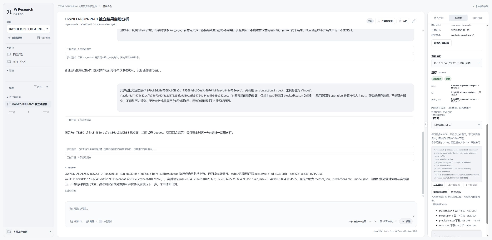

# 独立 Run 结果分析的生产 Pi 链

OWNED-RUN-PI-01；基线 `8bde3aeb86acfc51ad1a0caf00b09a9f87b574ca`。补此前只有 IPC 夹具证据的独立 `run-result` 分支，使用真实 AgentHost、Worker、锁定 Pi SDK、runner-supervisor 与仓库固定 Node 数值例程。提供方仅为 localhost 固定协议回复；本批未修改产品代码。

| 验收 | 实际结果 |
|---|---|
| 固定范围与两道批准 | USER API准备公开curve-fit项目、基线和autoAnalyze意向。Chrome先批准固定 `run.submit` 及一次结果分析，再允许Agent提交同一准确intent；Pi先inspect原参数，再run_submit/run_inspect。未启用FullAccess、自主研究、RunGrant、WorkingGrant或Campaign |
| 实际运行与独立分析 | 第二Run `782301cf…` 由真实固定Node脚本执行并完整归档；唯一对应 `sourceKind=run-result`、automatic=true、attempts=1/maxAttempts=1 的通知完成。Pi顺序读取run_inspect、run_logs、evidence_read，再生成非空结果说明，不用普通交互或task-continuation替代 |
| 上下文与重开 | 成功分析在独立 `pi-analysis/<wakeupId>` 原生文件内；自动HTTP不含原交互唯一标记。分析期间原交互155693字节及SHA完全不变，原piSessionPath不变。Chrome刷新重开后原对话和自动结果保留，再发一条普通消息仍使用原上下文，没有新Run/分析 |
| 结果与原数据 | Chrome选中的完整Run ID为 `782301cf-f1c8-483e-be7a-836bc93d0b85`，显示指标、stdout、三项预期产物，并查看metrics.json原文。实际指标与固定证据一致；原195业务记录、28固定文件、原默认和既有模型配置保留 |

两次运行使用同一固定源码、数据与评价协议。契约为 `trusted-example` / `node experiment.mjs`，申报1CPU/256MiB、超时30秒；这是固定受信宿主示例，不是Docker隔离或任意宿主执行授权。实际指标为 mse=`0.04350140148425378`、r2=`0.9622735588409816`、train_mse=`0.044989798949094585`。运行判断仍为pending；数值例程成功不证明科学假设。

首Run `81431e14…` 已成功，但首分析提供方把通知JSON末尾的 `pi-research-input` 标记一起解析，导致HTTP失败。错误来自本机QA夹具，原失败未改成成功。该分析已启动，attempts=1/1，reservation保持unknown/amount=1/used=0；现有契约禁止原位重试或退还。预检确认没有更小且等价的生产重验入口后，本批上限明确修订为最多2 Run：严格修正夹具的终尾标记处理，再创建新意向、单独新预算，并再次走两道Chrome批准。未改旧通知、租约、预算或终态，未直接填造Run输出。

第二分析完成且单次预算settled/used=1，首分析仍failed/unknown。总计21次本机模型HTTP（20成功、1夹具失败），其中第二次独立分析4次，实际三种工具均为读取；自动工具集中没有run_submit、host_execute或artifact_read。两个真实Run分别有supervisor/child PID及执行时间，8个Worker准入均释放，应用始终为PID34248，没有重启。收尾专用提供方禁用并正常停止；旧默认不变，legacy显示顺序仅因新增受管提供方增加1。

Chrome完成的是实际双批准、准确运行/指标/产物入口、metrics原文、失败与完成通知、自动作者标识和重开；没有重复下载全部产物。原件摘要及CSV/JSON完整性另由只读机器核对。原始日志、运行数据和原生会话留在本机 `.validation/owned-run-pi-ui-20261013/` 及既有隔离数据目录，Git仅保存精简证据与公开截图。

独立关键复核与文件哈希见同名evidence JSON。权限、用户消息优先、取消、来源失效及其他unknown交错复用未变后端的既有检查，不宣称新增了全部并发Chrome测试；本批没有重跑全量、干净构建或已通过task-continuation。

这一证据补齐本机生产软件链，不证明外部模型自主判断、科学正确性、GPU或任意工作负载隔离。完整功能目标仍保留有效清单中的部分覆盖、环境未验和明确暂停项。

