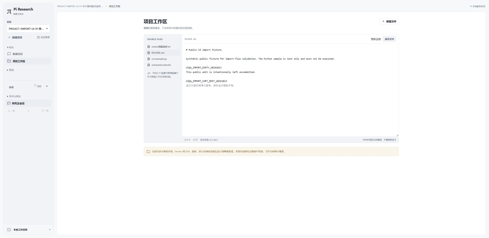

# 本地项目副本导入与 Chrome 重开

PROJECT-IMPORT-UI-01，2026-10-13；基线 `8c764243d3d50e47e89d87f6e0247ce655a0d7c8`。本批使用公开测试目录，经既有 CLI 导入，再在 Chrome 选择、查看、编辑和刷新重开。网页目前没有导入表单，因此不称全流程都由 Chrome 完成。

| 验收 | 实际结果 |
|---|---|
| 有效 Git 源码副本导入 | 新增一个项目及空闲主会话；复制4个文件，包含未提交 README、未跟踪文件和中文嵌套路径；来源 commit、dirty=true及净化 remote 正确 |
| 原目录保护和排除项 | 两个夹具仓库共33个文件（含 Git 元数据）的原字节摘要不变；副本无 `.git`、`.env`、`.pi`。Chrome 保存只改变副本 README，导入来源记录完整摘要仍固定 |
| 失败边界 | 不存在目录返回 `PATH_DENIED`，未解析 LFS 指针返回 `UNSUPPORTED_LFS`；两次均没有新增项目、会话或源码目录 |
| 查看、保存和重开 | Chrome 显示4文件、中文文本及嵌套 Python 源码；实际保存一次，刷新后重新打开 README，内容与保存值完全一致。原2项目、9会话、99条消息摘要、文件、默认模型和主机作业保持 |

新项目 ID `4ada42e9-9d00-4ab2-b8f3-a39b630173f9`，主会话 `db91f1f8-070b-4a1c-b390-235d013d9e55`。README 摘要从 `486e9121c9165120e033556ee49b0767368f6c319f752b568c56e551d8d1a01d` 变为 `4c314acffd8f64f480e5b18162f1d43f9e414db380794a7240f2ece7f577bcaa`；源目录仍是前者。模型请求为0，浏览器仅有一次文件保存写入，其余 POST 是只读会话目录请求。没有执行导入源码或访问配置的测试远端。

本批未发现需要修复的产品逻辑缺陷，未改产品代码。网页缺少导入入口作为可用性限制保留。夹具由 Luna/max 制作；独立证据复核请求 Sol/high，四条验收通过、46个摘要锚核对通过，无阻断或关键证据缺口。实际模型/档位未由运行时回显。

按用户要求精简收尾：11个相关源码/构建/测试文件在统一 CRLF/LF 后内容一致，5个构建文件另核字节摘要一致；源码换行格式差异单列。复用上一批全量中已通过的7条导入检查及661份一致的干净构建，不再重复全量。上一批整体全量曾有2处旧错误字段断言失败，后续110项定向修正通过；这里没有称它全量全绿。

证据采集首次用 PowerShell 重序列化时把时间戳 `.530Z` 变成 `.53Z`，导致整条来源记录摘要校验失败。保存原始 HTTP JSON 后严格摘要校验通过，未放宽断言，也未因此修改产品。原失败日志保留。

机器证据见 [evidence.json](2026-10-13-project-import.evidence.json)，本机原始记录位于 `.validation/project-import-ui-20261013/`。真实密钥、运行数据库、原始对话及夹具 `.env`/Git 仓库均不提交。完整功能巡检继续，布局仍暂缓。

