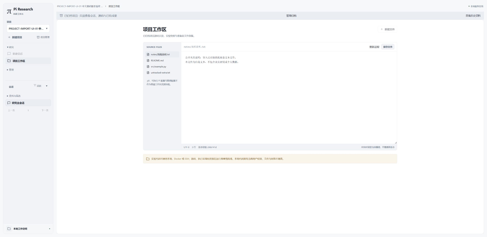
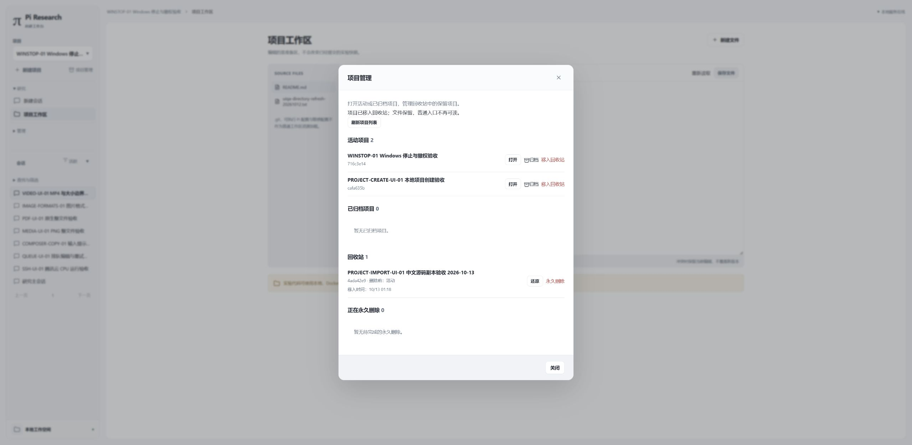
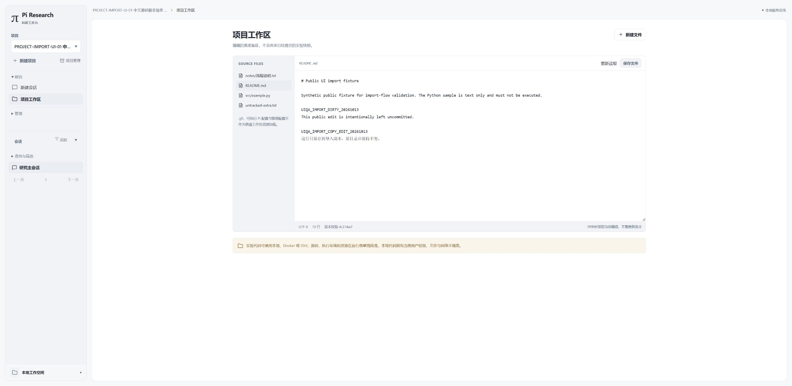

# Chrome 项目归档、回收与还原

PROJECT-LIFECYCLE-UI-01，2026-10-13；基线 `67aac62b2fc7ff64f0b451f9e7b5943592f16c82`。用户明确授权仅对公开导入项目 `4ada42e9-9d00-4ab2-b8f3-a39b630173f9` 执行一次归档→取消归档→移入回收站→还原。四步已由 Chrome 实际完成，项目最终恢复活动状态，未执行永久删除。

| 实际步骤 | 项目版本 / 生命周期代次 | 会话权限 | Chrome 结果 |
|---|---|---|---|
| 初始、取消本次归档操作 | 1 / 0 | 尚无持久权限行 | 取消没有生命周期写入请求或状态变化 |
| 归档 | 2 / 1 | confirm / 代次1 | 从活动列表退出；打开历史和刷新仍能读取4文件；编辑器只读，新建文件/保存/新建会话受限 |
| 取消归档 | 3 / 2 | 保持代次1 | 返回活动状态，文件和原会话保留 |
| 移入回收站 | 4 / 3 | confirm / 代次2 | 原项目普通内容退出，回退到其他活动项目；回收站显示摘要、还原入口及删除前的活动状态 |
| 取消还原、确认还原与重开 | 取消时保持4 / 3；还原为5 / 4 | 保持代次2 | 取消无变化；确认后回到活动列表，刷新再开读取相同README和项目ID |

诊断记录只有4次对应生命周期 POST，全部200；其余 POST 为只读会话列表。模型请求为0，没有启动源代码、计算或新权限授权。回收站确认来自浏览器对可恢复删除的授权规则，得到用户具体确认后才执行。

原2项目及所有非目标/全局记录的整行摘要保持；目标项目除生命周期行和新增/更新的会话权限行外，原记录摘要保持。全部10个会话、99条消息摘要、完整导入来源记录、4文件和原源夹具33文件均不变。既有记录绑定的生命周期代次未被重写；四个对应事件及事件代次准确。

本批未发现需要修复的新产品缺陷，未改产品代码或布局。权限/保留预检请求 Astra/high；独立证据复核请求 Astra/xhigh，四条验收通过，无阻断或本批关键证据缺口。运行时未回显实际模型/档位。

按用户要求精简收尾：复用仍适用的16条生命周期/回收站单元与HTTP成功记录、修正后的项目管理29项及干净构建，不重复全量。原全量实际为1927项/1901通过/2旧错误字段断言失败/24跳过，后续110项定向修正通过；不将其表述为最终全量全绿。

本 QA 初始没有旧grant、权限行或排队消息，本轮只证明实际观察到的权限代次与保留行为，不能据此声称所有旧授权恢复场景都经过Chrome验证。未覆盖忙碌作业、全部跨客户端交错、从归档状态回收再还原或永久清理；这些路径的已有自动证据与人工范围分开记录。

机器证据见 [evidence.json](2026-10-13-project-lifecycle.evidence.json)。原始诊断、DOM、文件摘要和预检保留于 `.validation/project-lifecycle-ui-20261013/`；不提交运行数据库、原始对话或密钥。完整功能巡检仍在继续。

