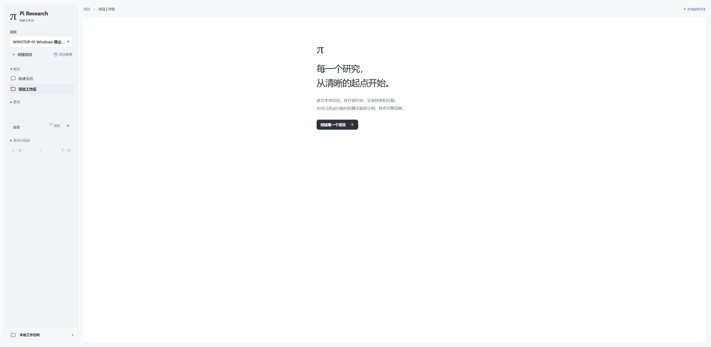
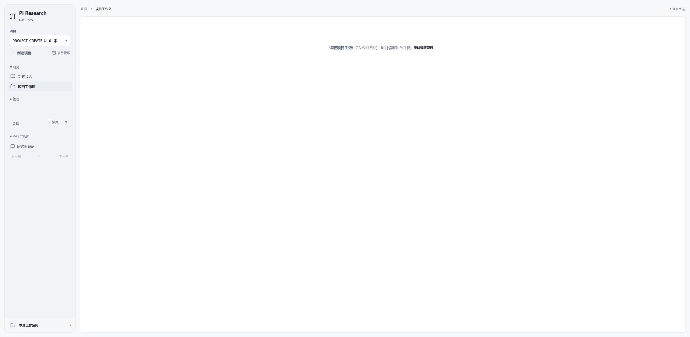
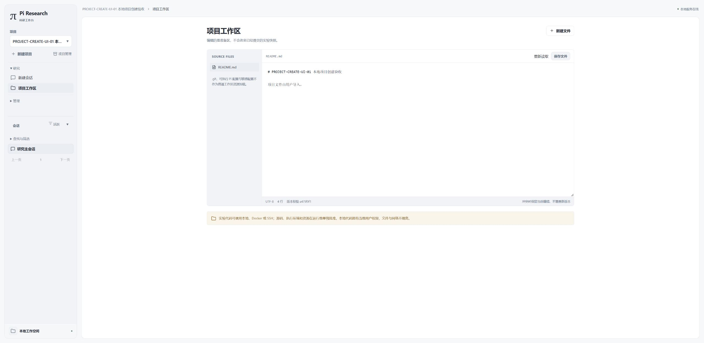

# 项目切换：加载、失败与真正空态

PROJECT-SWITCH-UI-01，2026-10-13，基线 `c308ec8282e92285d877fc6f7712efd41897c2ca`。本批 Chrome 流程与独立复核通过；全量发现的两处旧断言已修正并通过定向复验。完整功能巡检仍未全部完成；前端布局继续暂缓。

## 问题与修复

已有项目切换时，App 先清空旧快照，再读取目标项目。原界面把没有快照直接当成没有项目，因而在等待和读取失败时显示“创建第一个项目”。读取错误还与操作错误共用字段，恢复后旧错误仍留在页面上。

现在分别显示读取中、读取失败及只读重试、真正无项目的欢迎页。独立保存读取错误，成功读取只清这类错误，保留无关操作错误和现有草稿；已有快照的安静轮询仍不打断用户。缺快照时主面板提供单一反馈区，避免右侧重复显示失败。后端、请求协议、既有读取代次/取消机制、Perform、依赖及 CSS 未改。

## 四条验收与实际证据

| 验收 | 结果 |
|---|---|
| 已有项目等待时不显示欢迎或旧正文 | Chrome 在真实项目 state GET 延迟时显示 `role=status`“正在读取项目…”；专用 App 检查同时确认旧消息/工作区节点清空 |
| 失败可重试，恢复不残留读取错误 | Chrome 注入公开 503 后出现单一错误与“重试读取项目”；自动重连及按钮点击后的恢复均显示正确 README。按钮可复用已经进行的轮询，未声称每次点击都单独发请求。操作错误和草稿保留由真实 App 方法检查覆盖 |
| 真正空态仍可创建、进入全局管理 | 使用全新独立数据目录，没有清空原数据。Chrome 欢迎页可打开/取消创建弹框；模型设置及环境列表可进入，环境显示零变量；刷新仍为欢迎页 |
| 快速切回、重开及历史保持 | Chrome 快速 B→A→B、刷新重开保持 B；迟到成功/失败和排队选择另有 App 方法检查。恢复原数据后，两项目、9 会话、99 条消息完整记录摘要、工作区文件摘要、默认模型及主机作业状态一致 |

测试服务仅延迟生产 HTTP 读取或注入明确标注的公开 503；业务响应、项目数据与文件读取仍走项目本身。所有阶段模型请求为零，没有创建、会话写入或计算请求；真实侧栏正常使用只读 `POST /api/operations/session_list`，因此不称整个浏览器“零 POST”。原端口 4794/4795/4796 未动。

## 检查

- 旧代码专用检查 7 项失败，其中 4 项直接暴露错误呈现，另 3 项检查新增错误状态契约，不能把它们称为旧竞态反例。
- 实施定向检查及独立复核各 81/81 通过。首次类型错误及一次误用旧构建的检查日志保留，均未当作最终验证。
- 初次全量实际为 **1927 项：1901 通过、2 失败、24 跳过**。两条 project-management 旧检查仍断言读取错误在操作错误字段。仅将这两处改到 `projectReadError`，补充操作错误保持为空与成功回退清读取错误的断言；原数据/历史保护断言全部保留。最终根工作区相关 **110/110 通过**。可执行源码及构建产物未再改变，复用其余全量和干净构建结果，没有称最终测试快照重跑全量。
- 干净安装、构建、类型检查通过，661 份产物一致，清单 SHA256 `08ac41c014c086114d1ff3afe54a5cf4fd039115de0b8a6018bf5048588b96a2`。
- 实施与独立复核分别请求 Sol/high；接口未回显实际模型/档位。独立复核原相关检查81/81、受影响项目管理检查29/29通过，最终6文件及32处证据引用摘要一致；无代码/报告阻断或关键验收证据缺口。

机器摘要见 [evidence.json](2026-10-13-project-loading.evidence.json)。原始日志、读取记录及隔离源保留于 `.validation/project-switch-ui-20261013/`。`green-loading.jpg` 捕获上一帧，与同期 DOM 不符，未用作加载成功证据；重试截图也不冒充新请求已启动。下面仅保留已人工看图核对的公开 QA 页面。

## 范围与剩余限制

全局设置/环境在已有 bootstrap、缺项目快照时优先可用，读取错误保存在状态中，返回项目相关页可见。加载或失败时复用现有样式，未进行布局重做。启动瞬间侧栏“尚未创建项目”的占位文案未改；本批修的是主面板误判。

方法测试没有挂载 React DOM；Chrome 的快速选择不能覆盖全部调度交错。本批没有新增真实模型、SSH、GPU、GitHub 或科研任务执行，不代表这些功能已全部验收。

